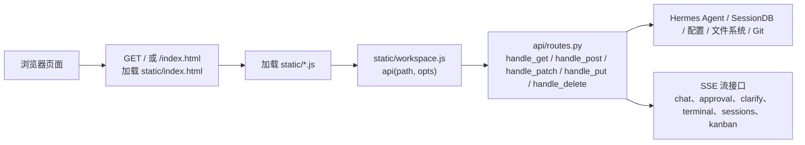
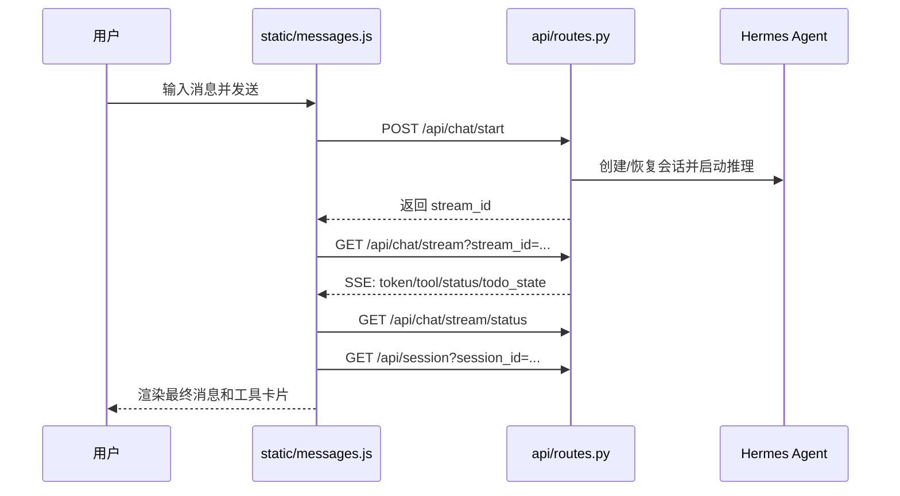
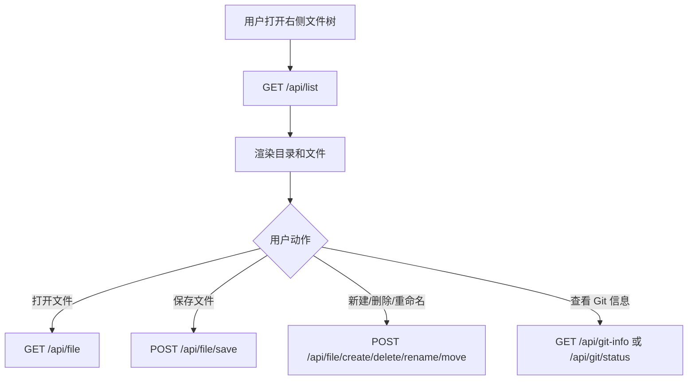
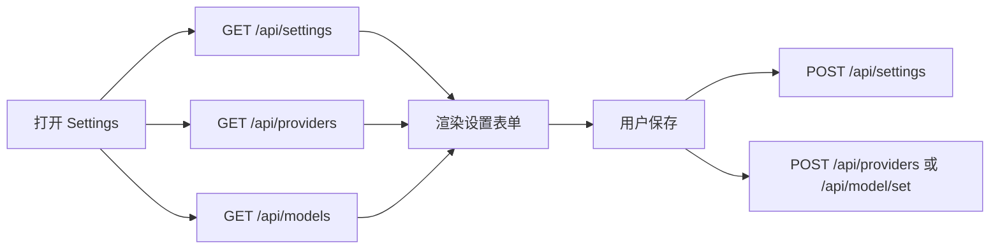

# Hermes WebUI API 与页面关系指南

本文基于 `api/routes.py` 的路由分发逻辑，并对照 `static/*.js` 的前端调用点，整理 Web 页面、业务面板和后端 API 的关系。目标是帮助二次开发者快速判断：

- **某个页面功能会调用哪些 API**
- **要改一个接口时，需要同步检查哪些前端文件**
- **哪些接口属于业务能力，哪些只是健康检查、静态资源或诊断支撑**

> 适合阅读对象：准备修改页面、增加简单接口、调整业务逻辑的 Web 初级工程师。

## 1. 总体入口关系

Hermes WebUI 是一个 **Python HTTP 服务 + 原生 JavaScript 前端** 项目，没有 React/Vue/Vite 这类构建链。浏览器访问页面后，前端 JS 直接通过 HTTP API 与 `api/routes.py` 交互。



核心文件关系：

| 位置 | 作用 | 二次开发关注点 |
|---|---|---|
| `api/routes.py` | 后端 HTTP 路由总分发器 | **新增/修改 API 的主要入口** |
| `static/workspace.js` | 前端 `api()` fetch 包装器、工作区文件浏览逻辑 | **大多数接口调用都会经过这里的 `api()`** |
| `static/index.html` | 主页面 DOM、左侧导航、右侧面板容器 | 新增页面入口、导航按钮、面板容器时会改 |
| `static/panels.js` | 任务、看板、技能、记忆、工作区、配置等面板逻辑 | **右/左面板类功能的高频修改文件** |
| `static/sessions.js` | 会话列表、项目、归档、置顶、搜索、会话操作 | 改会话列表和项目管理时看这里 |
| `static/messages.js` | 聊天发送、流式消息、审批/澄清交互 | 改聊天主流程时看这里 |
| `static/commands.js` | 斜杠命令、模型/人格/压缩/目标等快捷操作 | 改命令面板和 composer 快捷动作时看这里 |
| `static/ui.js` | 通用 UI、工作区文件右键、健康检查、更新提示 | 改文件操作、状态卡、更新提示时看这里 |
| `static/onboarding.js` | 首次启动向导 | 改初始化配置、OAuth、Provider 探测时看这里 |
| `static/login.js` | 登录页 | 改密码登录、Passkey 登录时看这里 |
| `static/terminal.js` | Web 终端 | 改终端启动、输入、输出流时看这里 |

## 2. 页面与 API 总览

### 2.1 页面级入口

| 浏览器路径 | 对应页面 | 后端处理 | 说明 |
|---|---|---|---|
| `/`、`/index.html` | 主 WebUI | `GET` 返回 `static/index.html` | 默认主界面 |
| `/session/<session_id>` | 主 WebUI，并打开指定会话 | `GET` 返回同一份 `index.html` | 前端根据 URL 中的 session id 加载会话 |
| `/login` | 登录页 | `GET` 返回登录 HTML | 启用密码/认证时使用 |
| `/static/*` | 静态资源 | `GET` 返回 JS/CSS/图片等 | 前端资源加载 |
| `/sw.js`、`/favicon.ico`、manifest | PWA/图标资源 | `GET` 静态资源 | 支撑类，不是业务 API |

### 2.2 前端面板与业务 API

| Web 区域/面板 | 前端主要文件 | 主要 API | 业务含义 |
|---|---|---|---|
| 登录页 | `static/login.js` | `/api/auth/status`、`/api/auth/login`、`/api/auth/passkey/login/*` | 登录状态、密码登录、Passkey 登录 |
| 首次启动向导 | `static/onboarding.js` | `/api/onboarding/status`、`/api/onboarding/setup`、`/api/onboarding/probe`、`/api/onboarding/complete`、`/api/onboarding/oauth/*` | 初始化 Provider、模型、工作区、OAuth |
| 会话列表/项目 | `static/sessions.js` | `/api/sessions`、`/api/session`、`/api/projects`、`/api/sessions/search`、`/api/session/pin`、`/api/session/archive`、`/api/session/move` | 左侧会话列表、项目分组、搜索、置顶归档 |
| 聊天主区 | `static/messages.js` | `/api/chat/start`、`/api/chat/stream`、`/api/chat/stream/status`、`/api/chat/cancel`、`/api/session` | 发送消息、接收流式回答、恢复消息 |
| 审批/澄清卡片 | `static/messages.js` | `/api/approval/pending`、`/api/approval/respond`、`/api/approval/stream`、`/api/clarify/pending`、`/api/clarify/respond`、`/api/clarify/stream` | 工具调用审批、模型向用户提问 |
| Composer/斜杠命令 | `static/commands.js` | `/api/commands`、`/api/commands/exec`、`/api/models`、`/api/personalities`、`/api/personality/set`、`/api/goal` | 命令补全、执行命令、模型/人格/目标快捷操作 |
| 右侧工作区文件 | `static/workspace.js`、`static/ui.js` | `/api/list`、`/api/file`、`/api/file/raw`、`/api/file/save`、`/api/file/create`、`/api/file/delete`、`/api/file/rename`、`/api/file/move`、`/api/git-info` | 文件树、文件预览/编辑、基础文件管理 |
| Git 控制 | `static/ui.js` | `/api/git/status`、`/api/git/diff`、`/api/git/branches`、`/api/git/stage`、`/api/git/commit`、`/api/git/pull`、`/api/git/push` | 工作区 Git 状态与提交操作 |
| Tasks 任务面板 | `static/panels.js` | `/api/crons`、`/api/crons/create`、`/api/crons/update`、`/api/crons/delete`、`/api/crons/run`、`/api/crons/pause`、`/api/crons/resume`、`/api/crons/history`、`/api/crons/status` | 定时任务/后台任务管理 |
| Kanban 看板 | `static/panels.js` | `/api/kanban/*` | 看板、任务卡、评论、状态流。具体实现委托给 `api/kanban_bridge.py` |
| Skills 技能面板 | `static/panels.js` | `/api/skills`、`/api/skills/content`、`/api/skills/save`、`/api/skills/delete`、`/api/skills/toggle`、`/api/skills/usage` | 查看、编辑、启停技能 |
| Memory 记忆面板 | `static/panels.js` | `/api/memory`、`/api/memory/write`、`/api/notes/sources`、`/api/notes/search`、`/api/notes/item` | 用户/Agent 记忆、外部笔记检索 |
| Workspaces 工作区面板 | `static/panels.js` | `/api/workspaces`、`/api/workspaces/suggest`、`/api/workspaces/add`、`/api/workspaces/remove`、`/api/workspaces/rename`、`/api/workspaces/reorder`、`/api/session/new`、`/api/session/update` | 管理可用工作区，为会话绑定工作目录 |
| Profiles 配置档面板 | `static/panels.js` | `/api/profiles`、`/api/profile/active`、`/api/profile/switch`、`/api/profile/create`、`/api/profile/delete`、`/api/gateway/status` | 多 Profile 切换和创建 |
| Insights 面板 | `static/panels.js` | `/api/insights`、`/api/wiki/status`、`/api/skills/usage` | 使用统计、知识库/技能使用概览 |
| Logs 面板 | `static/panels.js` | `/api/logs` | 查看 WebUI/Agent 日志尾部 |
| Settings 设置面板 | `static/panels.js` | `/api/settings`、`/api/providers`、`/api/models`、`/api/model/set`、`/api/model/auxiliary`、`/api/default-model`、`/api/reasoning`、`/api/plugins`、`/api/mcp/*`、`/api/updates/*`、`/api/rollback/*` | 配置模型、Provider、认证、安全、MCP、插件、更新与回滚 |
| Web 终端 | `static/terminal.js` | `/api/terminal/start`、`/api/terminal/input`、`/api/terminal/resize`、`/api/terminal/close`、`/api/terminal/output` | 在浏览器里操作工作区终端 |

## 3. `routes.py` 中的 API 家族

下面按业务域拆解，方便你从页面需求反向定位后端接口。

### 3.1 会话与聊天

常用接口：

| 方法 | API | 前端调用 | 作用 |
|---|---|---|---|
| `GET` | `/api/session` | `static/sessions.js`、`static/messages.js`、`static/commands.js` | 获取单个会话的元数据和消息 |
| `GET` | `/api/sessions` | `static/sessions.js` | 获取会话列表 |
| `GET` | `/api/sessions/search` | `static/sessions.js` | 搜索会话标题/内容 |
| `POST` | `/api/session/new` | `static/sessions.js`、`static/panels.js`、`static/ui.js` | 创建新会话 |
| `POST` | `/api/session/update` | `static/boot.js`、`static/panels.js` | 更新会话绑定的 workspace/profile/model 等 |
| `POST` | `/api/session/rename` | `static/sessions.js`、`static/panels.js`、`static/commands.js` | 重命名会话 |
| `POST` | `/api/session/delete` | `static/sessions.js` | 删除会话 |
| `POST` | `/api/session/pin` | `static/sessions.js` | 置顶/取消置顶 |
| `POST` | `/api/session/archive` | `static/sessions.js` | 归档/取消归档 |
| `POST` | `/api/session/move` | `static/sessions.js` | 移动到项目 |
| `POST` | `/api/session/duplicate` | `static/sessions.js` | 复制会话 |
| `POST` | `/api/session/retry` | `static/commands.js` | 重试最后一轮 |
| `POST` | `/api/session/undo` | `static/commands.js` | 撤销上一轮 |
| `POST` | `/api/session/truncate` | `static/ui.js` | 截断会话消息 |
| `POST` | `/api/session/branch` | `static/commands.js` | 从当前会话分支出新会话 |
| `GET/POST` | `/api/session/yolo` | `static/messages.js`、`static/commands.js` | 获取/设置会话的 YOLO 自动审批模式 |
| `POST` | `/api/chat/start` | `static/messages.js` | 创建一次聊天流任务 |
| `GET` | `/api/chat/stream` | `static/messages.js` | SSE 接收模型输出、工具事件、状态事件 |
| `GET` | `/api/chat/stream/status` | `static/messages.js`、`static/ui.js` | 查询流状态，处理重连/取消后恢复 |
| `GET` | `/api/chat/cancel` | `static/boot.js` 或直接 fetch | 取消当前流 |
| `POST` | `/api/chat/steer` | `static/commands.js` | 对运行中的会话发送 steer/控制指令 |
| `POST` | `/api/btw` | `static/commands.js` | 向会话追加临时问题 |
| `POST` | `/api/background` | `static/commands.js` | 将请求转为后台任务 |
| `GET` | `/api/background/status` | `static/messages.js` | 查询后台任务状态 |

典型聊天流程：



二次开发提示：

- 改“发送消息的请求字段”：优先看 `static/messages.js` 的 `/api/chat/start` 请求体，再看 `api/routes.py` 对 `/api/chat/start` 的处理。
- 改“流式事件展示”：优先看 `/api/chat/stream` 产生的 SSE 事件，以及 `static/messages.js` 的事件处理。
- 改“历史消息结构”：同步检查 `/api/session` 返回值和 `static/sessions.js`、`static/messages.js` 的渲染逻辑。

### 3.2 审批与澄清

| 方法 | API | 前端调用 | 作用 |
|---|---|---|---|
| `GET` | `/api/approval/pending` | `static/messages.js` | 查询当前会话是否有待审批工具调用 |
| `POST` | `/api/approval/respond` | `static/messages.js` | 用户同意/拒绝工具调用 |
| `GET` | `/api/approval/stream` | `static/messages.js` | SSE 推送审批状态 |
| `GET` | `/api/clarify/pending` | `static/messages.js` | 查询是否有待回答的澄清问题 |
| `POST` | `/api/clarify/respond` | `static/messages.js` | 提交澄清回答 |
| `GET` | `/api/clarify/stream` | `static/messages.js` | SSE 推送澄清状态 |

这类 API 的页面表现通常是聊天区里的卡片或弹出交互。修改时要同时考虑：

- **pending 接口**：页面刷新或 SSE 断线后能否恢复状态。
- **respond 接口**：用户点击按钮后的后端状态变更。
- **stream 接口**：运行中实时推送，不能当成普通 JSON 接口处理。

### 3.3 工作区、文件与媒体

| 方法 | API | 前端调用 | 作用 |
|---|---|---|---|
| `GET` | `/api/list` | `static/workspace.js`、`static/ui.js` | 列出工作区目录 |
| `GET` | `/api/file` | `static/workspace.js` | 读取文件内容 |
| `GET` | `/api/file/raw` | 前端预览/下载 | 获取文件原始内容 |
| `GET` | `/api/media` | 消息/预览 | 读取媒体资源 |
| `GET` | `/api/folder/download` | 下载逻辑 | 下载目录打包内容 |
| `POST` | `/api/file/save` | `static/workspace.js` | 保存文件 |
| `POST` | `/api/file/create` | `static/ui.js` | 创建文件 |
| `POST` | `/api/file/create-dir` | `static/ui.js` | 创建目录 |
| `POST` | `/api/file/delete` | `static/ui.js` | 删除文件/目录 |
| `POST` | `/api/file/rename` | `static/ui.js` | 重命名 |
| `POST` | `/api/file/move` | `static/ui.js` | 移动文件 |
| `POST` | `/api/file/reveal` | `static/ui.js` | 在系统文件管理器中打开位置 |
| `POST` | `/api/file/open-vscode` | `static/ui.js` | 用 VS Code 打开 |
| `POST` | `/api/file/path` | `static/ui.js` | 获取本机路径 |
| `POST` | `/api/upload` | 上传组件 | 上传附件 |
| `POST` | `/api/upload/extract` | 上传组件 | 上传并提取内容 |
| `POST` | `/api/workspace/upload` | `static/workspace.js` | 上传到工作区 |
| `POST` | `/api/transcribe` | `static/boot.js` 或语音 UI | 音频转写 |
| `POST` | `/api/tts` | `static/boot.js` 或语音 UI | 文本转语音 |

工作区文件流程：



**易错点**：

- 文件 API 涉及本机路径和工作区路径，改后端时必须继续保证路径安全校验。
- Windows 11 下路径可能包含反斜杠、空格、中文目录名，前端传参要使用 `encodeURIComponent()`。
- 上传接口通常涉及 multipart/form-data，不要按普通 JSON 接口改。

### 3.4 Git 与工作区版本控制

| 方法 | API | 前端调用 | 作用 |
|---|---|---|---|
| `GET` | `/api/git/status` | Git UI | 查看当前工作区 Git 状态 |
| `GET` | `/api/git/branches` | Git UI | 分支列表 |
| `GET` | `/api/git/diff` | Git UI | 文件差异 |
| `GET` | `/api/git-info` | `static/workspace.js` | 工作区 Git 摘要信息 |
| `POST` | `/api/git/stage` | Git UI | 暂存文件 |
| `POST` | `/api/git/unstage` | Git UI | 取消暂存 |
| `POST` | `/api/git/discard` | Git UI | 丢弃改动 |
| `POST` | `/api/git/commit-message` | Git UI | 生成提交信息 |
| `POST` | `/api/git/commit-message-selected` | Git UI | 基于选中文件生成提交信息 |
| `POST` | `/api/git/commit` | Git UI | 提交 |
| `POST` | `/api/git/commit-selected` | Git UI | 只提交选中文件 |
| `POST` | `/api/git/fetch` | Git UI | 拉取远端引用 |
| `POST` | `/api/git/pull` | Git UI | 拉取并合并 |
| `POST` | `/api/git/push` | Git UI | 推送 |
| `POST` | `/api/git/checkout` | Git UI | 切换分支 |
| `POST` | `/api/git/stash-checkout` | Git UI | 暂存当前改动后切换 |

**二次开发边界**：Git API 会修改真实工作区。新增按钮或自动化操作时，要确认不会误删或误丢用户未提交改动。

### 3.5 模型、Provider、设置与认证

| 方法 | API | 前端调用 | 作用 |
|---|---|---|---|
| `GET/POST` | `/api/settings` | `static/panels.js`、`static/boot.js`、`static/onboarding.js` | 读取/保存 WebUI 设置 |
| `GET/POST` | `/api/providers` | `static/panels.js` | Provider 列表、保存 API Key |
| `POST` | `/api/providers/delete` | `static/panels.js` | 删除 Provider 凭据 |
| `GET` | `/api/models` | `static/commands.js`、`static/panels.js` | 模型列表 |
| `GET` | `/api/models/live` | 设置/模型 UI | 实时模型状态 |
| `POST` | `/api/models/refresh` | `static/panels.js` | 刷新 Provider 模型缓存 |
| `POST` | `/api/default-model` | `static/panels.js` | 设置默认模型 |
| `POST` | `/api/model/set` | `static/panels.js` | 设置指定模型槽位 |
| `GET` | `/api/model/auxiliary` | `static/panels.js` | 获取辅助模型配置 |
| `GET` | `/api/provider/quota` | `static/ui.js`、`static/panels.js` | 查询额度 |
| `GET` | `/api/provider/cost-history` | 设置/Provider UI | 成本历史 |
| `GET/POST` | `/api/reasoning` | `static/commands.js`、`static/ui.js` | reasoning effort/display 设置 |
| `GET` | `/api/auth/status` | `static/login.js`、`static/panels.js` | 当前认证状态 |
| `POST` | `/api/auth/login` | `static/login.js` | 密码登录 |
| `POST` | `/api/auth/logout` | `static/panels.js` | 登出 |
| `POST` | `/api/auth/passkeys` | `static/panels.js` | Passkey 列表 |
| `POST` | `/api/auth/passkey/register/options` | `static/panels.js` | Passkey 注册参数 |
| `POST` | `/api/auth/passkey/register` | `static/panels.js` | 注册 Passkey |
| `POST` | `/api/auth/passkey/login/options` | `static/login.js` | Passkey 登录参数 |
| `POST` | `/api/auth/passkey/login` | `static/login.js` | Passkey 登录 |
| `POST` | `/api/auth/passkey/delete` | `static/panels.js` | 删除 Passkey |

Settings 流程：



### 3.6 首次启动与系统健康

| 方法 | API | 前端调用 | 作用 |
|---|---|---|---|
| `GET` | `/api/onboarding/status` | `static/onboarding.js` | 是否需要首次启动向导 |
| `POST` | `/api/onboarding/probe` | `static/onboarding.js` | 测试 Provider/Base URL/API Key |
| `POST` | `/api/onboarding/setup` | `static/onboarding.js` | 保存首次启动配置 |
| `POST` | `/api/onboarding/complete` | `static/onboarding.js` | 标记向导完成 |
| `POST` | `/api/onboarding/oauth/start` | `static/onboarding.js` | 发起 OAuth |
| `GET` | `/api/onboarding/oauth/poll` | `static/onboarding.js` | 轮询 OAuth 状态 |
| `POST` | `/api/onboarding/oauth/cancel` | `static/onboarding.js` | 取消 OAuth |
| `GET` | `/health` | 外部健康检查 | WebUI 基础健康 |
| `GET` | `/api/health/agent` | `static/ui.js` | Agent 健康状态 |
| `GET` | `/api/system/health` | `static/ui.js` | 系统综合健康 |
| `GET` | `/api/dashboard/status` | `static/ui.js` | 顶部/仪表状态 |
| `GET/POST` | `/api/dashboard/config` | `static/ui.js` | 仪表板配置 |
| `POST` | `/api/client-events/log` | `static/workspace.js` | 前端事件日志 |
| `POST` | `/api/csp-report` | 浏览器 CSP | 安全策略违规上报 |
| `POST` | `/api/shutdown` | `static/boot.js` | 关闭 WebUI 服务 |

### 3.7 Tasks/Cron 定时任务

| 方法 | API | 前端调用 | 作用 |
|---|---|---|---|
| `GET` | `/api/crons` | `static/panels.js` | 任务列表 |
| `POST` | `/api/crons/create` | `static/panels.js` | 创建任务 |
| `POST` | `/api/crons/update` | `static/panels.js` | 更新任务 |
| `POST` | `/api/crons/delete` | `static/panels.js` | 删除任务 |
| `GET/POST` | `/api/crons/run` | `static/panels.js` | 运行任务/获取运行输出 |
| `POST` | `/api/crons/pause` | `static/panels.js` | 暂停任务 |
| `POST` | `/api/crons/resume` | `static/panels.js` | 恢复任务 |
| `GET` | `/api/crons/history` | `static/panels.js` | 任务历史 |
| `GET` | `/api/crons/status` | `static/panels.js` | 单个任务状态 |
| `GET` | `/api/crons/recent` | `static/panels.js` | 最近任务事件 |
| `GET` | `/api/crons/output` | 任务详情 | 任务输出 |
| `GET` | `/api/crons/delivery-options` | `static/panels.js` | 可用消息投递方式 |

### 3.8 Kanban 看板

`routes.py` 对 `/api/kanban/*` 采用委托处理，具体逻辑在 `api/kanban_bridge.py`。前端主要在 `static/panels.js`。

常见路径：

| 方法 | API | 作用 |
|---|---|---|
| `GET` | `/api/kanban/config` | 看板配置 |
| `GET` | `/api/kanban/assignees` | 负责人列表 |
| `GET/POST` | `/api/kanban/tasks` | 任务列表/创建任务 |
| `GET/PATCH/DELETE` | `/api/kanban/tasks/<id>` | 任务详情、更新、删除 |
| `POST` | `/api/kanban/tasks/bulk` | 批量更新 |
| `POST` | `/api/kanban/tasks/<id>/block` | 标记阻塞 |
| `POST` | `/api/kanban/tasks/<id>/unblock` | 解除阻塞 |
| `POST` | `/api/kanban/tasks/<id>/comments` | 添加评论 |
| `GET` | `/api/kanban/tasks/<id>/log` | 任务日志 |
| `GET` | `/api/kanban/stats` | 看板统计 |
| `GET` | `/api/kanban/events` | 看板事件轮询 |
| `GET` | `/api/kanban/events/stream` | 看板 SSE 事件流 |
| `GET/POST` | `/api/kanban/boards` | 看板列表/创建看板 |
| `POST` | `/api/kanban/boards/<slug>/switch` | 切换活跃看板 |
| `PATCH/DELETE` | `/api/kanban/boards/<slug>` | 更新/删除看板 |

**改看板时不要只看 `routes.py`**：因为它只是分发到桥接模块，字段、状态、校验通常在 `api/kanban_bridge.py` 里。

### 3.9 Skills、Memory、Notes

| 方法 | API | 前端调用 | 作用 |
|---|---|---|---|
| `GET` | `/api/skills` | `static/panels.js`、`static/commands.js` | 技能列表 |
| `GET` | `/api/skills/content` | `static/panels.js` | 技能文件内容 |
| `POST` | `/api/skills/save` | `static/panels.js` | 保存技能 |
| `POST` | `/api/skills/delete` | `static/panels.js` | 删除技能 |
| `POST` | `/api/skills/toggle` | `static/panels.js` | 启用/停用技能 |
| `GET` | `/api/skills/usage` | `static/panels.js` | 技能使用统计 |
| `GET` | `/api/memory` | `static/panels.js` | 读取记忆 |
| `POST` | `/api/memory/write` | `static/panels.js` | 写入记忆 |
| `GET` | `/api/notes/sources` | `static/panels.js` | 外部笔记源 |
| `GET` | `/api/notes/search` | `static/panels.js` | 搜索笔记 |
| `GET` | `/api/notes/item` | `static/panels.js` | 获取单条笔记 |

### 3.10 Workspaces、Profiles 与 Gateway

| 方法 | API | 前端调用 | 作用 |
|---|---|---|---|
| `GET` | `/api/workspaces` | `static/panels.js`、`static/commands.js` | 工作区列表 |
| `GET` | `/api/workspaces/suggest` | `static/panels.js`、`static/commands.js` | 根据路径输入给出建议 |
| `POST` | `/api/workspaces/add` | `static/panels.js`、`static/onboarding.js` | 添加工作区 |
| `POST` | `/api/workspaces/remove` | `static/panels.js` | 移除工作区 |
| `POST` | `/api/workspaces/rename` | `static/panels.js` | 重命名工作区展示名 |
| `POST` | `/api/workspaces/reorder` | `static/panels.js` | 调整排序 |
| `GET` | `/api/profiles` | `static/panels.js` | Profile 列表 |
| `GET` | `/api/profile/active` | `static/boot.js` | 当前 Profile |
| `POST` | `/api/profile/switch` | `static/panels.js` | 切换 Profile |
| `POST` | `/api/profile/create` | `static/panels.js` | 创建 Profile |
| `POST` | `/api/profile/delete` | `static/panels.js` | 删除 Profile |
| `GET` | `/api/gateway/status` | `static/panels.js` | Gateway 状态 |
| `GET` | `/api/sessions/gateway/stream` | `static/sessions.js` | Gateway 会话事件流 |
| `GET` | `/api/sessions/events` | `static/sessions.js` | 会话列表事件流 |

### 3.11 MCP、插件、更新与回滚

| 方法 | API | 前端调用 | 作用 |
|---|---|---|---|
| `GET` | `/api/plugins` | `static/panels.js` | 插件列表 |
| `GET` | `/api/mcp/servers` | `static/panels.js` | MCP server 列表 |
| `PATCH/PUT/DELETE` | `/api/mcp/servers/<name>` | `static/panels.js` | 更新/启停/删除 MCP server |
| `GET` | `/api/mcp/tools` | `static/panels.js` | MCP 工具列表 |
| `GET` | `/api/updates/check` | `static/boot.js`、`static/panels.js` | 检查更新 |
| `POST` | `/api/updates/summary` | `static/ui.js` | 生成更新摘要 |
| `POST` | `/api/updates/apply` | `static/ui.js` | 应用更新 |
| `POST` | `/api/updates/force` | `static/ui.js` | 强制更新 |
| `GET` | `/api/rollback/list` | `static/panels.js` | 回滚点列表 |
| `GET` | `/api/rollback/diff` | `static/panels.js` | 回滚差异 |
| `POST` | `/api/rollback/restore` | `static/panels.js` | 执行回滚 |

## 4. SSE 流接口单独说明

SSE 是 Server-Sent Events，浏览器用 `EventSource` 建立长连接，后端持续推送事件。它不是一次性 JSON 响应。

| API | 前端文件 | 作用 |
|---|---|---|
| `/api/chat/stream` | `static/messages.js` | 模型回复、工具调用、状态变更、todo 状态 |
| `/api/approval/stream` | `static/messages.js` | 审批事件 |
| `/api/clarify/stream` | `static/messages.js` | 澄清事件 |
| `/api/terminal/output` | `static/terminal.js` | 终端输出 |
| `/api/sessions/events` | `static/sessions.js` | 会话列表变化 |
| `/api/sessions/gateway/stream` | `static/sessions.js` | Gateway 会话变化 |
| `/api/kanban/events/stream` | `static/panels.js` | 看板变化 |

**修改 SSE 时的检查清单**：

- 后端是否设置正确的 `text/event-stream` 响应。
- 前端是否处理断线重连。
- 事件 payload 是否保持可兼容，老字段不要随意删除。
- 是否需要配套普通查询接口做冷启动恢复，例如 `/api/session`、`/api/approval/pending`。

## 5. 新增或调整 API 的推荐流程

假设你要新增一个“在会话详情里保存备注”的简单功能，可以按这个顺序做：

1. **先确定页面位置**

   - 会话详情/聊天区：优先看 `static/sessions.js`、`static/messages.js`。
   - 右侧工作区：优先看 `static/workspace.js`、`static/ui.js`。
   - 设置/技能/任务等面板：优先看 `static/panels.js`。

2. **在 `api/routes.py` 里找相近接口**

   例如会话备注可以参考：

   - `/api/session/update`
   - `/api/session/rename`
   - `/api/session/draft`

   这样能复用已有的鉴权、参数读取、错误返回风格。

3. **新增后端路由**

   伪代码示例：

   ```python
   if parsed.path == "/api/session/note":
       data = self._read_json()
       sid = data.get("session_id")
       note = data.get("note", "")
       if not sid:
           return self._json({"error": "session_id required"}, status=400)
       # 调用已有 session 存储逻辑
       return self._json({"ok": True})
   ```

   实际写法请以 `routes.py` 附近已有 helper 为准，比如 JSON 返回、错误返回、鉴权检查、参数解析函数。

4. **前端调用**

   ```javascript
   await api('/api/session/note', {
     method: 'POST',
     body: JSON.stringify({
       session_id: S.session.session_id,
       note,
     }),
   });
   ```

5. **测试**

   PowerShell 中可以用：

   ```powershell
   curl.exe http://localhost:8787/api/session?session_id=<你的会话ID>
   ```

   对 POST JSON 接口：

   ```powershell
   curl.exe -X POST http://localhost:8787/api/session/note `
     -H "Content-Type: application/json" `
     -d "{\"session_id\":\"<你的会话ID>\",\"note\":\"hello\"}"
   ```

6. **同步文档和变更记录**

   如果接口影响用户可见功能，更新：

   - `CHANGELOG.md`
   - 相关 `docs/*.md`
   - 必要的测试文件

## 6. 高频易错点

### 6.1 不要把所有 API 都当成 JSON

大部分 `api()` 调用返回 JSON，但这些例外要特别注意：

- SSE：`/api/chat/stream`、`/api/approval/stream`、`/api/clarify/stream`、`/api/terminal/output`
- 文件/媒体：`/api/file/raw`、`/api/media`、`/api/folder/download`
- 上传：`/api/upload`、`/api/upload/extract`、`/api/workspace/upload`
- 静态资源：`/static/*`、`/sw.js`、`/favicon.ico`

### 6.2 前端路径要考虑子路径部署

`static/workspace.js` 的 `api(path, opts)` 会基于当前页面路径拼接请求。新增前端调用时优先使用：

```javascript
await api('/api/xxx');
```

不要手写固定域名，例如：

```javascript
// 不推荐
fetch('http://localhost:8787/api/xxx');
```

固定域名会破坏远程访问、反向代理、SSH tunnel 或子路径部署。

### 6.3 POST/PUT/PATCH/DELETE 可能受认证和 CSRF 影响

启用认证后，危险方法一般需要通过 WebUI 页面发起。调试 POST 接口时如果直接用 `curl.exe`，可能遇到 401/403。排查顺序：

1. 先访问 `/api/auth/status` 看是否启用认证。
2. 如果需要登录，先通过浏览器登录页面完成认证。
3. 再用 DevTools Network 观察真实请求头和返回。

### 6.4 Windows 11 路径处理

在 Windows 本机开发时：

- PowerShell 换行符使用反引号 `` ` ``。
- 文件路径可能是 `E:\xxx\yyy`，传到 URL query 时必须 encode。
- 前端不要手动拼 `?path=${path}`，应该用 `encodeURIComponent(path)`。
- 后端不要简单按 `/` 分割路径，优先使用项目已有路径解析工具。

### 6.5 `routes.py` 很大，新增接口要保持局部一致

这个文件是总分发器，里面混合了页面、静态资源、业务 API、诊断 API。新增接口时建议：

- 放在同类接口附近，例如 session 接口放 session 区域。
- 沿用附近接口的返回格式和错误格式。
- 能委托到专门模块就委托，不要让 `routes.py` 继续无限膨胀。
- 涉及状态、会话、恢复、流式、Git、文件系统时，先读 `docs/CONTRACTS.md` 和相关 RFC。

## 7. 快速定位表

| 你想改的功能 | 优先看前端文件 | 优先看后端 API |
|---|---|---|
| 聊天发送参数 | `static/messages.js` | `/api/chat/start` |
| 聊天流展示 | `static/messages.js` | `/api/chat/stream`、`/api/chat/stream/status` |
| 左侧会话列表 | `static/sessions.js` | `/api/sessions`、`/api/session`、`/api/projects` |
| 会话重命名/删除/归档 | `static/sessions.js` | `/api/session/rename`、`/api/session/delete`、`/api/session/archive` |
| 右侧文件树 | `static/workspace.js` | `/api/list`、`/api/file` |
| 文件右键菜单 | `static/ui.js` | `/api/file/create/delete/rename/move/reveal/open-vscode` |
| Git 面板 | `static/ui.js` | `/api/git/*` |
| 设置页 | `static/panels.js` | `/api/settings`、`/api/providers`、`/api/models` |
| Provider/API Key | `static/panels.js`、`static/onboarding.js` | `/api/providers`、`/api/onboarding/probe` |
| 模型选择 | `static/commands.js`、`static/panels.js` | `/api/models`、`/api/model/set`、`/api/default-model` |
| 定时任务 | `static/panels.js` | `/api/crons/*` |
| 看板 | `static/panels.js` | `/api/kanban/*`、`api/kanban_bridge.py` |
| 技能 | `static/panels.js` | `/api/skills/*` |
| 记忆 | `static/panels.js` | `/api/memory`、`/api/memory/write` |
| 工作区管理 | `static/panels.js` | `/api/workspaces/*` |
| Profile 管理 | `static/panels.js` | `/api/profiles`、`/api/profile/*` |
| 登录/Passkey | `static/login.js`、`static/panels.js` | `/api/auth/*` |
| 首次启动向导 | `static/onboarding.js` | `/api/onboarding/*` |
| Web 终端 | `static/terminal.js` | `/api/terminal/*` |
| 更新/回滚 | `static/ui.js`、`static/panels.js` | `/api/updates/*`、`/api/rollback/*` |

## 8. 修改接口后的手动验证建议

Windows 11 + PowerShell 下，推荐按下面顺序验证：

1. 启动服务：

   ```powershell
   .\start.ps1
   ```

2. 打开浏览器访问：

   ```text
   http://localhost:8787
   ```

3. 用 DevTools Network 看接口：

   - 是否请求到了正确 API。
   - HTTP 方法是否正确。
   - 请求体字段是否正确。
   - 响应 JSON 是否符合前端预期。

4. 用 `curl.exe` 单独验证 GET 接口：

   ```powershell
   curl.exe http://localhost:8787/api/health/agent
   curl.exe http://localhost:8787/api/settings
   ```

5. 对 SSE 接口，优先用浏览器验证，不建议只靠 `curl.exe` 判断，因为页面还需要处理重连和事件顺序。

## 9. 结论

可以把 Hermes WebUI 的业务 API 理解成几组核心能力：

- **会话与聊天**：`/api/session*`、`/api/chat*`
- **工作区与文件**：`/api/list`、`/api/file*`、`/api/workspaces*`
- **配置与模型**：`/api/settings`、`/api/providers`、`/api/models`、`/api/model*`
- **任务/技能/记忆**：`/api/crons*`、`/api/skills*`、`/api/memory*`
- **系统能力**：`/api/auth*`、`/api/onboarding*`、`/api/git*`、`/api/mcp*`、`/api/updates*`

二次开发时，最实用的路径是：**先从页面面板定位前端文件，再从前端 API 调用反查 `routes.py`，最后确认是否需要改更底层的业务模块。**
