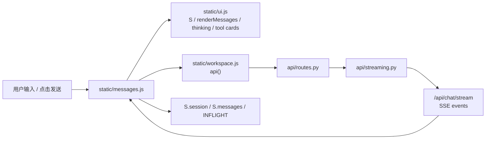
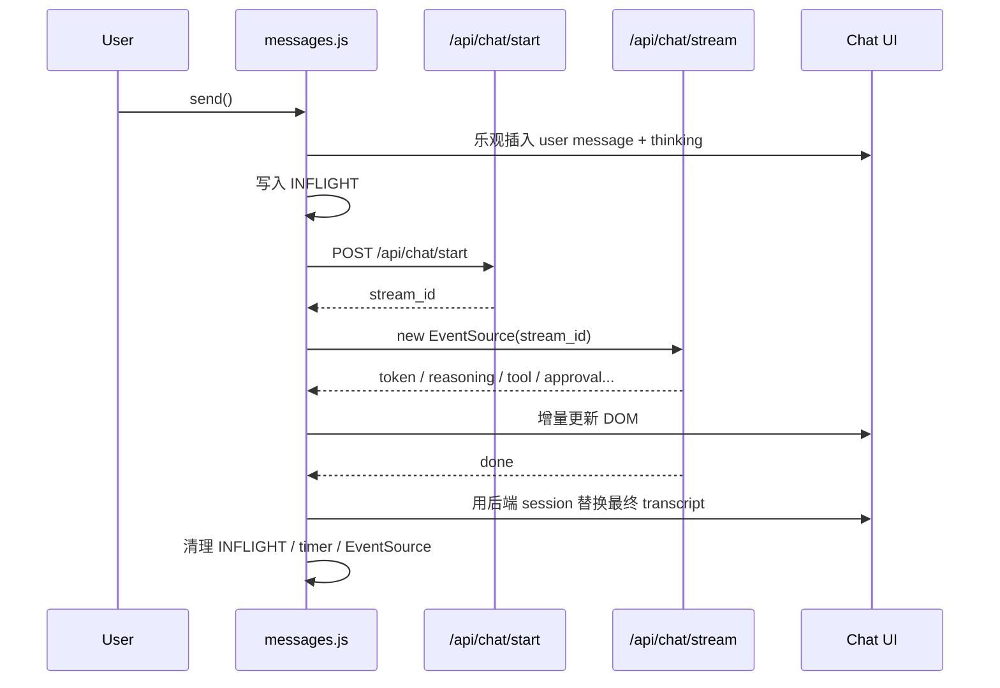
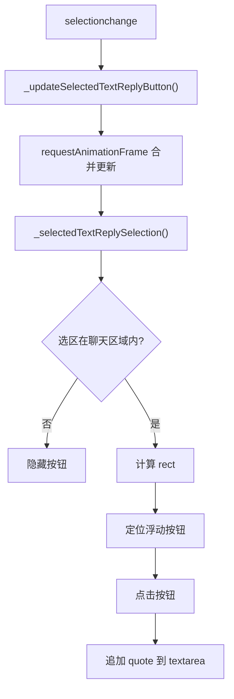
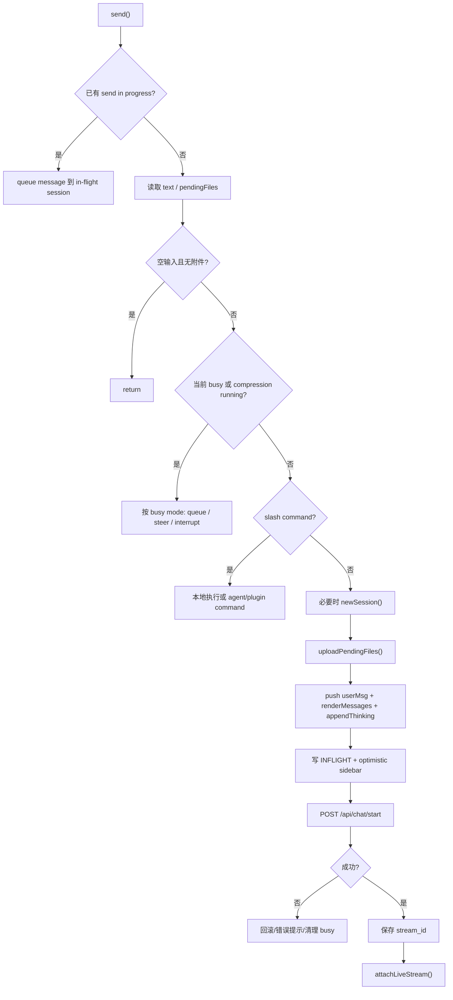

# `static/messages.js` 精读与 JavaScript 提升指南

本文面向正在通过真实项目源码提升 JavaScript 能力的前端学习者。
`static/messages.js` 是 Hermes WebUI 中最核心、也最值得精读的前端文件之一。
它当前约 3800 行，不适合从第 1 行机械读到最后一行；更好的方式是先理解它在系统中的位置，再沿着“发送消息 -> 启动流 -> 实时渲染 -> 终态收敛 -> 错误恢复”的主线阅读。

这份文档会从资深前端架构师视角拆解它的结构、设计思想、核心职责、可学习的 JS 技巧和适合练习的方向。

## 1. 文件整体定位

`static/messages.js` 可以理解为 Hermes WebUI 的 **聊天运行时前端控制器**。

它不是一个单纯的“消息渲染组件”，而是负责把用户输入、后端 Agent 运行、SSE 流式事件、工具调用、人类审批、澄清问题、后台任务、通知和最终会话状态串起来。

在项目中的位置大致如下：



它的核心职责可以拆成 7 类：

| 职责 | 说明 |
|---|---|
| 消息发送控制 | 读取 composer 内容、处理附件、slash command、busy 队列、只读 session 限制 |
| 乐观 UI | 用户发送后立即把消息渲染到界面，不等后端完成 |
| 流式连接 | 通过 `EventSource` 连接 `/api/chat/stream`，消费 token / tool / done / error 等事件 |
| 实时渲染 | 增量 Markdown、thinking 卡片、tool call 卡片、自动滚动、代码高亮、KaTeX |
| 状态恢复 | 用 `INFLIGHT`、localStorage、stream status、journal replay 恢复中断的流 |
| 人机协作 | approval 卡片、clarify 卡片、YOLO 模式、通知音、浏览器通知 |
| 终态收敛 | `done` 后以服务端返回的 canonical session 覆盖本地临时状态 |

## 2. 一句话理解设计思路

这个文件的核心设计思想是：

> 聊天不是一次 HTTP 请求，而是一个长生命周期的异步状态机。

用户点击发送之后，前端会经历这些阶段：



这里有三层状态同时存在：

| 状态层 | 作用 | 是否最终可信 |
|---|---|---|
| `S.session` / `S.messages` | 当前页面正在显示的状态 | 运行中只是临时可信 |
| `INFLIGHT[sessionId]` | 未完成流的恢复快照 | 用于刷新、切换、重连 |
| 后端 session | 持久化后的 canonical 状态 | 最终可信 |

大型前端异步 UI 的难点就在这里：用户界面要足够快，不能等后端全部完成；但最终又必须回到服务端事实，不能永远相信本地临时状态。

## 3. 推荐阅读路线

不要一开始就逐行读。建议按这条路线：

| 阶段 | 目标 | 推荐重点 |
|---|---|---|
| 第 1 遍 | 知道文件干什么 | `send()`、`attachLiveStream()`、`done` 事件 |
| 第 2 遍 | 理解状态流动 | `S.messages`、`S.activeStreamId`、`INFLIGHT`、`LIVE_STREAMS` |
| 第 3 遍 | 理解流式渲染 | `token`、`reasoning`、`_scheduleRender()`、`_smdWrite()` |
| 第 4 遍 | 理解恢复与错误 | `error`、`apperror`、`cancel`、`_restoreSettledSession()` |
| 第 5 遍 | 学工程实践 | approval、clarify、toast、notification、background polling |

## 4. 模块总览

| 模块 | 大致位置 | 核心函数/变量 | 作用 |
|---|---:|---|---|
| 会话可见性与模型 payload | 1-68 | `_isSessionCurrentPane()`、`_chatPayloadModelState()` | 判断当前 session 是否仍拥有事件，构造发送模型信息 |
| 持久化 toast | 79-164 | `_maybeNotifyPersistentStateSaved()` | 工具保存 memory/skill 后给用户提示 |
| 选中文本回复 | 166-294 | `_selectedTextReplySelection()`、`_appendSelectedTextReplyToComposer()` | 把聊天中选中的文本作为引用追加到 composer |
| 发送并发保护 | 296-380 | `_sendInProgress`、`applySessionTitleUpdate()` | 防重复发送、临时标题更新 |
| 消息发送主流程 | 382-772 | `send()` | 文件最重要入口之一 |
| SSE 流管理 | 773-803 | `LIVE_STREAMS`、`closeLiveStream()` | 管理每个 session 的 EventSource |
| 实时流处理 | 804-2758 | `attachLiveStream()` | 文件核心，处理全部 SSE 事件 |
| transcript / textarea | 2760-2785 | `transcript()`、`autoResize()` | 导出 Markdown transcript、输入框自适应 |
| YOLO / approval | 2787-3050 | `toggleYoloFromApproval()`、`showApprovalCard()` | 工具审批与会话级自动批准 |
| clarify | 3051-3626 | `showClarifyCard()`、`respondClarify()` | Agent 需要澄清时的人类输入流程 |
| 通知与后台任务 | 3628-3801 | `playAttentionSound()`、`attachBtwStream()`、`startBackgroundPolling()` | 声音、通知、临时问答、后台任务 |

## 5. 模块一：会话可见性与所有权保护

### 5.1 解决什么问题

聊天系统里最常见的 bug 是：用户已经切换到 B 会话，但 A 会话的异步事件晚到了，结果 A 的 token 被渲染到了 B 的界面。

开头这组函数就是为了避免这种错位：

```javascript
function _isSessionCurrentPane(sid) {
  if(!sid || !S.session || S.session.session_id!==sid) return false;
  if(typeof _loadingSessionId!=='undefined' && _loadingSessionId && _loadingSessionId!==sid) return false;
  return true;
}
```

它检查：

- 事件是否有 session id。
- 当前页面是否仍然打开这个 session。
- 是否正在切换到另一个 session。

### 5.2 使用了哪些 JS 特性

- 短路判断：`if (...) return false`
- 全局状态读取：`S.session`
- `typeof` 防御：避免某些全局变量不存在时报错
- 布尔返回：把复杂条件收敛为一个判断函数

### 5.3 为什么这么写

因为 SSE、fetch、timer、rAF 都是异步的。任何异步回调执行时，用户界面可能已经不是当初那个界面。

所以这类代码的核心思想是：

> 异步回调落地前，必须重新确认上下文。

这是大型前端工程中极其重要的能力。

### 5.4 可复用技巧

你可以在任何异步 UI 中复用这个模式：

```javascript
const requestOwnerId = currentId;
const data = await fetchData();
if (currentId !== requestOwnerId) return;
applyData(data);
```

## 6. 模块二：发送 payload 的模型状态

### 6.1 解决什么问题

发送消息时，前端需要告诉后端：

- 用哪个模型。
- 这个模型属于哪个 provider。
- 如果 session 上已有模型，优先使用 session 模型。
- 如果没有，才使用下拉框当前值。

核心函数：

```javascript
function _chatPayloadModel(){
  return S.session&&S.session.model||($('modelSelect')&&$('modelSelect').value)||'';
}

function _chatPayloadModelState(){
  const model=_chatPayloadModel();
  return {model,model_provider:_chatPayloadModelProvider(model)};
}
```

### 6.2 使用了哪些 JS 特性

- `&&` 和 `||` 组合取 fallback 值
- 对象属性简写：`{model, model_provider: ...}`
- DOM 查询：`$('modelSelect')`
- 函数拆分：一个函数只负责一个小问题

### 6.3 背后的编程思想

这是 **单一来源优先级** 的设计：

1. 当前 session 的模型最可信。
2. UI 下拉框是 fallback。
3. 没有值时返回空字符串。

如果代码里到处写 `S.session.model || select.value`，以后优先级一变会很难维护。封装成 helper 后，发送消息、队列消息、goal continuation 都可以复用同一套规则。

## 7. 模块三：持久化状态 toast

### 7.1 解决什么问题

Agent 执行工具时可能保存 memory 或创建/更新 skill。用户需要知道“这次对话产生了持久化变化”，但又不能每个工具事件都弹 toast。

相关函数：

- `_persistentToastToolName()`
- `_persistentToastArgs()`
- `_persistentToastPreview()`
- `_persistentToastHasWriteIntent()`
- `_maybeNotifyPersistentStateSaved()`
- `_showPersistentStateToast()`

### 7.2 关键思路

代码先把不稳定的 tool 数据统一成稳定文本：

```javascript
function _persistentToastText(value){
  if(value===null||value===undefined)return '';
  if(typeof value==='string')return value;
  try{return JSON.stringify(value);}catch(_){return String(value||'');}
}
```

然后用正则判断“是否有写入意图”：

```javascript
return /\b(save|saved|write|wrote|written|update|updated|create|created|store|stored|persist|persisted|remember|remembered)\b/.test(haystack);
```

最后只允许 memory / skill 相关工具触发 toast，并用 `Set` 去重。

### 7.3 使用了哪些 JS 特性

- `JSON.stringify()`
- `try/catch`
- 正则表达式
- `Set`
- 字符串 normalize：`toLowerCase()`、`replace()`
- 模板字符串

### 7.4 高质量写法

它体现了一个成熟工程习惯：

> 外部事件不可信，先 normalize，再判断业务语义。

而且 toast 去重不是无限增长的：

```javascript
if(_persistentStateToastSeen.size>200){
  const first=_persistentStateToastSeen.values().next().value;
  _persistentStateToastSeen.delete(first);
}
```

这是一种轻量级内存上限控制。

## 8. 模块四：选中文本回复

### 8.1 解决什么问题

用户在聊天历史里选中一段文字后，可以点击浮动按钮，把选中文本作为 Markdown 引用追加到 composer。

核心流程：



### 8.2 关键代码思想

选区读取：

```javascript
const selection=window.getSelection();
if(!selection||selection.isCollapsed||!selection.rangeCount)return null;
const range=selection.getRangeAt(0);
const rect=range.getBoundingClientRect();
```

引用格式化：

```javascript
return normalized.split('\n').map(line=>`> ${line}`).join('\n');
```

### 8.3 使用了哪些 JS 特性

- Selection API：`window.getSelection()`
- Range API：`getRangeAt()`、`getBoundingClientRect()`
- DOM 动态创建 button
- `requestAnimationFrame`
- textarea 光标控制：`setSelectionRange()`
- 自定义事件：`dispatchEvent(new Event('input'))`

### 8.4 性能优化点

`selectionchange` 可能非常频繁。代码没有每次事件都立即计算布局，而是用 rAF 合并：

```javascript
if(_selectedTextReplyRaf)return;
_selectedTextReplyRaf=window.requestAnimationFrame(()=>{ ... });
```

这是非常常见、非常实用的前端性能技巧。

## 9. 模块五：发送并发锁

### 9.1 解决什么问题

如果用户快速点击发送，或者队列 drain 和用户点击几乎同时发生，可能两个 `send()` 同时执行。

如果只依赖 `S.busy`，不一定够，因为 `setBusy(true)` 可能发生在第一个 `await` 之后。在这之前第二次 `send()` 已经进来了。

所以代码在 `send()` 最开始设置同步锁：

```javascript
let _sendInProgress = false;
let _sendInProgressSid = null;

async function send(){
  if (_sendInProgress) {
    ...
    return;
  }
  _sendInProgress = true;
  try {
    ...
  } finally {
    _sendInProgress=false;
    _sendInProgressSid=null;
  }
}
```

### 9.2 背后的 JS 知识

`async function` 在遇到第一个 `await` 之前是同步执行的。

因此，把锁放在任何 `await` 之前，可以保证同一轮事件循环里第二次调用会看到 `_sendInProgress === true`。

### 9.3 高质量写法

- 用 `finally` 保证锁一定释放。
- 如果有并发发送，不丢弃用户输入，而是尝试 queue 到当前 in-flight session。
- `_sendInProgressSid` 记录真正拥有运行中请求的 session，避免用户切走后消息被排到错误会话。

这是非常值得学习的并发控制写法。

## 10. 模块六：`send()` 主流程

### 10.1 `send()` 解决什么问题

`send()` 是用户点击发送后的主入口。它负责：

1. 读取输入框文本和附件。
2. 如果当前 session 忙，根据 busy mode 决定 queue / steer / interrupt。
3. 处理 slash command。
4. 必要时创建新 session。
5. 上传附件。
6. 推入乐观 user message。
7. 保存 `INFLIGHT`。
8. 调用 `/api/chat/start` 启动后端 agent。
9. 得到 `stream_id` 后调用 `attachLiveStream()`。

### 10.2 发送主流程图



### 10.3 乐观 UI

核心片段：

```javascript
S.messages.push(userMsg);
renderMessages();
appendThinking('',{pending:true});
setBusy(true);
```

这几行的意义非常大：

- 用户一按发送，界面马上显示自己的消息。
- 不用等待后端启动 agent。
- `appendThinking()` 给用户反馈系统正在工作。
- `setBusy(true)` 把发送按钮切成停止/忙碌状态。

### 10.4 为什么要先写 `INFLIGHT`

```javascript
INFLIGHT[activeSid]={messages:optimisticMessages,uploaded:uploadedNames,toolCalls:[]};
saveInflightState(activeSid,{streamId:null,messages:...,uploaded:...});
```

这是为了处理这些情况：

- 用户刚发送后刷新页面。
- `/api/chat/start` 还没返回时页面崩了。
- session 切走再切回来。
- 后端已经开始运行，但前端还没拿到最终 session。

这体现的是 **恢复优先设计**。

### 10.5 slash command 处理

`send()` 里会先识别本地命令：

- `/help`
- `/clear`
- `/model`
- `/usage`
- `/theme`
- `/reload-mcp`
- plugin command

有些命令直接在前端执行，不走 agent；有些命令会显示“CLI only”；有些 plugin command 走专门的执行函数。

这里的思想是：

> 不是所有输入都应该进入 LLM。能确定是控制命令的，应该先在客户端或后端控制层处理。

### 10.6 高质量写法

- `send()` 中大量使用早返回，避免深层嵌套。
- 非关键 UI 前置步骤包进 `_runOptionalPreStartUiStep()`，失败不阻断主请求。
- 后端 `/api/chat/start` 失败时区分 404、active stream conflict、普通错误。
- 发送成功后更新模型、provider、localStorage、topbar、session list。

### 10.7 可优化点

`send()` 非常长，承担了太多职责。未来如果重构，可以拆成：

- `handleBusyInput()`
- `handleSlashCommand()`
- `prepareOutgoingMessage()`
- `applyOptimisticUserTurn()`
- `startChatStream()`
- `handleStartChatError()`

不过在无构建、无框架的项目约束下，现在这种集中式写法也有现实合理性：调用链短，调试直接。

## 11. 模块七：`LIVE_STREAMS` 与连接管理

### 11.1 解决什么问题

浏览器对同源 `EventSource` 连接数有限。如果每个后台 session 都保留一个 live SSE，连接池会被耗尽。

所以代码维护：

```javascript
const LIVE_STREAMS={};
```

并且只保留当前正在看的 session 的 live connection：

```javascript
function closeOtherLiveStreams(activeSid){
  for(const sid of Object.keys(LIVE_STREAMS)){
    if(sid!==activeSid) closeLiveStream(sid);
  }
}
```

### 11.2 关键设计

关闭 EventSource 不代表后端停止运行。后端 agent 仍然继续，用户切回 session 时可以 reattach。

因此 `closeLiveStream()` 里会标记：

```javascript
if(INFLIGHT[sessionId]) INFLIGHT[sessionId].reattach=true;
```

这是很好的工程思维：

> 关闭观察通道，不等于取消任务本身。

## 12. 模块八：`attachLiveStream()` 总览

### 12.1 文件最核心的函数

`attachLiveStream(activeSid, streamId, uploaded=[], options={})` 是整个文件最复杂、也最值得学习的函数。

它做的事情包括：

- 建立 `EventSource`。
- 维护当前流的局部状态。
- 增量渲染 Markdown。
- 处理 thinking / reasoning。
- 处理 tool call。
- 处理 todo snapshot。
- 处理 approval / clarify。
- 处理 auto compression。
- 处理 done/error/cancel。
- 处理断线重连和 journal replay。

### 12.2 闭包作为“单次流实例”

函数内部定义了大量局部变量：

```javascript
let assistantText = '';
let reasoningText = '';
let assistantRow = null;
let assistantBody = null;
let segmentStart = 0;
let _streamFinalized = false;
let _terminalStateReached = false;
```

这些变量只属于这一次 stream。每调用一次 `attachLiveStream()`，就创建一套新的私有状态。

这是闭包的高级用法：不用 class，也能创建一个“运行实例”。

### 12.3 为什么不用全局变量

如果这些变量放到全局，就会有问题：

- A session 的 token 可能污染 B session。
- 重连时旧 parser 状态难以清理。
- 并发流之间难以隔离。

闭包天然提供了作用域隔离。

这是你阅读大型 JS 时一定要培养的能力：

> 看到一个大函数内部的局部变量，不要只当变量看，要把它们看成这个异步任务实例的状态机字段。

## 13. 模块九：thinking 与可见内容分离

### 13.1 解决什么问题

不同模型可能用不同方式输出 reasoning：

- 独立 SSE `reasoning` 事件。
- 文本里包 `<think>...</think>`。
- 特殊 token，如 `<|channel>thought`。
- thinking 标签还可能流到一半未闭合。

用户界面需要：

- thinking 显示在 thinking 卡片里。
- 最终回答只显示可见内容。
- 持久化 session 时尽量把 reasoning 放到 `m.reasoning` 字段。

### 13.2 核心函数

```javascript
function _streamDisplay(){
  const raw=_stripXmlToolCalls(assistantText);
  for(const {open,close} of _thinkPairs){
    const trimmed=raw.trimStart();
    if(trimmed.startsWith(open)){
      const ci=trimmed.indexOf(close,open.length);
      if(ci!==-1){
        return trimmed.slice(ci+close.length).replace(/^\s+/,'');
      }
      return '';
    }
    if(open.startsWith(trimmed)) return '';
  }
  return raw;
}
```

### 13.3 使用了哪些 JS 特性

- 数组遍历：`for...of`
- 字符串方法：`trimStart()`、`startsWith()`、`indexOf()`、`slice()`
- 正则替换
- 结构化配置：`_thinkPairs`

### 13.4 背后的思想

这是 **presentation filtering**：

模型原始输出不等于用户应该看到的内容。前端要把不同语义层拆开：

- reasoning
- visible answer
- tool call XML
- recovery control message

真实 AI 产品前端里，这个能力非常重要。

## 14. 模块十：增量 Markdown 渲染

### 14.1 解决什么问题

流式回答可能每秒几十个 token。如果每次 token 都执行：

```javascript
assistantBody.innerHTML = renderMd(fullText);
```

会产生大量 DOM 重建、代码高亮重跑、KaTeX 重跑、滚动抖动和 GC 压力。

所以代码优先使用 `streaming-markdown`：

```javascript
window.smd.parser_write(_smdParser, delta);
```

只把新增 delta 喂给 parser。

### 14.2 核心状态

```javascript
let _smdParser=null;
let _smdWrittenLen=0;
let _smdWrittenText='';
```

含义：

| 变量 | 含义 |
|---|---|
| `_smdParser` | 当前 Markdown 增量 parser |
| `_smdWrittenLen` | 已经写入 parser 的长度 |
| `_smdWrittenText` | 已写入文本快照，用于检测 prefix 是否还一致 |

### 14.3 自愈逻辑

```javascript
if(_smdWrittenText && !displayText.startsWith(_smdWrittenText)){
  _smdParser=null;
  _smdWrittenLen=0;
  _smdWrittenText='';
  if(assistantBody) assistantBody.innerHTML='';
  _smdNewParser(assistantBody,fade);
}
```

如果当前显示文本不再以已写入文本开头，说明中途发生了清洗、thinking 剥离、tool XML 剥离等变化。此时增量切片会错，所以代码直接重建 parser。

这是高质量热路径写法：

> 快路径增量更新，异常路径重建自愈。

### 14.4 安全处理

`streaming-markdown` 不负责 URL scheme 安全，所以代码补了 sanitizer：

```javascript
const _SMD_SAFE_URL_RE=/^(?:https?:|mailto:|tel:|\/|#|\?|\.|api|session\/)/i;
```

不安全的链接会被移除 `href` 或 `src`。

这是非常重要的安全意识：

> 只要有 Markdown、HTML、innerHTML，就必须考虑 XSS 和 URL scheme 注入。

## 15. 模块十一：rAF 渲染节流

### 15.1 解决什么问题

token 可能来得比浏览器渲染快。每个 token 都操作 DOM，会让主线程爆掉。

核心函数：

```javascript
function _scheduleRender(){
  if(_renderPending) return;
  if(_streamFinalized) return;
  _renderPending=true;
  ...
}
```

它把 DOM 更新限制到大约：

- 普通模式：约 15fps，`66ms`
- fade 模式：约 30fps，`33ms`

### 15.2 使用了哪些 JS 特性

- `requestAnimationFrame`
- `setTimeout`
- `performance.now()`
- 状态锁：`_renderPending`
- 终止保护：`_streamFinalized`

### 15.3 背后的编程思想

这是 **backpressure**。

后端可以高速吐 token，但前端不应该无限制跟随。UI 应该以浏览器能承受、用户能感知的频率更新。

类似思想也出现在持久化节流里：

```javascript
function _throttledPersist(){
  if(_persistTimer) return;
  _persistTimer=setTimeout(()=>{_persistTimer=null;persistInflightState();},2000);
}
```

这避免了每个 token 都 JSON stringify 整个 inflight map。

## 16. 模块十二：SSE 事件处理总表

`attachLiveStream()` 里最重要的阅读方法是画事件表。

| SSE 事件 | 前端动作 |
|---|---|
| `token` | 追加 assistantText，更新 INFLIGHT，调度渲染 |
| `interim_assistant` | 插入阶段性可见回答，重置 segment |
| `reasoning` | 追加 reasoningText，更新 thinking 卡片 |
| `tool` | 创建 live tool card，finalize thinking，开启新 assistant segment |
| `tool_complete` | 标记工具完成，保存 snippet，刷新 workspace preview |
| `todo_state` | 用完整 todo snapshot 替换 `S.todos` |
| `approval` | 展示审批卡片，播放提示音，发浏览器通知 |
| `clarify` | 展示澄清卡片，锁定 composer |
| `state_saved` | memory/skill 保存提示 |
| `title` | 更新 session 标题 |
| `context_status` | 显示 recall prefill 状态 |
| `goal` | 显示 goal 进度 |
| `goal_continue` | 把下一步 goal continuation 排入队列 |
| `compressing` | 显示自动压缩运行卡片 |
| `compressed` | 显示自动压缩完成卡片 |
| `metering` | 更新 token/cost/TPS 指示 |
| `done` | 最终收敛，替换为服务端 session |
| `stream_end` | 没有 done 时尝试恢复 settled session |
| `apperror` | 应用层错误，如限额、取消、模型错误 |
| `warning` | 非致命警告 |
| `error` | SSE 网络错误，尝试 reconnect/replay/restore |
| `cancel` | 用户取消，拉取服务端最新 session |

### 16.1 阅读技巧

不要把这些 handler 当作零散代码读。

你要问：

1. 这个事件属于运行过程、交互过程，还是终止过程？
2. 它会不会修改 `S.messages`？
3. 它会不会修改 `INFLIGHT`？
4. 它是否要求当前 session 仍然 active？
5. 它是否需要持久化？
6. 它是否可能重复到达？

## 17. 模块十三：tool call 分段渲染

### 17.1 解决什么问题

Agent 输出的顺序可能是：

1. thinking
2. 一小段 assistant text
3. tool call
4. tool result
5. 继续 assistant text
6. 再 tool call
7. 最终回答

如果所有 assistant token 都写到同一个 DOM 节点里，tool 后面的文本可能跑到 tool 卡片上方。

所以代码用：

```javascript
let segmentStart=0;
let _freshSegment=false;
```

在 tool 事件后重置 assistant segment：

```javascript
_flushPendingSegmentRender({force:true});
_freshSegment=true;
_smdEndParser();
_resetAssistantSegment();
```

### 17.2 背后的思想

这是 **timeline rendering**。

聊天不是只有 user/assistant 两种气泡，而是一条运行时间线：

```text
user message
thinking card
assistant segment
tool card
assistant segment
tool card
final assistant segment
```

前端必须保证时间线顺序稳定。

## 18. 模块十四：`done` 终态收敛

### 18.1 `done` 是什么

`done` 表示后端 agent 本轮运行已经完成，并返回最终 session。

这是从“临时流式状态”切换到“持久化最终状态”的关键点。

### 18.2 关键动作

`done` handler 做了大量清理和收敛：

- 设置 `_streamFinalized=true`
- 取消 pending rAF
- 结束 smd parser
- finalize thinking card
- 清理 `INFLIGHT`
- 清 approval/clarify
- 用 `d.session` 覆盖 `S.session`
- 用 `d.session.messages` 覆盖 `S.messages`
- 迁移临时字段，如 `_turnUsage`
- 处理 reasoning 持久化
- 标记 tool calls 完成
- 渲染最终 transcript
- 刷新 session list
- 播放通知
- drain queued message

### 18.3 为什么要先设置 `_streamFinalized`

注释里提到一个真实 bug：如果 `done` 到了，但之前某个 token 事件已经安排了 rAF，rAF 可能在最终渲染之后又执行，把旧 thinking 或旧 live DOM 插回来。

所以代码在终态处理一开始就设置：

```javascript
_streamFinalized=true;
```

并在 `_scheduleRender()` 里检查：

```javascript
if(_streamFinalized) return;
```

这是一种非常典型的异步终止保护。

### 18.4 可复用技巧

任何长生命周期异步任务都可以用：

```javascript
let finalized = false;

function scheduleWork() {
  if (finalized) return;
  requestAnimationFrame(() => {
    if (finalized) return;
    render();
  });
}

function finish() {
  finalized = true;
  cleanup();
}
```

## 19. 模块十五：断线恢复

### 19.1 解决什么问题

网络断开、SSH tunnel 中断、浏览器 tab 进入后台、手机切 App，都可能让 SSE 断开。

但后端 agent 可能还在运行，甚至已经完成。

代码的恢复顺序是：

1. 如果离线或页面 hidden，先延迟处理。
2. 查询 `/api/chat/stream/status?stream_id=...`。
3. 如果 stream 仍 active，重新打开 EventSource。
4. 如果有 replay，带 `replay=1&after_seq=...` 重放 journal。
5. 如果后端已 settle，调用 `_restoreSettledSession()`。
6. 都失败才显示连接中断错误。

### 19.2 关键思想

这是 **graceful degradation**：

> 不要一断线就失败。先判断真实状态，再选择 reconnect、replay、restore 或 error。

### 19.3 Run journal cursor

代码会记录 SSE 的 `lastEventId`：

```javascript
function _rememberRunJournalCursor(e){
  const raw=String(e&&e.lastEventId||'').trim();
  ...
  _lastRunJournalSeq=seq;
  _lastRunJournalEventId=raw;
}
```

恢复 replay 时带上 cursor，避免重复渲染已处理过的事件。

这是事件系统里非常重要的 **幂等性设计**。

## 20. 模块十六：application error、network error、cancel 的区别

### 20.1 三种终止路径

| 路径 | 来源 | 含义 |
|---|---|---|
| `apperror` | 服务端显式发出的应用错误 | 限额、认证、模型不存在、取消、无响应等 |
| `error` | EventSource 网络错误 | 连接中断、服务器重启、隧道断开 |
| `cancel` | 用户取消 | 用户主动 Stop |

### 20.2 为什么要区分

这三种错误的用户语义不同：

- 网络中断不一定代表 agent 失败。
- 用户取消不是 provider 错误。
- 限额和认证需要给出明确提示。
- recovery control message 不应该显示成普通聊天内容。

这体现了成熟产品的错误建模能力。

## 21. 模块十七：approval 工具审批

### 21.1 解决什么问题

Agent 执行危险操作前，需要用户批准。

approval 模块负责：

- 展示命令和描述。
- 支持 allow once / session / always / deny。
- 防止重复提交。
- SSE 优先，polling 兜底。
- session 切换时只展示当前 session 的审批。

### 21.2 核心状态

```javascript
let _approvalSessionId = null;
let _approvalCurrentId = null;
let _approvalPendingBySession = new Map();
```

含义：

| 变量 | 含义 |
|---|---|
| `_approvalSessionId` | 当前可见审批属于哪个 session |
| `_approvalCurrentId` | 当前审批 id，响应时传回后端 |
| `_approvalPendingBySession` | 每个 session 的 pending approval 缓存 |

### 21.3 高质量写法

响应审批时先禁用按钮：

```javascript
["approvalBtnOnce","approvalBtnSession","approvalBtnAlways","approvalBtnDeny"].forEach(id => {
  const b = $(id);
  if (b) { b.disabled = true; ... }
});
```

这是防重复提交。

并且提交前保存 `approvalId`，确保响应的是当前卡片，不是后面新来的审批。

## 22. 模块十八：clarify 澄清流程

### 22.1 解决什么问题

有些任务 Agent 不能继续，需要用户补充信息。clarify 模块负责把这个问题插入聊天区域，并锁定 composer。

它比 approval 更复杂，因为它有：

- 问题文本。
- 多个候选选项。
- 自由输入。
- 倒计时。
- 折叠状态。
- 草稿保留。
- 过期处理。
- 网络失败重试。

### 22.2 动态创建 DOM

```javascript
card = document.createElement("div");
card.className = "clarify-card";
card.id = "clarifyCard";
card.setAttribute("role", "dialog");
card.setAttribute("aria-labelledby", "clarifyHeading");
```

这里体现了两个点：

- 不依赖框架，直接创建 DOM。
- 加了 ARIA 属性，考虑可访问性。

### 22.3 草稿保护

如果 clarify 过期或关闭，用户已经输入的内容不能丢：

```javascript
sessionStorage.setItem(key, JSON.stringify({
  draft,
  reason,
  saved_at: Date.now(),
}));
```

还会把 draft 放回 composer。

这是很好的用户体验思维：

> 系统状态变化不应该轻易吞掉用户正在输入的文字。

### 22.4 SSE + polling fallback

clarify 和 approval 都采用类似策略：

1. 优先建立 SSE，实时收到 pending prompt。
2. SSE 失败时回退到 HTTP polling。
3. timer 中检查当前 session 是否仍匹配。
4. stop 时关闭 EventSource 和 interval。

这是非常实用的实时系统前端模板。

## 23. 模块十九：通知、声音、后台任务

### 23.1 声音通知

`playAttentionSound()` 使用 Web Audio API：

```javascript
const ctx=new (window.AudioContext||window.webkitAudioContext)();
const osc=ctx.createOscillator();
const gain=ctx.createGain();
osc.connect(gain);
gain.connect(ctx.destination);
```

并且做了去重和节流：

- 900ms 内不重复播放。
- 同一个 attention key 5 分钟内只播放一次。

### 23.2 浏览器通知

`sendBrowserNotification()` 会检查：

- 用户是否开启通知。
- 当前文档是否 hidden。
- 浏览器是否支持 Notification。
- 权限是否 granted。

这体现了 Web API 使用中的渐进增强思想。

### 23.3 `/btw` ephemeral stream

`attachBtwStream()` 是一个简化版流式回答：

- 建立 EventSource。
- token 累积到 `answer`。
- 动态创建一个特殊 bubble。
- done 后不写入 session history。

这个函数很适合初学者练习，因为它比主 `attachLiveStream()` 简单很多，但核心模式相同。

### 23.4 background polling

`startBackgroundPolling()` 用 `setTimeout` 递归轮询后台任务结果：

```javascript
_bgPollTimers[taskId]=setTimeout(_poll,3000);
```

它没有用 `setInterval`，而是每次请求结束后再安排下一次 poll，避免请求堆叠。

这是一个好习惯。

## 24. 高质量写法总结

### 24.1 异步所有权保护

几乎每个 SSE handler 都会检查：

```javascript
if(!S.session||S.session.session_id!==activeSid) return;
```

这防止旧 session 的事件污染当前页面。

### 24.2 终止态统一清理

`done`、`apperror`、`cancel`、`stream_end`、network error 都会做类似清理：

- 清 timer。
- 设置 `_streamFinalized`。
- 取消 rAF。
- 结束 smd parser。
- 关闭 EventSource。
- 清 INFLIGHT。
- 清 approval/clarify。
- 让 UI 回到 idle。

大型异步代码最怕“只处理成功，不处理终止”。这个文件在终止路径上很扎实。

### 24.3 渐进增强

很多能力都有 fallback：

- streaming-markdown 不存在时 fallback 到 `renderMd()`。
- SSE 失败 fallback 到 polling。
- Notification 不支持就跳过。
- speechSynthesis 不存在就跳过。
- `renderKatexBlocks` 不存在就不调用。

这种写法让 vanilla JS 应用更稳。

### 24.4 非关键 UI 失败不阻断主流程

`_runOptionalPreStartUiStep()` 的设计很值得学：

```javascript
try{
  return typeof fn==='function'?fn():undefined;
}catch(e){
  console.warn(...);
  return undefined;
}
```

sidebar cache、toast、状态同步这类 UI 辅助失败，不应该阻止真正的消息发送。

### 24.5 状态最终收敛

流式过程中前端维护临时状态，`done` 后以服务端 session 为准。

这是很多实时应用的通用模型：

```text
optimistic local state -> live projected state -> canonical server state
```

## 25. 性能优化点总结

| 优化点 | 代码体现 | 学习价值 |
|---|---|---|
| rAF 渲染节流 | `_scheduleRender()` | 高频事件不要直接刷 DOM |
| 增量 Markdown | `_smdWrite()` | 避免整段 innerHTML 重建 |
| 持久化节流 | `_throttledPersist()` | 避免 JSON churn 和 GC 压力 |
| EventSource 数量控制 | `closeOtherLiveStreams()` | 避免浏览器连接池耗尽 |
| 选区 UI rAF 合并 | `_updateSelectedTextReplyButton()` | 避免频繁 layout |
| 后台 polling 用递归 timeout | `startBackgroundPolling()` | 避免请求重叠 |
| URL sanitizer | `_sanitizeSmdLinks()` | 安全和性能边界清晰 |
| KaTeX 延迟扫描 | `_scheduleStreamingKatex()` | 昂贵渲染要节流 |

## 26. 工程化实践总结

### 26.1 无框架下的模块边界

这个项目没有 React/Vue，也没有 bundler。模块之间通过全局函数和全局状态协作：

- `S` 来自 `ui.js`
- `api()` 来自 `workspace.js`
- `renderMessages()` 来自 `ui.js`
- `queueSessionMessage()` 来自 `ui.js`
- `loadSession()` 来自 `sessions.js`

这要求代码非常注意：

- 函数是否存在：`typeof fn === 'function'`
- 全局状态是否已经初始化。
- DOM 元素是否存在。

### 26.2 注释质量

文件里有很多“解释为什么”的注释，而不是只解释“做什么”。

例如：

- 为什么不能在 tool 事件里 remove thinking。
- 为什么不能在 reconnect 时重置 token accumulator。
- 为什么 rAF 要限到 15fps。
- 为什么 recovery control message 不能用宽泛字段过滤。

高质量注释应该解释历史 bug、边界条件和设计约束。

### 26.3 兼容旧数据

代码里经常出现 backward-compat 逻辑：

- 老 session 的 recovery control message 没有 marker，只能匹配固定文本。
- 某些 provider 把 reasoning 放进 content。
- 某些 EventSource replay path 可能没有 `done`。

真实项目不会永远只有“新格式”。兼容旧状态是工程能力的一部分。

## 27. 可复用技巧清单

### 27.1 异步上下文保护

```javascript
const owner = currentId;
const result = await request();
if (owner !== currentId) return;
apply(result);
```

### 27.2 终止 flag 防止旧回调写 UI

```javascript
let finalized = false;
requestAnimationFrame(() => {
  if (finalized) return;
  render();
});
finalized = true;
```

### 27.3 SSE 优先，polling 兜底

```javascript
try {
  const es = new EventSource(url);
  es.onerror = () => {
    es.close();
    startPolling();
  };
} catch (_) {
  startPolling();
}
```

### 27.4 高频事件 rAF 合并

```javascript
let raf = 0;
function schedule() {
  if (raf) return;
  raf = requestAnimationFrame(() => {
    raf = 0;
    update();
  });
}
```

### 27.5 非关键副作用保护

```javascript
function optional(label, fn) {
  try { fn(); }
  catch (e) { console.warn(label, e); }
}
```

### 27.6 本地临时状态最终由服务端收敛

```javascript
messages.push(optimisticMessage);
render();
const finalSession = await waitDone();
messages = finalSession.messages;
render();
```

## 28. 你可以从中学到的 JS 核心能力

| 能力 | 文件中的体现 | 练习目标 |
|---|---|---|
| `async/await` | `send()`、polling、restore | 知道 await 后状态可能变 |
| 事件驱动 | SSE handlers、DOM events | 能把事件表画出来 |
| 闭包 | `attachLiveStream()` 内部状态 | 理解函数级私有状态 |
| DOM 编程 | clarify card、selected reply、btw row | 熟练 createElement / classList / dataset |
| Web API | EventSource、Notification、AudioContext、Selection | 知道浏览器原生能力 |
| 性能优化 | rAF、throttle、incremental parser | 高频输入要限流 |
| 错误处理 | app error / network error / cancel | 按语义分类错误 |
| 状态管理 | `S`、`INFLIGHT`、`LIVE_STREAMS` | 区分 UI 状态、恢复状态、最终状态 |
| 安全意识 | URL sanitizer、textContent 优先 | 理解 innerHTML 风险 |
| 产品思维 | 草稿保护、最短展示、通知去重 | 保护用户操作 |

## 29. 适合练习巩固的任务

### 29.1 入门练习：实现简化版流式输出

目标：

- 一个 textarea。
- 一个发送按钮。
- 点击后把用户消息追加到页面。
- 用 `setInterval` 模拟 token 流。
- 每 66ms 最多渲染一次。

练习点：

- DOM 创建。
- rAF 节流。
- 字符串累积。
- busy 状态。

### 29.2 入门练习：选中文本引用

目标：

- 在一段聊天文本中选择内容。
- 显示浮动按钮。
- 点击后把内容作为 `> quote` 追加到 textarea。

练习点：

- Selection API。
- Range API。
- button 定位。
- textarea 光标。

### 29.3 中级练习：实现 SSE + polling fallback

目标：

- 优先连接一个 EventSource。
- 连接失败后改用 `setTimeout` polling。
- session 切换时停止旧连接。

练习点：

- EventSource 生命周期。
- timer 清理。
- 所有权判断。

### 29.4 中级练习：实现 `INFLIGHT` 恢复

目标：

- 发送后把临时消息写入 localStorage。
- 刷新页面后恢复“正在生成中”的消息。
- 完成后清除恢复状态。

练习点：

- localStorage。
- JSON parse/stringify 防御。
- 最终状态清理。

### 29.5 高级练习：拆分 `attachLiveStream()`

目标：

把主流处理拆成几个小模块：

- `createStreamRenderer()`
- `createStreamPersistence()`
- `wireStreamEvents()`
- `finalizeStream()`
- `recoverStream()`

练习点：

- 闭包拆分。
- 依赖注入。
- 单元测试友好设计。

## 30. 阅读大型 JS 文件的方法

### 30.1 先找入口

这个文件最重要的入口是：

- `send()`
- `attachLiveStream()`
- `showApprovalCard()`
- `showClarifyCard()`
- `attachBtwStream()`
- `startBackgroundPolling()`

先不要纠结 helper，先找谁调用谁。

### 30.2 再画数据流

对 `messages.js` 来说，最重要的数据流是：

```text
textarea -> send() -> optimistic S.messages
          -> /api/chat/start -> stream_id
          -> EventSource -> token/tool/done
          -> live DOM / INFLIGHT
          -> final S.session / S.messages
```

### 30.3 把变量按生命周期分类

| 生命周期 | 例子 |
|---|---|
| 页面全局 | `_sendInProgress`、`LIVE_STREAMS` |
| session 级 | `INFLIGHT[activeSid]`、pending approval map |
| 单次 stream 级 | `assistantText`、`_streamFinalized`、`_smdParser` |
| 单次 DOM 交互级 | `_selectedTextReplyText`、clarify draft |

看到变量时先问：它活多久？

### 30.4 把事件按语义分类

| 类别 | 事件 |
|---|---|
| 内容增量 | `token`、`reasoning`、`interim_assistant` |
| 工具活动 | `tool`、`tool_complete`、`todo_state` |
| 人类输入 | `approval`、`clarify` |
| 状态提示 | `title`、`context_status`、`metering`、`goal` |
| 生命周期终止 | `done`、`stream_end`、`apperror`、`error`、`cancel` |

### 30.5 最后再逐段精读

精读时对每个函数问 8 个问题：

1. 它读了哪些状态？
2. 它改了哪些状态？
3. 它是否发网络请求？
4. 它是否直接改 DOM？
5. 它是否可能被高频调用？
6. 它失败时会怎样？
7. 它是否需要检查当前 session？
8. 它是业务逻辑、UI 逻辑、性能逻辑，还是恢复逻辑？

## 31. 这份文件的改进方向

这些不是 bug，而是未来二次开发或重构时可以考虑的方向：

| 方向 | 原因 | 可能拆法 |
|---|---|---|
| `send()` 拆分 | 职责太多 | command、busy、upload、optimistic、start stream |
| `attachLiveStream()` 拆分 | 函数过长 | renderer、event wiring、recovery、finalization |
| approval / clarify 抽象 | 两者都有 SSE + polling fallback | promptChannel helper |
| stream renderer 独立化 | Markdown、fade、KaTeX、scroll 混在一起 | `liveStreamRenderer.js` |
| 错误模型集中化 | app/network/cancel 分散 | `classifyStreamError()` |
| 类型注释增强 | vanilla JS 缺少类型提示 | JSDoc typedef |

如果你以后想练习重构，这个文件很适合做“保持行为不变的小步拆分”。

## 32. 最后总结

`static/messages.js` 是一份非常典型的真实生产级 vanilla JS 文件。

它的价值不在于语法多炫，而在于它把大量真实前端工程问题放在一起解决：

- 用户输入不能丢。
- 异步事件不能串 session。
- 流式渲染不能卡浏览器。
- 网络断开要能恢复。
- 工具调用要按时间线展示。
- 危险操作要有人类审批。
- 最终状态必须回到服务端事实。

如果你能把这份文件读懂，你学到的不只是 JavaScript 语法，而是大型前端运行时的思维方式：

> 状态有归属，事件有生命周期，UI 是临时投影，服务端事实负责最终收敛。

建议你后续按这份文档配合源码阅读，每次只挑一个模块精读。读完后自己实现一个小型流式聊天 demo，会比单纯看语法教程提升快得多。
