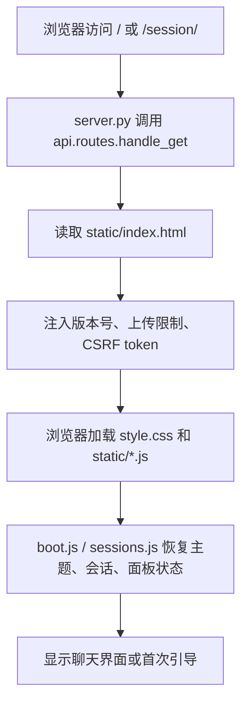
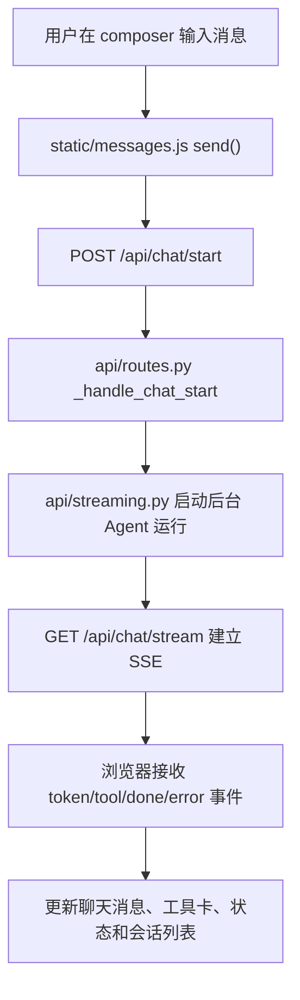
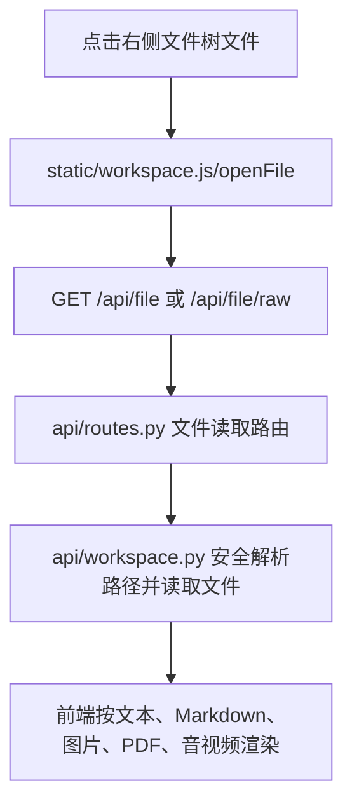

# Hermes WebUI 入门与二次开发指南

面向读者：刚接触这个仓库的初级 Web 工程师。

目标：让你在 1 到 2 天内理解项目做什么、怎么跑起来、常改哪里，并能完成简单二次开发，例如改样式、新增一个侧边栏页面、新增或调整一个简单接口。

> **先记住一句话：Hermes WebUI 不是 Vue/React 项目。**
>
> 它是一个“Python 标准库 HTTP 服务 + 原生 HTML/CSS/JavaScript”的轻量 Web 应用。没有 Vite、Webpack、Vue、React、Element Plus，也没有前端构建步骤。

## 1. 仓库概述

### 1.1 核心功能

Hermes WebUI 是 Hermes Agent 的浏览器界面。你可以把它理解成：

- Hermes Agent 负责真正的 AI Agent 能力：聊天、调用工具、记忆、技能、定时任务、工作区操作、模型提供商配置等。
- Hermes WebUI 负责把这些能力变成一个三栏式网页应用：左侧会话和功能导航，中间聊天，右侧工作区文件浏览和预览。

它解决的核心问题是：**让原本主要通过终端使用的 Hermes Agent，可以在浏览器里用接近 1:1 的体验操作。**

主要使用场景：

- 和 Hermes Agent 聊天、切换模型、查看上下文用量；
- 管理会话、项目、标签、归档和导入导出；
- 浏览、预览、编辑工作区文件；
- 查看定时任务、技能、记忆、Profiles、Todos、日志等 Agent 状态；
- 在自托管服务器、家用主机、WSL2 或 Docker 环境中通过浏览器访问。

### 1.2 技术栈明细

后端：

| 类别 | 技术 | 说明 |
|---|---|---|
| 语言 | Python 3.11+ | CI 覆盖 Python 3.11、3.12、3.13 |
| HTTP 服务 | `http.server.ThreadingHTTPServer` | Python 标准库，没有 Flask/FastAPI/Django |
| 路由 | `server.py` + `api/routes.py` | `server.py` 很薄，业务路由集中在 `api/routes.py` |
| 实时通信 | SSE | 聊天流式输出、审批、澄清、会话事件等 |
| 状态存储 | JSON 文件 + Hermes Agent 的 SQLite 状态 | WebUI 默认状态目录是 `~/.hermes/webui`，不是仓库目录 |
| 核心依赖 | `pyyaml>=6.0`、`cryptography>=42.0` | 见 `requirements.txt` |
| 可选能力 | `edge-tts` | 服务端 TTS，可选安装 |

前端：

| 类别 | 技术 | 说明 |
|---|---|---|
| UI | 原生 HTML/CSS/JavaScript | 没有前端框架 |
| 样式 | `static/style.css` | 所有主题、皮肤、响应式样式都在这里 |
| 页面模板 | `static/index.html` | 主页面 HTML |
| JS 模块 | `static/*.js` | 通过 `<script defer>` 直接加载 |
| Markdown 流式渲染 | `streaming-markdown@0.2.15` | vendored 在 `static/vendor/smd.min.js` |
| 数学公式 | KaTeX `0.16.22` | vendored 在 `static/vendor/katex/0.16.22` |
| 代码高亮 | Prism.js `1.29.0` | CDN 版本锁定 |
| 终端 | xterm.js `5.3.0` | CDN 版本锁定 |
| YAML 解析 | js-yaml `4.1.0` | vendored 在 `static/vendor/js-yaml/4.1.0` |

开发工具：

| 工具 | 作用 |
|---|---|
| `pytest` | 后端和大量静态回归测试 |
| `ruff` | Python 新增/改动代码的正确性 lint |
| `eslint@^10.4.0` | 仅用于检查 `static/**/*.js` 的运行时错误风险，不是构建工具 |
| Docker / Compose | 自托管部署选项 |

### 1.3 适用场景和边界

适合做：

- 在现有 WebUI 上加一个小面板、小按钮、小设置项；
- 修改主题、布局、按钮状态、提示文案；
- 新增简单 JSON API；
- 调整会话、工作区、任务、技能、模型选择等已有业务逻辑；
- 做自托管场景下的二次定制。

不适合直接做：

- 把它改造成大型前后端分离平台；
- 引入 Vue/React/Vite/Webpack 等构建体系，除非有非常明确的收益和回滚方案；
- 把 WebUI 当作多租户 SaaS 后台。当前架构更偏单用户、自托管、可信本机/内网场景；
- 在没有理解状态目录前，直接操作真实 `~/.hermes`。那里可能有真实会话、记忆、凭据和定时任务。

**二次开发不要走偏的关键边界：保持 Python + 原生 JS 的简单结构，优先延续现有模式。**

## 2. 快速上手

### 2.1 环境准备

你的本地环境是 Windows 11，所以建议按下面的优先级准备：

| 场景 | 推荐方式 | 说明 |
|---|---|---|
| 日常改代码、改 CSS/JS、写文档 | **Windows 11 原生 + PowerShell** | 编辑体验最好，仓库也提供 `start.ps1` |
| 第一次完整跑通 Hermes Agent + WebUI | **WSL2** | 官方 bootstrap 路径更稳，Linux 工具链兼容性最好 |
| Docker 部署验证 | Windows 11 + Docker Desktop | 注意容器里 `localhost` 不是宿主机 |

Windows 11 原生开发需要：

- Windows 11；
- PowerShell 7 或 Windows PowerShell；
- Python 3.11+，安装时勾选 “Add python.exe to PATH”；
- Git for Windows；
- 可选：Node.js 20+，只在运行 ESLint 开发检查时需要；
- 可选：Docker Desktop；
- Hermes Agent 的 **Windows 原生安装**。WSL2 里的 venv 不能直接给 Windows Python 用。

PowerShell 验证命令：

```powershell
git --version
python --version
py --version
node --version      # 可选
npm --version       # 可选
docker --version    # 可选
```

WSL2 验证命令：

```bash
git --version
python3 --version
node --version      # 可选
npm --version       # 可选
docker --version    # 可选
```

Windows 说明：

- **如果只是二次开发 WebUI，Windows 11 原生可以用。**
- **如果要完整验证 Agent 工具链、shell 工具、终端行为，优先在 WSL2 跑一遍。**
- 不要混用 venv：WSL2 生成的是 `venv/bin/python`，Windows 原生需要 `venv\Scripts\python.exe`。

### 2.2 代码拉取和分支说明

```bash
git clone https://github.com/nesquena/hermes-webui.git hermes-webui
cd hermes-webui
git branch --show-current
```

当前仓库主分支是 `master`，远端默认分支也是 `origin/master`。一般二次开发从主分支拉新分支：

```bash
git checkout master
git pull --ff-only
git checkout -b feature/about-panel
```

基础知识点：

- 分支可以理解成“独立的改动空间”；
- 在 feature 分支开发，不会直接污染主分支；
- 后续通过 PR/MR 把分支改动合并回主分支。

### 2.3 依赖安装

#### 后端依赖

在 WSL2/Linux/macOS 中，最省心方式是直接运行 bootstrap：

```bash
python3 bootstrap.py
```

它会尝试：

1. 发现 Hermes Agent；
2. 找到合适 Python；
3. 安装 WebUI 必需依赖；
4. 启动服务；
5. 等待 `/health`；
6. 打开浏览器并进入首次引导。

如果你在 Windows 11 原生开发，建议先安装好 Windows 原生 Hermes Agent，然后在 WebUI 仓库里准备依赖。

PowerShell 示例：

```powershell
cd E:\liuzhihuan\workspace\hermes\hermes-webui

# 如果你知道 hermes-agent 的 Windows 原生路径，显式指定它。
$env:HERMES_WEBUI_AGENT_DIR = "E:\liuzhihuan\workspace\hermes\hermes-agent"

# start.ps1 会优先使用 hermes-agent\venv\Scripts\python.exe。
# WebUI 依赖也要安装到这个 Python 环境里。
$agentPython = Join-Path $env:HERMES_WEBUI_AGENT_DIR "venv\Scripts\python.exe"
& $agentPython -m pip install -r requirements.txt
```

如果你只想手动准备 WebUI 本地虚拟环境：

```bash
python3 -m venv .venv
source .venv/bin/activate
python -m pip install --upgrade pip
python -m pip install -r requirements.txt
```

PowerShell 写法：

```powershell
python -m venv .venv
.\.venv\Scripts\Activate.ps1
python -m pip install --upgrade pip
python -m pip install -r requirements.txt
```

注意：

- WebUI 的 `requirements.txt` 只包含很少依赖；
- 真正的 Agent 依赖通常在 Hermes Agent 自己的 venv 里；
- Windows 原生启动时，`start.ps1` 会优先使用 Hermes Agent 的 Windows venv，所以更推荐把 WebUI 依赖也装进 Agent venv。

#### 前端依赖

这个项目没有前端构建步骤，所以通常不需要 `npm install`。

只有你要跑 JS 运行时错误检查时，才安装开发依赖：

```bash
npm install
npm run lint:runtime
```

`npm install` 的作用是把 `package.json` 里的开发工具下载到 `node_modules`。这里主要是 ESLint，不会生成线上前端包。

### 2.4 推荐的本地启动方式

为了避免误写真实 Hermes 状态，初次试跑建议使用隔离状态目录。

Windows 11 原生 PowerShell 推荐写法：

```powershell
cd E:\liuzhihuan\workspace\hermes\hermes-webui

$env:HERMES_HOME = Join-Path $env:TEMP "hermes-webui-agent-home"
$env:HERMES_WEBUI_STATE_DIR = Join-Path $env:TEMP "hermes-webui-agent-state"
$env:HERMES_WEBUI_PORT = "8789"
$env:HERMES_WEBUI_AGENT_DIR = "E:\liuzhihuan\workspace\hermes\hermes-agent"

.\start.ps1 -Port 8789
```

启动成功后访问：

```text
http://127.0.0.1:8789
```

WSL2/Linux/macOS 写法：

```bash
mkdir -p /tmp/hermes-webui-agent-home /tmp/hermes-webui-agent-state

HERMES_HOME=/tmp/hermes-webui-agent-home \
HERMES_WEBUI_STATE_DIR=/tmp/hermes-webui-agent-state \
HERMES_WEBUI_PORT=8789 \
python3 bootstrap.py
```

启动成功后访问：

```text
http://127.0.0.1:8789
```

Windows 11 原生常规开发启动：

```powershell
.\start.ps1
```

WSL2/Linux/macOS 常规开发启动：

```bash
python3 bootstrap.py
```

默认访问地址：

```text
http://127.0.0.1:8787
```

在 WSL2/Linux/macOS 中也可以使用 shell 启动脚本：

```bash
./start.sh
```

WSL2/Linux/macOS 自托管或后台运行：

```bash
./ctl.sh start
./ctl.sh status
./ctl.sh logs --lines 100
./ctl.sh restart
./ctl.sh stop
```

### 2.5 启动失败常见排查

端口占用：

PowerShell：

```powershell
.\start.ps1 -Port 8790
```

WSL2/Linux/macOS：

```bash
HERMES_WEBUI_PORT=8790 python3 bootstrap.py
```

检查服务健康：

PowerShell：

```powershell
curl.exe -sS http://127.0.0.1:8787/health
```

WSL2/Linux/macOS：

```bash
curl -sS http://127.0.0.1:8787/health
```

Hermes Agent 导入失败：

PowerShell：

```powershell
$env:HERMES_WEBUI_AGENT_DIR = "E:\liuzhihuan\workspace\hermes\hermes-agent"
$env:HERMES_WEBUI_PYTHON = "E:\liuzhihuan\workspace\hermes\hermes-agent\venv\Scripts\python.exe"
& $env:HERMES_WEBUI_PYTHON -c "from run_agent import AIAgent; print('ok')"
.\start.ps1 -Port 8789
```

WSL2/Linux/macOS：

```bash
export HERMES_WEBUI_AGENT_DIR=/absolute/path/to/hermes-agent
export HERMES_WEBUI_PYTHON=/absolute/path/to/hermes-agent/venv/bin/python
python3 bootstrap.py
```

本地模型连不上：

- 非 Docker 同机：通常是 `http://127.0.0.1:<port>/v1`；
- Docker Desktop：通常是 `http://host.docker.internal:<port>/v1`；
- Linux Docker Engine：需要 `extra_hosts` 或使用宿主机 LAN IP；
- 容器里的 `localhost` 指容器自己，不是宿主机。

不要直接删除真实状态目录来重跑引导：

- Windows 默认可能在 `%LOCALAPPDATA%\hermes`；
- WSL2/Linux/macOS 默认通常是 `~/.hermes`。

那里可能存着真实配置、凭据、记忆、技能、会话和定时任务。

### 2.6 测试和检查命令

运行完整测试：

```bash
pytest tests/ -v --timeout=60
```

先跑小范围回归：

```bash
pytest tests/test_regressions.py -q
```

Python 语法检查：

```bash
python -m py_compile server.py
```

Python diff lint：

```bash
python3 scripts/ruff_lint.py --diff origin/master
```

JS 运行时错误检查：

```bash
npm run lint:runtime
```

浏览器冒烟测试：

```bash
pip install playwright
python -m playwright install chromium
python tests/browser_smoke.py
```

## 3. 代码结构解析

### 3.1 核心目录

```text
hermes-webui/
├── server.py
├── bootstrap.py
├── start.sh
├── start.ps1
├── ctl.sh
├── api/
├── static/
├── tests/
├── scripts/
├── docs/
├── requirements.txt
├── package.json
├── pyproject.toml
├── Dockerfile
└── docker-compose.yml
```

高频目录说明：

| 路径 | 作用 | 二次开发频率 |
|---|---|---|
| `api/` | 后端业务逻辑、路由、状态、文件操作、模型、Profiles、流式聊天等 | **高** |
| `static/index.html` | 页面结构、侧边栏、面板、主聊天区、右侧文件面板 | **高** |
| `static/style.css` | 全部 UI 样式、主题、皮肤、响应式布局 | **高** |
| `static/ui.js` | DOM 工具、Markdown 渲染、通用 UI、文件树部分逻辑 | **高** |
| `static/workspace.js` | 工作区文件浏览、预览、上传、文件 API 封装 `api()` | **高** |
| `static/sessions.js` | 会话列表、搜索、创建、切换、恢复 | **中高** |
| `static/messages.js` | 发送消息、SSE 流式响应、重试、取消、编辑消息 | **中高** |
| `static/panels.js` | 左侧功能面板：任务、技能、记忆、工作区、Profiles、设置等 | **高** |
| `static/commands.js` | Slash command 自动补全和执行 | **中** |
| `static/boot.js` | 启动初始化、移动端导航、语音、主题、面板尺寸 | **中** |
| `tests/` | Pytest 测试和静态回归测试 | **中高** |
| `docs/` | 设计、架构、测试、引导、部署文档 | **中** |

### 3.2 核心文件

后端核心文件：

- `server.py`：HTTP server 入口，负责认证、中间件、静态资源和把请求转给 `api.routes`。**一般不要把业务逻辑塞回这里。**
- `start.ps1`：Windows 11 原生 PowerShell 启动脚本，适合本机开发调试。
- `api/routes.py`：主要 API 路由分发。新增简单接口通常从这里开始。
- `api/helpers.py`：JSON 返回、错误返回、请求体解析、安全路径解析等通用 HTTP 工具。
- `api/models.py`：WebUI 会话模型、会话创建、加载、列表。
- `api/config.py`：配置加载、环境变量、模型列表、设置读写。
- `api/streaming.py`：聊天流式执行、SSE 事件、取消、恢复等。
- `api/workspace.py`：工作区文件读取、目录列表、安全路径、Git 状态等。
- `api/upload.py`：上传、转录、工作区上传。
- `api/providers.py`：模型提供商和 API Key 管理。
- `api/profiles.py`：Hermes Profiles。

前端核心文件：

- `static/index.html`：页面骨架。新增侧边栏页面或按钮时常改这里。
- `static/style.css`：全局样式和主题变量。改颜色、间距、响应式通常改这里。
- `static/workspace.js`：定义了中心 `api(path, opts)` fetch 封装。前端调用后端接口优先用它。
- `static/panels.js`：`switchPanel()` 管理左侧面板切换。新增侧边栏页面需要改这里。
- `static/i18n.js`：多语言文案。新增可见文案最好补 i18n key。

### 3.3 关键业务流程

#### 页面启动流程



对应代码位置：

- `server.py`：HTTP Handler；
- `api/routes.py`：`handle_get()`；
- `static/index.html`：页面模板；
- `static/boot.js`、`static/sessions.js`：启动和会话恢复。

#### 发送消息和流式响应流程



核心注意点：

- `/api/chat/start` 只负责启动后台任务并返回 `stream_id`；
- `/api/chat/stream` 是长连接，逐步推送 token 和工具状态；
- 修改 streaming、恢复、取消逻辑属于高风险改动，需要读相关 RFC 和补测试。

#### 工作区文件预览流程



核心注意点：

- 所有文件路径必须通过安全解析，不能信任前端传来的路径；
- 文件读写要限制在可信工作区内；
- 上传接口要在读取 JSON body 前处理 multipart body。

## 4. 二次开发入门示例

下面的示例都按当前仓库的真实结构写。

### 示例 1：修改首页导航栏颜色

这里的“首页导航栏”按当前 UI 理解为左侧 rail/sidebar 的导航按钮和顶部 titlebar。最常见的改法是改主题变量，而不是到处硬编码颜色。

步骤 1：找到颜色变量。

打开 `static/style.css`，文件顶部有 `:root` 和 `:root.dark`：

```css
:root {
  --accent:#B8860B;
  --accent-hover:#996F08;
  --accent-bg:rgba(184,134,11,0.08);
  --accent-bg-strong:rgba(184,134,11,0.15);
  --accent-text:#8B6508;
}

:root.dark {
  --accent:#FFD700;
  --accent-hover:#FFBF00;
  --accent-bg:rgba(255,215,0,0.08);
  --accent-bg-strong:rgba(255,215,0,0.15);
  --accent-text:#FFD700;
}
```

步骤 2：只改主题变量，例如把暗色模式主导航高亮改成蓝绿色：

```css
:root.dark {
  --accent:#4DD0E1;
  --accent-hover:#22B8CF;
  --accent-bg:rgba(77,208,225,0.10);
  --accent-bg-strong:rgba(77,208,225,0.18);
  --accent-text:#4DD0E1;
}
```

步骤 3：如果只想影响导航按钮，不影响全站 accent，可以加更窄的选择器：

```css
.rail .nav-tab.active,
.sidebar-nav .nav-tab.active {
  color: #4DD0E1;
}

.rail .nav-tab.active::before,
.sidebar-nav .nav-tab.active::before {
  background: #4DD0E1;
}
```

步骤 4：启动服务并刷新验证。

Windows 11 原生：

```powershell
$env:HERMES_HOME = Join-Path $env:TEMP "hermes-webui-agent-home"
$env:HERMES_WEBUI_STATE_DIR = Join-Path $env:TEMP "hermes-webui-agent-state"
$env:HERMES_WEBUI_PORT = "8789"
.\start.ps1 -Port 8789
```

WSL2/Linux/macOS：

```bash
HERMES_HOME=/tmp/hermes-webui-agent-home \
HERMES_WEBUI_STATE_DIR=/tmp/hermes-webui-agent-state \
HERMES_WEBUI_PORT=8789 \
python3 bootstrap.py
```

访问：

```text
http://127.0.0.1:8789
```

验证点：

- 左侧 rail active 图标颜色是否变化；
- 移动端窄屏 `.sidebar-nav` 是否仍然清晰；
- light/dark 两种模式是否都可读；
- 不要让按钮文字、图标和背景对比度太低。

### 示例 2：新增一个“关于我们”页面并配置路由

当前项目不是传统 URL 路由 SPA。左侧导航里的“页面”本质是 `panel-view` 面板，通过 `switchPanel(name)` 切换。

目标：新增一个 `About` 面板。

#### 2.1 修改 `static/index.html`

在 rail 导航中增加一个按钮。可以放在 `logs` 或 `settings` 前：

```html
<button class="rail-btn nav-tab has-tooltip"
        data-panel="about"
        onclick="switchPanel('about',{fromRailClick:true})"
        data-tooltip="About"
        aria-label="About">
  <svg width="20" height="20" viewBox="0 0 24 24" fill="none"
       stroke="currentColor" stroke-width="1.5"
       stroke-linecap="round" stroke-linejoin="round" aria-hidden="true">
    <circle cx="12" cy="12" r="10"/>
    <path d="M12 16v-4"/>
    <path d="M12 8h.01"/>
  </svg>
</button>
```

在移动端 `.sidebar-nav` 里也加一个对应按钮：

```html
<button class="nav-tab has-tooltip has-tooltip--bottom"
        data-panel="about"
        data-label="About"
        onclick="switchPanel('about',{fromRailClick:true})"
        data-tooltip="About">
  <svg width="18" height="18" viewBox="0 0 24 24" fill="none"
       stroke="currentColor" stroke-width="2"
       stroke-linecap="round" stroke-linejoin="round" aria-hidden="true">
    <circle cx="12" cy="12" r="10"/>
    <path d="M12 16v-4"/>
    <path d="M12 8h.01"/>
  </svg>
</button>
```

再新增面板内容，建议放在已有 `panelLogs` 或 `panelSettings` 附近：

```html
<div class="panel-view" id="panelAbout">
  <div class="panel-head">
    <span>About</span>
  </div>
  <div class="side-menu about-panel">
    <div class="about-panel-body">
      <strong>Hermes WebUI</strong>
      <p>A browser workbench for Hermes Agent.</p>
      <p>Use this panel for project-specific notes or internal help.</p>
    </div>
  </div>
</div>
```

#### 2.2 修改 `static/panels.js`

把 `about` 加到标题映射：

```js
const APP_TITLEBAR_KEYS = {
  chat: 'tab_chat', tasks: 'tab_tasks', skills: 'tab_skills',
  memory: 'tab_memory', workspaces: 'tab_workspaces',
  profiles: 'tab_profiles', todos: 'tab_todos', insights: 'tab_insights',
  logs: 'tab_logs', settings: 'tab_settings',
  about: 'tab_about',
};
```

把 `about` 加到主区域 class 切换列表：

```js
['settings','skills','memory','tasks','kanban','workspaces','profiles','insights','logs','plugin','about'].forEach(p => {
  mainEl.classList.toggle('showing-' + p, nextPanel === p);
});
```

如果这个面板需要加载数据，可以在 `switchPanel()` 中添加：

```js
if (nextPanel === 'about') await loadAboutPanel();
```

再写一个简单函数：

```js
async function loadAboutPanel() {
  const el = document.querySelector('#panelAbout .about-panel-body');
  if (!el) return;
  // 静态页面可以什么都不做；如果以后要调接口，可以在这里 api('/api/about')。
}
```

#### 2.3 修改 `static/i18n.js`

至少给英文和中文补 key。英文 `en` 区域：

```js
tab_about: 'About',
```

中文 `zh` 区域：

```js
tab_about: '关于我们',
```

如果测试要求 locale parity，其他语言也要补。最简单的临时做法是给每个 locale 都加英文 fallback 文案。

#### 2.4 修改 `static/style.css`

```css
.about-panel {
  padding: 12px;
  overflow-y: auto;
}

.about-panel-body {
  color: var(--text);
  font-size: 13px;
  line-height: 1.6;
}

.about-panel-body p {
  margin-top: 8px;
  color: var(--muted);
}
```

#### 2.5 验证

```bash
npm run lint:runtime
pytest tests/test_static_js_runtime_lint.py -q
```

手动验证：

- 桌面左侧 rail 能看到 About 图标；
- 点击后左侧面板切换到 About；
- 移动端菜单里也能点击；
- 从 Settings 切出时，如果有未保存设置，仍然遵守 settings guard；
- 页面刷新后没有 JS 报错。

### 示例 3：调整“用户列表接口”返回字段

当前仓库没有现成的用户管理模块，也没有 `/api/users`。所以这个示例是教学用：演示如何按现有路由风格新增或调整一个简单 JSON 列表接口。

目标：让 `/api/users` 返回用户列表，并把字段从：

```json
{"id":"u_1","name":"Alice"}
```

调整成：

```json
{"id":"u_1","display_name":"Alice","role":"admin"}
```

#### 3.1 后端新增接口

在 `api/routes.py` 中增加处理函数。可以放在其他 `_handle_*` 函数附近：

```python
def _handle_users(handler, parsed) -> bool:
    users = [
        {
            "id": "u_1",
            "display_name": "Alice",
            "role": "admin",
        },
        {
            "id": "u_2",
            "display_name": "Bob",
            "role": "member",
        },
    ]
    return j(handler, {"users": users})
```

在 `handle_get()` 里加入路由，放在 API 404 fallback 之前：

```python
if parsed.path == "/api/users":
    return _handle_users(handler, parsed)
```

如果是修改已有接口，原则相同：

- 找到 `handle_get()` 或 `handle_post()` 中对应路径；
- 找到实际 `_handle_xxx()`；
- 改返回 payload；
- 同步改前端读取字段；
- 补测试。

#### 3.2 前端读取新字段

假设你在 `static/panels.js` 的某个面板里展示用户列表：

```js
async function loadUsersPanel() {
  const data = await api('/api/users');
  const users = Array.isArray(data.users) ? data.users : [];
  const el = document.getElementById('usersList');
  if (!el) return;
  el.innerHTML = users.map(u => `
    <div class="user-row">
      <strong>${escapeHtml(u.display_name || u.id)}</strong>
      <span>${escapeHtml(u.role || 'member')}</span>
    </div>
  `).join('');
}
```

注意：渲染接口返回文本时要做 HTML 转义。项目里已有 `escapeHtml()` 这类工具时优先复用，不要直接拼不可信 HTML。

#### 3.3 测试接口

启动服务后：

PowerShell：

```powershell
curl.exe -sS http://127.0.0.1:8789/api/users
```

WSL2/Linux/macOS：

```bash
curl -sS http://127.0.0.1:8789/api/users
```

期望看到：

```json
{
  "users": [
    {
      "id": "u_1",
      "display_name": "Alice",
      "role": "admin"
    }
  ]
}
```

#### 3.4 补一个简单测试

新增 `tests/test_users_api.py`：

```python
def test_users_api_returns_display_name(test_server):
    import requests

    base = test_server
    res = requests.get(base + "/api/users", timeout=5)
    assert res.status_code == 200
    payload = res.json()
    assert payload["users"][0]["display_name"] == "Alice"
    assert "role" in payload["users"][0]
```

实际测试 fixture 名称请以 `tests/conftest.py` 当前提供的为准。写测试前可以先看相邻 API 测试文件的写法，比如 `tests/test_provider_management.py`、`tests/test_workspace_upload.py`。

## 5. 常见问题与调试技巧

### 5.1 高频问题

#### 跨域或请求失败

表现：

- 浏览器 Console 出现 CORS、CSP、401、403；
- fetch 失败；
- 反向代理下资源路径错乱。

排查：

PowerShell：

```powershell
curl.exe -i http://127.0.0.1:8789/health
curl.exe -i http://127.0.0.1:8789/api/auth/status
```

WSL2/Linux/macOS：

```bash
curl -i http://127.0.0.1:8789/health
curl -i http://127.0.0.1:8789/api/auth/status
```

处理方向：

- 本地开发优先用同源访问：`http://127.0.0.1:<port>`；
- 不要直接从另一个域名调用 WebUI API；
- 如果启用了密码认证，POST/PUT/PATCH/DELETE 会受 CSRF 保护；
- 反向代理或子路径部署时，保持 `static/index.html` 里的相对路径约定，不要随手改成 `/static/...`。

#### 样式覆盖不生效

常见原因：

- 改错了主题轴。当前有 `theme` 和 `skin` 两套概念；
- 暗色模式实际走 `.dark` class；
- 某个 skin 用 `:root[data-skin="xxx"]` 覆盖了变量；
- CSS 选择器优先级不够；
- 浏览器缓存或 service worker 缓存。

排查：

- DevTools 选中元素，看 Computed 样式来源；
- 搜索变量名：`rg -n -- "--accent|data-skin|nav-tab" static/style.css`；
- 强制刷新页面，或在 DevTools Application 里清 service worker/cache。

#### 接口返回数据格式错误

表现：

- 前端报 `Cannot read properties of undefined`；
- 面板一直 Loading；
- Toast 显示 JSON 原始错误；
- 后端返回 500。

处理方向：

- 后端统一用 `j(handler, payload)` 返回 JSON；
- 参数缺失用 `bad(handler, "message", status=400)`；
- 前端读取数组前先 `Array.isArray()`；
- 改字段名时，后端、前端、测试一起改；
- 不要把 Python traceback 直接暴露给 API 客户端。

#### `AIAgent not available`

说明 WebUI 当前 Python 找不到 Hermes Agent。

排查：

PowerShell：

```powershell
$env:HERMES_WEBUI_AGENT_DIR = "E:\liuzhihuan\workspace\hermes\hermes-agent"
$env:HERMES_WEBUI_PYTHON = "E:\liuzhihuan\workspace\hermes\hermes-agent\venv\Scripts\python.exe"
& $env:HERMES_WEBUI_PYTHON -c "from run_agent import AIAgent; print('ok')"
.\start.ps1 -Port 8789
```

WSL2/Linux/macOS：

```bash
export HERMES_WEBUI_AGENT_DIR=/absolute/path/to/hermes-agent
export HERMES_WEBUI_PYTHON=/absolute/path/to/hermes-agent/venv/bin/python
$HERMES_WEBUI_PYTHON -c "from run_agent import AIAgent; print('ok')"
python3 bootstrap.py
```

更多细节见 `docs/troubleshooting.md`。

#### 端口占用

PowerShell：

```powershell
.\start.ps1 -Port 8790
```

WSL2/Linux/macOS：

```bash
HERMES_WEBUI_PORT=8790 python3 bootstrap.py
```

如果在 WSL2/Linux/macOS 中用 `ctl.sh`：

```bash
./ctl.sh status
./ctl.sh logs --lines 100
```

#### 修改真实状态导致数据混乱

初次开发统一使用隔离目录：

PowerShell：

```powershell
$env:HERMES_HOME = Join-Path $env:TEMP "hermes-webui-agent-home"
$env:HERMES_WEBUI_STATE_DIR = Join-Path $env:TEMP "hermes-webui-agent-state"
$env:HERMES_WEBUI_PORT = "8789"
.\start.ps1 -Port 8789
```

WSL2/Linux/macOS：

```bash
HERMES_HOME=/tmp/hermes-webui-agent-home \
HERMES_WEBUI_STATE_DIR=/tmp/hermes-webui-agent-state \
HERMES_WEBUI_PORT=8789 \
python3 bootstrap.py
```

不要删除真实 `~/.hermes`，除非你非常确定并且已经备份。

### 5.2 前端调试技巧

打开 DevTools：

- Elements：看 DOM 和 CSS；
- Console：看 JS 报错；
- Network：看 API 请求、状态码、响应 JSON；
- Application：看 localStorage、service worker、cache；
- Sources：给 `static/*.js` 打断点。

常用定位方法：

```bash
rg -n "switchPanel|loadCrons|loadProfilesPanel|api\\('/api" static
rg -n "panelWorkspaces|panelSettings|panelLogs" static/index.html
rg -n "nav-tab|panel-view|about-panel" static/style.css
```

如果某个按钮没反应：

1. 在 Elements 里确认按钮是否存在；
2. 看 `onclick` 或事件监听函数名；
3. 在 Console 里手动调用函数；
4. 到 Sources 里给函数打断点；
5. 看 Network 是否真的发出请求。

### 5.3 后端调试技巧

健康检查：

PowerShell：

```powershell
curl.exe -sS http://127.0.0.1:8789/health
```

WSL2/Linux/macOS：

```bash
curl -sS http://127.0.0.1:8789/health
```

查看日志：

Windows 原生前台启动时，日志会直接输出在当前 PowerShell 窗口；如果用 WSL2/Linux/macOS 的 `ctl.sh` 后台启动：

```bash
./ctl.sh logs --lines 100
```

直接调 API：

PowerShell：

```powershell
curl.exe -sS "http://127.0.0.1:8789/api/sessions"
```

WSL2/Linux/macOS：

```bash
curl -sS "http://127.0.0.1:8789/api/sessions" | python -m json.tool
```

给简单接口加临时日志：

```python
logger.info("users endpoint called")
```

注意不要打印：

- API key；
- OAuth token；
- cookie；
- 完整 `.env`；
- 完整 `auth.json`；
- 密码 hash。

### 5.4 断点调试

Python 后端可以临时使用：

```python
breakpoint()
```

然后以前台方式启动：

PowerShell：

```powershell
$env:HERMES_WEBUI_PORT = "8789"
.\start.ps1 -Port 8789
```

WSL2/Linux/macOS：

```bash
HERMES_WEBUI_PORT=8789 python3 bootstrap.py --no-browser
```

注意：

- 断点会阻塞当前请求线程；
- SSE 和聊天流式逻辑是多线程，断点可能影响浏览器等待；
- 调 streaming/recovery/cancellation 时，优先写测试和看日志，不要只靠手动断点。

## 6. 提交流程与规范

### 6.1 创建本地开发分支

```bash
git checkout master
git pull --ff-only
git checkout -b feature/about-panel
```

分支命名建议：

- `feature/about-panel`：新增功能；
- `fix/session-title-bug`：修复 bug；
- `docs/dev-guide-zh`：文档；
- `chore/ruff-cleanup-small`：工具或维护。

### 6.2 提交前检查

查看改动：

```bash
git status
git diff
```

运行相关检查：

```bash
python -m py_compile server.py
pytest tests/test_regressions.py -q
npm run lint:runtime
```

如果改了 UI，还要手动验证：

- 桌面宽屏；
- 笔记本宽度；
- 移动端窄屏；
- 相关面板打开/关闭状态；
- 刷新后状态是否正确。

### 6.3 Commit 信息格式

推荐使用简单清晰的 Conventional Commits 风格：

```bash
git add static/index.html static/panels.js static/style.css static/i18n.js
git commit -m "feat: add about panel"
```

常见前缀：

- `feat:` 新功能；
- `fix:` 修 bug；
- `docs:` 文档；
- `test:` 测试；
- `refactor:` 不改变行为的重构；
- `chore:` 工具、依赖、维护。

### 6.4 PR/MR 说明

仓库贡献指南建议 PR 描述包含：

- `Thinking Path`：你为什么这么改；
- `What Changed`：改了什么；
- `Why It Matters`：为什么重要；
- `Verification`：怎么验证；
- `Risks / Follow-ups`：风险和后续；
- `Model Used`：是否使用 AI，使用了哪个模型。

UI/UX 改动需要：

- before/after 截图或短视频；
- 说明测过哪些视口；
- 如果改变交互流程，补充手动测试步骤；
- 尽量补自动测试或静态回归测试。

涉及 runtime、streaming、recovery、replay、compression、sidebar metadata 的改动，要额外说明：

- 改的是哪一层状态；
- 保证了什么 invariant；
- 用什么测试或手动步骤证明没有破坏。

### 6.5 文档和变更记录

如果你改变了：

- 安装方式；
- 启动命令；
- 用户可见行为；
- UI/UX 流程；
- API 返回结构；
- 测试方式；
- 架构约束；

就应该同步更新相关文档。面向发布说明的用户可见变化，也要更新 `CHANGELOG.md` 的 `[Unreleased]`。

## 7. 新手二次开发路线建议

第一天：

1. 跑通隔离启动；
2. 浏览 `static/index.html`、`static/style.css`、`static/panels.js`；
3. 用 DevTools 找一个按钮从 HTML 到 JS 到 API 的链路；
4. 改一个小样式并验证移动端；
5. 跑 `npm run lint:runtime` 和一个小测试。

第二天：

1. 新增一个只展示静态内容的面板；
2. 新增一个简单 GET API；
3. 前端用 `api('/api/xxx')` 调这个接口；
4. 写一个 pytest；
5. 按 PR 模板整理说明。

最重要的习惯：

- **先搜现有模式，再动手写。**
- **小步提交，小范围测试。**
- **不要碰真实 `~/.hermes` 做试验。**
- **不要为了一个小功能引入新框架。**
