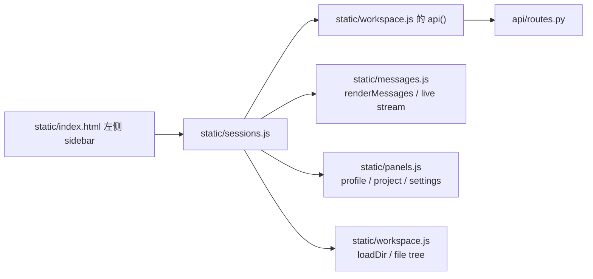
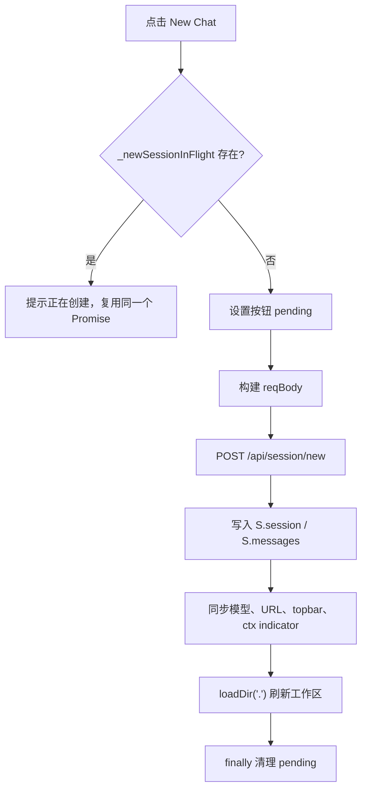
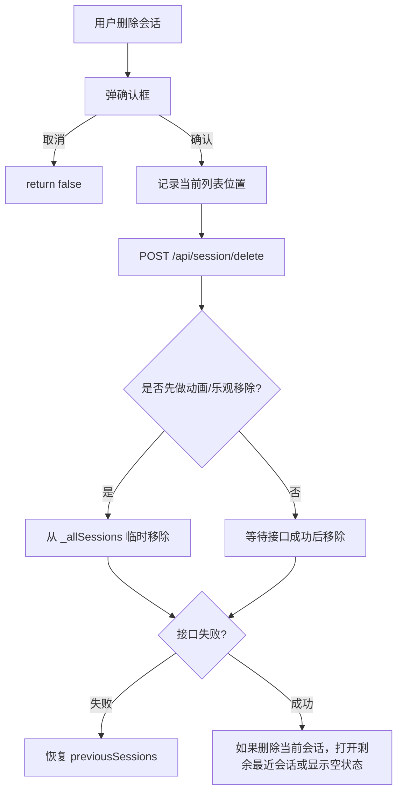

# `static/sessions.js` 精读与 JS 提升指南

本文面向正在学习前端工程代码的初级 Web 工程师，目标是用“资深前端导师带读”的方式理解 `static/sessions.js`。

`sessions.js` 当前约 5300 行，不适合从第 1 行机械读到最后一行。更好的方式是先看它在项目中的职责，再按业务模块拆解，最后回到关键函数逐行精读。

## 1. 文件整体功能与项目定位

`static/sessions.js` 是 Hermes WebUI 的 **会话系统前端控制器**。它负责管理左侧会话列表、当前会话加载、会话搜索、项目分组、会话归档/删除/置顶/重命名、消息分页加载、跨页面同步、SSE 实时刷新、移动端手势、工作区 worktree 删除等逻辑。

可以把它理解成这几个角色的组合：

| 角色 | 说明 |
|---|---|
| 会话路由器 | 根据 URL、localStorage、用户点击，决定当前打开哪个 session |
| 会话数据管理器 | 调 `/api/session`、`/api/sessions`、`/api/projects` 等接口，同步 `S.session`、`S.messages` |
| 侧边栏渲染器 | 把 `_allSessions` 渲染成左侧会话列表，支持分组、搜索、虚拟列表 |
| 用户交互控制器 | 处理点击、双击、长按、滑动、右键菜单、批量选择 |
| 实时同步器 | 通过 SSE 和轮询刷新会话列表、Gateway 会话、外部更新 |
| 本地状态缓存层 | 使用 `localStorage`、`sessionStorage` 记录草稿、未读、折叠状态、筛选项 |

它在项目中的位置：



这个文件不是“纯 UI 文件”，它同时处理业务状态、网络请求、DOM 渲染、性能优化和复杂交互。因此阅读它能很好地训练真实项目中的 JS 能力。

## 2. 推荐阅读路线

建议不要按物理行号直接通读，而是按下面顺序：

| 阶段 | 重点 | 推荐先读 |
|---|---|---|
| 第 1 遍 | 知道这个文件管什么 | 全局变量、`newSession()`、`loadSession()`、`renderSessionList()` |
| 第 2 遍 | 理解数据如何流动 | `/api/session`、`/api/sessions`、`_allSessions`、`S.session`、`S.messages` |
| 第 3 遍 | 理解复杂交互 | 搜索、虚拟列表、SSE、手势、批量操作 |
| 第 4 遍 | 学习工程技巧 | 竞态保护、乐观更新、防抖、节流、DOM 性能、错误兜底 |

## 3. 模块拆分总览

| 模块 | 大致位置 | 核心函数/变量 | 业务作用 |
|---|---:|---|---|
| 图标与加载保护 | 1-35 | `ICONS`、`_loadingSessionId` | 会话操作图标，防止异步加载串台 |
| Composer 草稿 | 36-157 | `_saveComposerDraft()`、`_restoreComposerDraft()` | 保存/恢复输入框草稿 |
| 未读与流状态 | 158-515 | `_sessionViewedCounts`、`_hasUnreadForSession()` | 识别新完成消息、流式会话状态 |
| 新建/加载会话 | 516-1042 | `newSession()`、`loadSession()` | 创建会话、切换会话、恢复流式状态 |
| 跨渠道 handoff 提示 | 1043-1459 | `_checkAndShowHandoffHint()` | 消息平台会话达到阈值后提示迁移/总结 |
| 消息分页加载 | 1460-1859 | `_ensureMessagesLoaded()`、`_loadOlderMessages()` | 快速加载尾部消息，滚动加载历史 |
| 会话列表状态 | 1868-2628 | `_allSessions`、批量选择、菜单、URL | 维护侧栏缓存、项目筛选、操作菜单 |
| 列表刷新与实时同步 | 2629-3213 | `renderSessionList()`、`ensureSessionEventsSSE()` | 拉取会话列表，SSE/轮询刷新 |
| 搜索与时间格式 | 3214-3522 | `filterSessions()`、`_formatRelativeSessionTime()` | 标题/内容搜索、相对时间展示 |
| lineage/子会话折叠 | 3523-3917 | `_collapseSessionLineageForSidebar()` | 压缩链路、fork、child session 展示 |
| 虚拟列表与主渲染 | 3918-5120 | `renderSessionListFromCache()` | 高性能渲染侧栏列表、手势交互 |
| 删除、worktree、项目管理 | 5121-末尾 | `deleteSession()`、`_showProjectPicker()` | 删除会话、移除 worktree、项目增删改 |

## 4. 模块一：图标、全局状态、加载保护

### 4.1 业务作用

文件开头定义会话操作图标和几个关键状态。它们看起来简单，但很重要：

- `ICONS`：给侧边栏菜单、滑动操作、按钮使用。
- `_loadingSessionId`：防止快速切换会话时，旧请求回来覆盖新会话。
- `_pendingCarryForwardSnapshot`：在强制刷新当前会话时，保留临时 UI 字段，例如 token 用量徽章。

### 4.2 关键代码逐行讲解

```javascript
const ICONS = {
  stop: '<svg ...></svg>',
  pin: '<svg ...></svg>',
  more: '<svg ...></svg>',
};
```

逐行理解：

- `const ICONS = { ... }`：使用对象集中管理图标字符串，调用处可以通过 `ICONS.pin` 取图标。
- 每个属性值是 SVG 字符串，后面会通过 `innerHTML` 插入 DOM。
- 这是一种轻量做法，符合本项目“无构建链、原生 JS”的技术路线。

高级知识点：

- **对象字面量**：用键值对维护 UI 资源。
- **模板化资源集中管理**：避免每个按钮散落一份 SVG。
- **安全注意**：这里的 SVG 是静态内置字符串，风险较低。如果 SVG 来自用户输入，就不能直接 `innerHTML`。

```javascript
let _loadingSessionId = null;
```

逐行理解：

- `let` 表示这个值会变化。
- 初始为 `null`，代表当前没有会话加载请求。
- `loadSession(sid)` 开始时会设置为当前 sid。
- 异步请求回来后会检查 `_loadingSessionId !== sid`，如果不一致，说明用户已经切到别的会话，旧响应要丢弃。

高级知识点：

- **异步竞态保护**：这是大型前端应用非常常见的模式。
- **可变模块级状态**：因为项目没有使用 React/Vue store，这类变量就承担了 store 的一部分职责。

优秀写法：

- 用一个简单 token 解决“慢请求覆盖快请求”的问题。
- 逻辑成本低，但效果非常关键。

可优化点：

- 如果未来模块化重构，可以把这些状态收敛到 `SessionController` 或 `SessionStore`，减少全局变量数量。

## 5. 模块二：Composer 草稿保存与恢复

### 5.1 业务作用

用户在一个会话里输入了一段文字，还没发送就切换到另一个会话。这个模块负责：

- 离开会话前保存草稿到后端。
- 再次打开会话时恢复草稿。
- 新建空会话时记住“这个空会话有草稿”，刷新后还能找回来。

涉及 API：

| API | 用途 |
|---|---|
| `GET /api/session?messages=0` | 获取会话元数据和草稿 |
| `POST /api/session/draft` | 保存/清空草稿 |

### 5.2 `_isRestorableNewChatDraftSession()` 逐行讲解

```javascript
function _isRestorableNewChatDraftSession(session, requireDraft=false) {
  if (!session || !session.session_id) return false;
  const messageCount = Number(session.message_count || 0);
  if (messageCount !== 0) return false;
  if (session.active_stream_id || session.pending_user_message || session.worktree_path) return false;
  const title = session.title || 'Untitled';
  if (title !== 'Untitled' && title !== 'New Chat') return false;
  const activeProfile = S.activeProfile || 'default';
  const sessionProfile = session.profile || 'default';
  if (sessionProfile !== activeProfile) return false;
  if (!requireDraft) return true;
  const draft = session.composer_draft || {};
  const text = (typeof draft.text === 'string') ? draft.text : '';
  const files = Array.isArray(draft.files) ? draft.files : [];
  return !!(text || files.length);
}
```

逐行理解：

- `function ...`：定义一个判断函数，只返回 true/false。
- `requireDraft=false`：默认参数。调用者可以要求“必须真的有草稿”。
- `if (!session || !session.session_id)`：没有会话对象或没有 ID，不能恢复。
- `Number(session.message_count || 0)`：把消息数转成数字，防止后端给字符串。
- `messageCount !== 0`：只有 0 消息的新会话才适合当草稿会话恢复。
- `active_stream_id`、`pending_user_message`、`worktree_path`：如果正在运行、有待发送消息、或绑定 worktree，就不是普通空草稿。
- `title` 判断：只允许默认标题，避免恢复到用户已命名的正式会话。
- `S.activeProfile`：当前 Profile，来自全局应用状态。
- `session.profile !== activeProfile`：避免跨 Profile 恢复错误草稿。
- `if (!requireDraft) return true`：只判断“是否可恢复”时，到这里就够了。
- `draft`、`text`、`files`：取出草稿内容。
- `return !!(text || files.length)`：双感叹号把值转成布尔值。

高级知识点：

- **默认参数**：`requireDraft=false`。
- **短路返回**：用多个 `if return` 让校验逻辑清楚。
- **类型防御**：`Number()`、`typeof`、`Array.isArray()`。
- **全局状态依赖**：读取 `S.activeProfile`。

优秀写法：

- 这个函数把“什么样的新会话草稿可以恢复”封装成单一规则。
- 规则从宽到严排列，读起来像一张业务检查清单。

可优化点：

- 函数依赖全局 `S`，单元测试会不方便。未来可以传入 `activeProfile`。

### 5.3 `_saveComposerDraft()` 逐行讲解

```javascript
function _saveComposerDraft(sid, text, files) {
  if (!sid) return;
  clearTimeout(_draftSaveTimer);
  _draftSaveTimer = setTimeout(() => {
    api('/api/session/draft', {
      method: 'POST',
      body: JSON.stringify({ session_id: sid, text: text || '', files: files || [] }),
    }).catch(() => {});
  }, _DRAFT_SAVE_DELAY_MS);
}
```

逐行理解：

- `if (!sid) return`：没有会话 ID 不保存。
- `clearTimeout(_draftSaveTimer)`：清掉上一次延迟保存。
- `setTimeout(..., 400)`：400ms 后再保存。
- 用户继续输入会不断清掉旧 timer，只保留最后一次保存。
- `api('/api/session/draft', ...)`：调用后端保存草稿。
- `method: 'POST'`：这是修改操作。
- `JSON.stringify(...)`：把 JS 对象转成 JSON 字符串。
- `.catch(() => {})`：保存草稿失败不打断用户输入。

高级知识点：

- **防抖 debounce**：输入频繁变化时，延迟执行最后一次请求。
- **闭包**：`setTimeout` 回调能访问 `sid/text/files`。
- **异步错误吞掉**：对非关键路径做静默失败。

优秀写法：

- 草稿保存不阻塞 UI。
- 用防抖保护后端，避免每敲一个字就发一次请求。

可优化点：

- 静默失败虽然不打扰用户，但调试时不明显。可以只在开发模式下 `console.warn`。

## 6. 模块三：未读状态与流式状态

### 6.1 业务作用

侧边栏需要知道：

- 这个会话用户看过多少条消息。
- 后台会话是否刚完成了一次回复。
- 某个会话是否仍在 streaming。
- 会话列表刷新时，哪些状态要保留，哪些要清理。

核心状态：

```javascript
const SESSION_VIEWED_COUNTS_KEY = 'hermes-session-viewed-counts';
const SESSION_COMPLETION_UNREAD_KEY = 'hermes-session-completion-unread';
const SESSION_OBSERVED_STREAMING_KEY = 'hermes-session-observed-streaming';
let _sessionViewedCounts = null;
let _sessionCompletionUnread = null;
let _sessionObservedStreaming = null;
const _sessionStreamingById = new Map();
const _sessionListSnapshotById = new Map();
```

逐行理解：

- 三个 `*_KEY` 是 localStorage 的 key。
- `_sessionViewedCounts`：记录用户看到过每个 session 的消息数量。
- `_sessionCompletionUnread`：记录后台完成但用户还没看的会话。
- `_sessionObservedStreaming`：记录浏览器观察到正在流式输出的会话。
- `_sessionStreamingById`：运行时 Map，记录会话是否 streaming。
- `_sessionListSnapshotById`：保存列表刷新前后的快照，用于判断变化。

高级知识点：

- **localStorage 缓存**：刷新页面后仍保留未读状态。
- **Map**：比普通对象更适合存动态 key，尤其 key 不一定是简单字段名。
- **懒加载缓存**：第一次读取 localStorage 后存在内存变量里。

### 6.2 `_getSessionViewedCounts()` 逐行讲解

```javascript
function _getSessionViewedCounts() {
  if (_sessionViewedCounts !== null) return _sessionViewedCounts;
  try {
    const parsed = JSON.parse(localStorage.getItem(SESSION_VIEWED_COUNTS_KEY) || '{}');
    _sessionViewedCounts = parsed && typeof parsed === 'object' && !Array.isArray(parsed) ? parsed : {};
  } catch (_){
    _sessionViewedCounts = {};
  }
  return _sessionViewedCounts;
}
```

逐行理解：

- 如果内存里已经有值，直接返回，避免重复解析 JSON。
- `try/catch` 防止 localStorage 里有坏 JSON。
- `JSON.parse(... || '{}')`：没有值时按空对象处理。
- `typeof parsed === 'object' && !Array.isArray(parsed)`：确保结果是普通对象。
- 解析失败时回退为空对象。

高级知识点：

- **懒初始化**。
- **异常兜底**。
- **本地持久化数据不可信**：即使是自己写入的 localStorage，也要防御损坏。

优秀写法：

- 这是前端状态恢复的标准写法，可以直接学习。

## 7. 模块四：新建会话 `newSession()`

### 7.1 业务作用

`newSession()` 负责点击“New Chat”后的完整流程：

1. 防止重复点击创建多个会话。
2. 收集当前 workspace、profile、project、model。
3. 调 `/api/session/new` 创建会话。
4. 更新全局状态 `S.session`、`S.messages`。
5. 更新 URL、顶部栏、上下文 token 指示器、文件树。
6. 不直接刷新会话列表，由调用者决定。

### 7.2 关键状态机



### 7.3 `_newSessionInFlight` 逐行讲解

```javascript
let _newSessionInFlight = null;

async function newSession(flash, options={}) {
  if (_newSessionInFlight) {
    if (typeof showToast === 'function') showToast(_newSessionPendingText(), 1500);
    return _newSessionInFlight;
  }
  _setNewSessionPending(true);
  _newSessionInFlight = (async () => {
    ...
  })();
  try {
    return await _newSessionInFlight;
  } finally {
    _newSessionInFlight = null;
    _setNewSessionPending(false);
  }
}
```

逐行理解：

- `_newSessionInFlight` 保存“正在创建会话”的 Promise。
- 如果用户重复点击，直接返回同一个 Promise，而不是再发请求。
- `_setNewSessionPending(true)` 禁用按钮并显示状态。
- `(async () => { ... })()` 是立即执行的异步函数，返回 Promise。
- `try/finally` 确保成功或失败都会清理状态。

高级知识点：

- **Promise 去重**：用一个变量缓存正在进行的异步任务。
- **IIFE 立即执行函数**：`(async () => {})()`。
- **try/finally**：异步函数中做资源释放。

优秀写法：

- 解决重复点击导致重复创建的真实问题。
- 业务逻辑失败时 pending 状态也能被恢复。

可优化点：

- `newSession()` 很长，未来可以拆成 `buildNewSessionRequest()`、`applyNewSessionResponse()`、`syncNewSessionUI()`。

## 8. 模块五：加载会话 `loadSession()`

### 8.1 业务作用

`loadSession(sid)` 是整个文件最核心的函数。它处理用户点击侧边栏会话后的完整流程：

1. 解析 lineage，可能把压缩链路里的旧 sid 映射到当前可见 sid。
2. 如果已经打开同一个会话且不是强制刷新，直接返回。
3. 保存当前会话草稿。
4. 清理当前会话的审批/澄清/流式状态。
5. 先用 `messages=0` 加载轻量元数据。
6. 再用 `_ensureMessagesLoaded()` 加载消息。
7. 如果会话正在 streaming，恢复 INFLIGHT 状态并重新挂 SSE。
8. 更新 URL、topbar、文件树、上下文 token、草稿。

### 8.2 为什么分两阶段加载

```text
Phase 1: GET /api/session?messages=0&resolve_model=0
  只拿元数据，快，适合快速切换侧栏

Phase 2: GET /api/session?messages=1&msg_limit=30
  再拿消息尾部，慢一点，但不会阻塞第一屏状态
```

这种设计是性能优化：长会话可能有很多消息，如果每次点击都立即拉全量，侧边栏切换会很卡。

### 8.3 竞态保护逐行讲解

```javascript
_loadingSessionId = sid;
...
data = await api(`/api/session?session_id=${encodeURIComponent(sid)}&messages=0&resolve_model=0`);
...
if (_loadingSessionId !== sid) return;
```

逐行理解：

- 加载开始时，把当前请求的 sid 记录下来。
- `await api(...)` 期间，用户可能又点了别的会话。
- 新的 `loadSession()` 会把 `_loadingSessionId` 改成新的 sid。
- 老请求回来后发现不匹配，就 `return`，不再写 `S.session`。

高级知识点：

- **异步请求乱序问题**：请求 A 先发、请求 B 后发，但 A 可能后回来。
- **最新请求获胜**：用 token 判断是否过期。

这是你必须掌握的真实项目 JS 能力。

### 8.4 保存草稿后再次检查

```javascript
if (currentSid && currentSid !== sid) {
  await _saveComposerDraftNow(currentSid, ($('msg') || {}).value || '', S.pendingFiles ? [...S.pendingFiles] : []);
  if (_loadingSessionId !== sid) return;
}
```

逐行理解：

- 如果从 A 会话切到 B 会话，要先保存 A 的输入框草稿。
- `_saveComposerDraftNow()` 是立即保存，不是防抖保存。
- `await` 会让出执行权，所以期间用户可能又点了 C。
- 保存回来后再次检查 `_loadingSessionId`，防止 A 的后续逻辑清掉 C 的消息。
- `S.pendingFiles ? [...S.pendingFiles] : []` 用展开拷贝数组，避免后续变动影响保存时的数据。

高级知识点：

- **await 之后必须重新判断状态**。
- **数组浅拷贝**：`[...S.pendingFiles]`。
- **DOM 读取**：`$('msg').value`。

优秀写法：

- 很多初级代码只在请求结束后检查一次，这里在每个危险 await 后都检查，质量很高。

## 9. 模块六：消息分页加载

### 9.1 业务作用

为了让长会话打开更快，初始只加载最后 30 条消息：

```javascript
const _INITIAL_MSG_LIMIT = 30;
```

当用户滚到顶部，再逐步加载更早的消息。

核心函数：

| 函数 | 作用 |
|---|---|
| `_ensureMessagesLoaded(sid)` | 如果还没有消息，加载尾部消息 |
| `_loadOlderMessages()` | 用户滚到顶部时加载更多旧消息 |
| `_ensureAllMessagesLoaded()` | 某些操作需要全量消息时使用 |
| `_mergeInflightTailMessages()` | 把流式进行中的尾部消息合并进冷加载消息 |

### 9.2 `_ensureMessagesLoaded()` 逐行讲解

```javascript
async function _ensureMessagesLoaded(sid) {
  if (S.messages && S.messages.length > 0 && S.messages[0] && S.messages[0].role) {
    _clearSameSessionForceReloadHint(sid);
    return;
  }
  const reloadLimit = _messageReloadLimitForSession(sid);
  const reloadLimitParam = reloadLimit ? `&msg_limit=${reloadLimit}` : '';
  let data;
  try {
    data = await api(`/api/session?session_id=${encodeURIComponent(sid)}&messages=1&resolve_model=0${reloadLimitParam}`);
  } finally {
    _clearSameSessionForceReloadHint(sid);
  }
  if (!data || !data.session) return;
  _messagesTruncated = !!data.session._messages_truncated;
  _oldestIdx = data.session._messages_offset || 0;
  let msgs = (data.session.messages || []).filter(m => m && m.role);
  _syncToolCallsForLoadedMessages(msgs, data.session.tool_calls);
  clearLiveToolCards();
  ...
  S.messages = msgs;
}
```

逐行理解：

- 如果 `S.messages` 已经有合法消息，说明加载过了，直接返回。
- `_messageReloadLimitForSession()` 决定要加载多少条，默认 30。
- 使用模板字符串拼 URL。
- `try/finally` 确保不管请求成功失败，都清理 reload hint。
- `if (!data || !data.session)`：处理未登录跳转或异常响应。
- `_messagesTruncated`：后端告诉前端“这里只是尾部窗口，不是全量消息”。
- `_oldestIdx`：当前最老消息在服务端完整数组里的位置。
- `filter(m => m && m.role)`：清理非法消息。
- `_syncToolCallsForLoadedMessages()`：从消息元数据重建工具调用卡片。
- `S.messages = msgs`：最后写入全局消息状态。

高级知识点：

- **幂等函数**：多次调用不会重复加载。
- **分页窗口**。
- **状态标记**：`_messagesTruncated`、`_oldestIdx`。
- **防御式过滤**。

### 9.3 `_loadOlderMessages()` 的工程价值

这个函数的重点不是“发请求”，而是处理滚动加载中的竞态：

```javascript
const startGeneration = _messagesGeneration;
...
const data = await api(...);
...
if (_messagesGeneration !== startGeneration) return;
```

逐行理解：

- 请求前记住当前消息版本号。
- 请求期间，可能发生会话切换、全量加载、强制刷新。
- 这些操作会 `_bumpMessagesGeneration()`。
- 请求回来后如果版本号变了，说明当前消息列表已不是原来的列表，不能把旧消息 prepend 上去。

高级知识点：

- **generation token**：比单个 `_loadingSessionId` 更细粒度，专门保护消息数组。
- **无限滚动竞态**：真实项目非常常见。
- **滚动位置保持**：通过 `scrollHeight` 差值修正 `scrollTop`。

优秀写法：

- 不是简单 `S.messages = [...older, ...S.messages]`，而是先确认 suffix 连续性，必要时 fallback 到旧分页接口。
- 说明作者很重视数据正确性。

## 10. 模块七：会话列表缓存、批量选择与操作菜单

### 10.1 核心状态

```javascript
let _allSessions = [];
let _renamingSid = null;
let _showArchived = false;
let _sessionSelectMode = false;
const _selectedSessions = new Set();
let _allProjects = [];
const NO_PROJECT_FILTER = '__none__';
let _activeProject = null;
```

逐行理解：

- `_allSessions`：后端 `/api/sessions` 返回的会话列表缓存。
- `_renamingSid`：正在重命名的会话。列表刷新时要避开它，防止输入框被重绘掉。
- `_showArchived`：是否显示归档会话。
- `_sessionSelectMode`：是否处于批量选择模式。
- `_selectedSessions`：用 Set 存选中的 session_id。
- `_allProjects`：项目列表缓存。
- `NO_PROJECT_FILTER`：特殊哨兵值，表示“只看未分配项目的会话”。
- `_activeProject`：当前项目筛选。

高级知识点：

- **Set**：适合保存选中集合，增删查都是 O(1)。
- **sentinel value 哨兵值**：用不可能和真实 ID 冲突的特殊值表示特殊状态。
- **UI 编辑锁**：`_renamingSid` 保护输入框不被刷新销毁。

### 10.2 批量选择函数

```javascript
function toggleSessionSelectMode(){
  _sessionSelectMode = !_sessionSelectMode;
  _selectedSessions.clear();
  renderSessionListFromCache();
}
```

逐行理解：

- 切换批量选择模式。
- 每次进入或退出都清空已选项，避免旧选择残留。
- 重新渲染侧栏，让 checkbox 显示或隐藏。

优秀写法：

- 状态变化后统一调用 `renderSessionListFromCache()`，让 UI 只由状态推导出来。

## 11. 模块八：列表刷新 `renderSessionList()`

### 11.1 业务作用

`renderSessionList()` 不是直接渲染 DOM，它负责向后端拉取数据：

```javascript
const [sessData, projData] = await Promise.all([
  api('/api/sessions' + allProfilesQS, {timeoutToast:false}),
  api('/api/projects' + allProfilesQS, {timeoutToast:false}),
]);
```

逐行理解：

- `Promise.all()` 并行请求会话和项目。
- 两个接口互不依赖，并行比串行更快。
- `timeoutToast:false` 表示列表后台刷新失败时不要频繁打扰用户。

高级知识点：

- **并行异步**：`Promise.all()`。
- **请求去重/排队**：`_renderSessionListInFlight` 和 `_renderSessionListQueuedRequest`。
- **延迟应用数据**：用户正在滚动/点击列表时，先把 payload 暂存，等空闲再应用。

### 11.2 generation 防旧响应

```javascript
const request = { opts: opts || {}, gen: ++_renderSessionListGen };
...
if (_gen !== _renderSessionListGen) return;
```

逐行理解：

- 每次刷新列表，版本号加 1。
- 请求回来后，如果自己的版本号不是最新，说明已经有更新的刷新请求。
- 旧响应直接丢弃，避免覆盖新列表。

这是非常经典的前端防竞态技巧。

### 11.3 用户交互时延迟刷新

```javascript
if (deferWhileInteracting && _isSessionListUserInteracting()) {
  _pendingSessionListPayload = {gen:_gen, sessData, projData};
  _schedulePendingSessionListApply();
  return;
}
```

逐行理解：

- 如果用户正在滚动、悬停或按住列表，就不立刻重绘。
- 先把服务端新数据保存到 `_pendingSessionListPayload`。
- 等用户空闲后再应用。

高级知识点：

- **用户体验优化**：避免点击菜单时 DOM 被刷新导致菜单消失。
- **交互空闲检测**：结合 pointer、hover、scroll 时间戳。

## 12. 模块九：SSE 与轮询同步

### 12.1 业务作用

会话列表会被很多来源改变：

- 当前浏览器发送消息。
- 另一个浏览器标签页修改会话。
- Gateway/CLI 产生新会话。
- Agent 后台完成任务。

所以 `sessions.js` 使用 SSE 和轮询组合：

| 机制 | API | 作用 |
|---|---|---|
| Session events SSE | `/api/sessions/events` | WebUI 会话列表变化 |
| Gateway SSE | `/api/sessions/gateway/stream` | CLI/Gateway 会话变化 |
| Poll fallback | `/api/sessions` | SSE 失败时兜底 |
| Active session poll | `/api/session?messages=0` | 当前会话被外部更新时刷新 |

### 12.2 `ensureSessionEventsSSE()` 逐行讲解

```javascript
function ensureSessionEventsSSE(){
  if(typeof EventSource === 'undefined') return;
  if(typeof document !== 'undefined' && document.hidden) return;
  if(_sessionEventsSSE) return;
  try{
    _sessionEventsSSE = new EventSource('api/sessions/events');
    _sessionEventsSSE.onopen = () => {
      _sessionEventsReconnectAttempt = 0;
      ...
    };
    _sessionEventsSSE.addEventListener('sessions_changed', () => {
      _scheduleSessionEventsRefresh('event');
    });
    _sessionEventsSSE.onerror = () => {
      _sessionEventsNeedsRefreshOnOpen = true;
      _closeSessionEventsSSE();
      ...
    };
  }catch(e){
    _closeSessionEventsSSE();
  }
}
```

逐行理解：

- 浏览器不支持 `EventSource` 就退出。
- 页面隐藏时不建立 SSE，节省资源。
- 如果已经有连接，就不重复建立。
- `new EventSource('api/sessions/events')` 建立同源 SSE。
- `onopen` 表示连接成功，重置重连计数。
- 收到 `sessions_changed` 事件后，不立刻刷新，而是调用 `_scheduleSessionEventsRefresh()` 做 300ms 合并。
- `onerror` 时关闭连接，按退避延迟重连。
- `catch` 捕获构造 EventSource 失败。

高级知识点：

- **SSE/EventSource**。
- **页面可见性 API**：`document.hidden`、`visibilitychange`。
- **指数退避 + jitter**：避免断线时疯狂重连。
- **事件合并**：300ms 内多次变更合并成一次刷新。

优秀写法：

- 使用相对路径 `api/sessions/events`，能兼容子路径部署。
- 页面隐藏时关闭连接，减少后台资源占用。

## 13. 模块十：搜索与高亮

### 13.1 业务作用

搜索分两层：

1. 本地快速搜索标题和 session id。
2. 防抖后调用 `/api/sessions/search` 搜索消息内容。

这样用户输入时列表能立即响应，同时又支持内容搜索。

### 13.2 `filterSessions()` 逐行讲解

```javascript
function filterSessions(){
  syncSessionSearchClear();
  const q = ($('sessionSearch').value || '').trim();
  if(q !== _lastSessionSearchQuery){
    _lastSessionSearchQuery = q;
    _hideSearchPreviewsAfterSelect = false;
  }
  renderSessionListFromCache();
  clearTimeout(_searchDebounceTimer);
  if (!q) { _contentSearchResults = []; return; }
  _searchDebounceTimer = setTimeout(async () => {
    const requestedQ = q;
    try {
      const data = await api(`/api/sessions/search?q=${encodeURIComponent(requestedQ)}&content=1&depth=5`);
      const currentQ = ($('sessionSearch').value || '').trim();
      if(currentQ !== requestedQ) return;
      ...
      renderSessionListFromCache();
    } catch(e) { /* ignore */ }
  }, 350);
}
```

逐行理解：

- `syncSessionSearchClear()` 同步清空按钮显示状态。
- 读取输入框并 trim。
- 如果搜索词变了，更新 `_lastSessionSearchQuery`。
- 立即本地渲染标题匹配结果。
- 清除旧的搜索 timer。
- 空搜索时清空内容搜索结果并返回。
- 350ms 后发内容搜索请求。
- 请求回来后再次读取当前输入框。
- 如果用户已经改了搜索词，丢弃旧结果。
- 成功后更新内容搜索结果并重新渲染。

高级知识点：

- **防抖**。
- **本地搜索 + 服务端搜索组合**。
- **请求回来后校验当前 query**，避免旧搜索结果覆盖新搜索。
- **URL 编码**：`encodeURIComponent()`。

## 14. 模块十一：时间格式与时区

### 14.1 业务作用

侧栏会显示“几分钟前、今天、昨天、本周、较早”等时间。服务器和浏览器可能不在同一时区，所以文件记录：

```javascript
let _serverTimeDelta = 0;
let _serverTz = '';
```

### 14.2 学习点

| 函数 | 学习点 |
|---|---|
| `_serverNowMs()` | 用服务器时间修正客户端时钟偏差 |
| `_formatInServerTz()` | 手动处理半小时/四十五分钟偏移时区 |
| `_sessionCalendarBoundaries()` | 计算今天、昨天、本周、上周边界 |
| `_formatRelativeSessionTime()` | 多条件分支生成相对时间文案 |

优秀写法：

- 没有简单相信浏览器时间，而是用服务端返回的 `server_time` 做补偿。
- 对印度、伊朗、尼泊尔等非整点时区做了兼容说明。

## 15. 模块十二：lineage、压缩链路与子会话

### 15.1 业务作用

Hermes 的会话可能有：

- 普通会话。
- 压缩后的 continuation。
- fork 出来的会话。
- 子 Agent / child session。
- CLI 或消息平台导入会话。

侧边栏不能简单平铺所有 session，否则会非常乱。所以这一模块负责折叠、展开和映射。

核心函数：

| 函数 | 作用 |
|---|---|
| `_sessionLineageKey()` | 判断一个会话属于哪条 lineage |
| `_collapseSessionLineageForSidebar()` | 把同一条压缩链路折叠成一行 |
| `_attachChildSessionsToSidebarRows()` | 把 child session 挂到父行下面 |
| `_resolveSessionIdFromSidebarLineage()` | 用户点击旧 segment 时解析到可打开 session |
| `_fetchLineageReportForRow()` | 本地数据不足时向后端拉完整 lineage report |

高级知识点：

- **Map 分组**。
- **树形/图形数据折叠**。
- **缓存和 inflight 去重**：`_lineageReportCache`、`_lineageReportInflight`。
- **复杂业务建模**：前端不只是展示，还要理解后端关系模型。

## 16. 模块十三：虚拟列表与主渲染

### 16.1 为什么需要虚拟列表

如果用户有几百上千个会话，直接一次性渲染所有 DOM 会卡。这个文件使用简单虚拟列表：

- 只渲染当前视口附近的行。
- 上下用 spacer 占位保持滚动高度。
- 滚动时用 `requestAnimationFrame` 合并刷新。

### 16.2 `_sessionVirtualWindow()` 逐行讲解

```javascript
function _sessionVirtualWindow(opts){
  const total = Math.max(0, Number(opts && opts.total) || 0);
  const threshold = Math.max(1, Number(opts && opts.threshold) || SESSION_VIRTUAL_THRESHOLD_ROWS);
  const itemHeight = Math.max(1, Number(opts && opts.itemHeight) || SESSION_VIRTUAL_ROW_HEIGHT);
  const buffer = Math.max(0, Number(opts && opts.buffer) || SESSION_VIRTUAL_BUFFER_ROWS);
  const viewportHeight = Math.max(itemHeight, Number(opts && opts.viewportHeight) || itemHeight * 10);
  const visibleRows = Math.max(1, Math.ceil(viewportHeight / itemHeight));
  if(total <= threshold){
    return {virtualized:false, start:0, end:total, topPad:0, bottomPad:0, itemHeight, total};
  }
  let start = Math.floor((Number(opts && opts.scrollTop) || 0) / itemHeight) - buffer;
  start = Math.max(0, Math.min(start, Math.max(0, total - visibleRows)));
  let end = Math.min(total, start + visibleRows + (buffer * 2));
  ...
}
```

逐行理解：

- `total`：总行数。
- `threshold`：超过多少行才启用虚拟列表。
- `itemHeight`：每行估算高度。
- `buffer`：视口上下多渲染几行，避免滚动白屏。
- `viewportHeight`：列表可视高度。
- `visibleRows`：当前视口能显示多少行。
- 如果总数小于阈值，不虚拟化，直接渲染全部。
- 根据 `scrollTop / itemHeight` 算出起始行。
- 用 `Math.max/min` 防止越界。
- `end` 是渲染窗口结束位置。

高级知识点：

- **虚拟滚动**。
- **数学边界保护**。
- **性能优化**：减少 DOM 节点数量。

可优化点：

- 固定行高虚拟列表实现简单，但如果行高差异很大，滚动位置会有误差。未来可考虑动态测量行高。

### 16.3 `renderSessionListFromCache()` 的职责

这个函数是真正的 DOM 渲染主入口。它做的事很多：

1. 如果正在重命名或菜单打开，跳过重绘。
2. 从 `_allSessions` 取缓存数据。
3. 应用搜索、source、profile、project、archived 过滤。
4. 处理 lineage 折叠和 child session。
5. 按 pinned 和时间分组。
6. 计算虚拟窗口。
7. 创建 DOM 节点。
8. 给每个会话绑定点击、双击、长按、滑动、右键等事件。

可以把它视为一个“原生 JS 版组件渲染函数”。

优秀写法：

- DOM 节点大多使用 `document.createElement()` 和 `textContent`，避免拼接用户内容造成 XSS。
- 把活跃会话、未读、streaming、attention 都转成 class，让 CSS 负责表现。
- 重命名时跳过重绘，保护用户输入。

可优化点：

- 函数太长，内嵌 `_renderOneSession()` 和大量手势逻辑。未来可拆成：
  - `buildSessionRows()`
  - `renderSessionGroups()`
  - `renderSessionRow()`
  - `attachSessionGestureHandlers()`

## 17. 模块十四：单行会话 `_renderOneSession()`

### 17.1 业务作用

`_renderOneSession(s)` 把一个 session 对象转成一个 DOM 行。它负责：

- 标题、时间、项目点、tag、source chip。
- pinned/worktree/fork/lineage/child 标记。
- unread/streaming/attention 状态点。
- 批量选择 checkbox。
- 三点菜单。
- 重命名输入框。
- 鼠标点击、双击。
- 移动端长按菜单、左右滑动归档/删除。

### 17.2 重命名逻辑逐行讲解

```javascript
const startRename = () => {
  if (_isReadOnlySession(s)) {
    if(typeof showToast === 'function') showToast('Read-only imported sessions cannot be renamed.', 3000);
    return;
  }
  if (_loadingSessionId && _loadingSessionId !== s.session_id) return;
  closeSessionActionMenu();
  _renamingSid = s.session_id;
  const oldTitle = s.title || 'Untitled';
  const inp = document.createElement('input');
  inp.className = 'session-title-input';
  inp.value = oldTitle;
  ...
};
```

逐行理解：

- 用箭头函数定义内部函数，它能访问当前行的 `s`、`title` 等变量。
- 只读会话不能重命名。
- 如果正在加载其他会话，避免开始编辑。
- 关闭菜单，避免菜单和输入框同时存在。
- `_renamingSid` 设置编辑锁，阻止列表刷新破坏输入框。
- 保存旧标题，用于取消或失败回滚。
- 创建 input，并填入旧标题。

高级知识点：

- **闭包**：`startRename` 捕获当前 row 的 `s`、`title`。
- **乐观 UI + 回滚**：先更新前端，失败恢复旧标题。
- **编辑锁**：用 `_renamingSid` 阻止 re-render。

### 17.3 手势交互学习点

这一段代码很长，但核心思想是一个状态机：

```javascript
let _gestureState = 'idle'; // idle | pressing | dragging | committed
```

状态含义：

| 状态 | 含义 |
|---|---|
| `idle` | 没有交互 |
| `pressing` | 用户按下但还没确定是点击、拖动、长按 |
| `dragging` | 用户移动，开始拖动或滑动 |
| `committed` | 已经触发归档/删除等动作 |

高级知识点：

- **有限状态机思想**。
- **Pointer Events + Touch Events 兼容**。
- **passive listener**：滚动相关事件用 `{passive:true}` 提升性能。
- **移动端手势判断**：根据横向/纵向位移区分滑动和滚动。
- **CSS 变量驱动动画**：通过 `el.style.setProperty('--session-swipe-offset', ...)` 让 CSS 处理视觉。

优秀写法：

- 鼠标、触屏、触控笔做了不同处理。
- 滑动动作有阈值和取消比例，避免误触。
- 删除/归档前有业务限制，例如导入会话不能直接删除。

可优化点：

- 手势代码建议拆成独立 helper，例如 `attachSwipeGesture(el, handlers)`，便于复用和测试。

## 18. 模块十五：删除会话与乐观更新

### 18.1 `deleteSession()` 业务流程



### 18.2 关键写法

```javascript
const previousSessions = _allSessions;
const deleteRequest = api('/api/session/delete', {...}).then(
  response => ({response}),
  error => ({error})
);
```

逐行理解：

- 先保存旧列表，用于失败回滚。
- 请求 Promise 不直接 throw，而是转成 `{response}` 或 `{error}`。
- 这样后续逻辑可以统一判断，不需要外层 try/catch 包住所有动画逻辑。

高级知识点：

- **乐观更新**。
- **失败回滚**。
- **Promise 错误归一化**。
- **动画与网络请求并行**。

## 19. 模块十六：项目管理

项目模块主要处理：

- 把会话移动到项目。
- 新建项目。
- 重命名项目。
- 修改项目颜色。
- 删除项目。

涉及 API：

| API | 用途 |
|---|---|
| `POST /api/session/move` | 移动会话到项目 |
| `POST /api/projects/create` | 创建项目 |
| `POST /api/projects/rename` | 重命名或改颜色 |
| `POST /api/projects/delete` | 删除项目 |

学习点：

- 动态创建 popup 菜单。
- 点击外部关闭菜单。
- 修改缓存 `_allSessions` 后立即 `renderSessionListFromCache()`。
- 和服务端保持一致后再 `renderSessionList()`。

## 20. 这个文件用到的 JS 高级知识点

| 知识点 | 文件中的体现 | 你应该掌握什么 |
|---|---|---|
| 异步函数 | `newSession()`、`loadSession()`、`renderSessionList()` | `async/await`、错误处理、finally |
| Promise 去重 | `_newSessionInFlight`、`_renderSessionListInFlight` | 防重复请求 |
| 竞态保护 | `_loadingSessionId`、`_renderSessionListGen`、`_messagesGeneration` | 旧请求不能覆盖新状态 |
| 防抖 | `_saveComposerDraft()`、`filterSessions()` | 输入型请求优化 |
| DOM 编程 | `document.createElement()`、`appendChild()` | 原生组件渲染 |
| 事件处理 | `onclick`、`addEventListener()`、pointer/touch | 冒泡、阻止传播、移动端事件 |
| SSE | `new EventSource()` | 实时消息、断线重连 |
| localStorage | 草稿、未读、折叠状态 | 本地持久化与异常兜底 |
| Map/Set | 缓存、去重、选中集合 | 动态 key 数据结构 |
| 虚拟列表 | `_sessionVirtualWindow()` | 大列表性能优化 |
| 乐观更新 | 删除/归档/新消息行 | 先改 UI，失败回滚 |
| 状态机 | 手势交互 `_gestureState` | 管理复杂交互 |
| 渐进加载 | `messages=0` 后 `messages=1` | 首屏性能优化 |
| URL 状态 | `history.pushState()`、`popstate` | 页面可分享、浏览器前进后退 |

## 21. 优秀写法总结

### 21.1 竞态保护做得非常扎实

这个文件多次在 `await` 后重新检查状态，例如：

- 加载会话后检查 `_loadingSessionId`。
- 搜索请求回来后检查当前搜索词。
- 加载旧消息后检查 `_messagesGeneration`。
- 导入 CLI 会话后检查当前 active sid。

这是大型前端代码最值得学习的地方。

### 21.2 UI 不盲目刷新

代码会避免在这些场景重绘列表：

- 用户正在重命名。
- 操作菜单打开。
- 用户正在滚动或按住侧栏。
- 页面隐藏。

这说明优秀前端代码不只是“数据来了就 render”，还要保护用户正在进行的操作。

### 21.3 性能意识强

典型表现：

- 会话详情先 `messages=0`，再加载消息。
- 长消息只加载尾部窗口。
- 会话列表超过阈值后虚拟化。
- SSE 事件做 300ms 合并。
- 输入和搜索都做防抖。

### 21.4 错误兜底比较完整

例如：

- localStorage JSON 解析失败时回退空对象。
- `/api/session` 404 时自清理 localStorage 和 URL。
- SSE 失败时走轮询 fallback。
- 删除失败时恢复之前的 `_allSessions`。

## 22. 可以优化的地方

这些不是“错误”，而是二次开发时可以逐步改善的方向：

| 问题 | 影响 | 可优化方向 |
|---|---|---|
| 文件过长 | 初学者难读，改动容易误伤 | 拆成 `sessionStore.js`、`sessionList.js`、`sessionGestures.js` |
| 全局变量较多 | 状态来源不够集中 | 建立轻量 store，统一读写 |
| `renderSessionListFromCache()` 过大 | 渲染、过滤、手势混在一起 | 拆纯数据函数和 DOM 函数 |
| 内联样式较多 | 维护主题困难 | 尽量迁移到 CSS class |
| 多处依赖全局函数 | 单元测试困难 | 通过参数注入或模块导入降低耦合 |
| 手势逻辑和业务混合 | 难复用 | 抽独立 gesture helper |

## 23. 从这个文件能学到哪些 JS 能力

你可以把它当成一套真实项目训练题：

1. **异步控制能力**

   - 会写 `async/await`。
   - 知道 `await` 后状态可能已经变了。
   - 会用 generation token 防止旧请求覆盖新状态。

2. **原生 DOM 能力**

   - 熟练创建节点、设置 class、绑定事件。
   - 知道什么时候用 `textContent`，什么时候谨慎用 `innerHTML`。
   - 能维护一个由状态驱动的 DOM 列表。

3. **状态管理能力**

   - 区分全局状态 `S`、模块缓存 `_allSessions`、本地持久化 localStorage。
   - 理解状态变化后如何触发渲染。

4. **性能优化能力**

   - 防抖。
   - 虚拟列表。
   - 分阶段加载。
   - 页面隐藏时暂停后台连接。

5. **复杂交互能力**

   - 菜单定位。
   - 双击重命名。
   - 长按菜单。
   - 左右滑动归档/删除。
   - 批量选择。

6. **工程防御能力**

   - 处理接口失败。
   - 处理页面刷新。
   - 处理多标签页。
   - 处理 SSE 断线。

## 24. 适合你的练习任务

建议按难度从低到高练：

1. **低难度：加一个会话列表字段**

   目标：在 detailed density 下显示 `workspace` 名称。

   练习点：读 session 对象、创建 DOM、拼 meta 文案。

2. **低难度：调整搜索高亮样式**

   目标：修改 `.session-search-hit` 的样式。

   练习点：理解 `_appendHighlightedText()` 和 CSS class。

3. **中等：新增一个会话筛选条件**

   目标：增加“只看未读会话”筛选。

   练习点：状态变量、过滤链、重新渲染。

4. **中等：给删除增加二次说明**

   目标：删除 worktree 会话时展示更明确的提示。

   练习点：`deleteSession()`、`showConfirmDialog()`、业务判断。

5. **较难：抽出 session row 渲染函数**

   目标：把 `_renderOneSession()` 拆成几个小函数。

   练习点：重构、闭包、事件绑定、行为保持。

6. **较难：给列表刷新增加单元测试**

   目标：测试 `_sessionVirtualWindow()`、搜索合并、lineage 折叠。

   练习点：纯函数测试、边界条件。

## 25. 通用项目代码规范与思路

从 `sessions.js` 可以总结出这类项目的通用思路：

- **先分清状态来源**：后端状态、浏览器本地状态、当前页面临时状态不要混淆。
- **所有异步回来都要确认当前上下文**：sid、query、generation 是否仍然匹配。
- **渲染函数要尽量由状态推导 UI**：不要靠 DOM 自己记业务状态。
- **用户正在操作时不要突然重绘**：重命名、菜单、滚动、长按都要保护。
- **后端接口要允许前端渐进加载**：元数据、尾部消息、全量消息分开。
- **列表类 UI 要考虑大数据量**：虚拟列表、延迟刷新、合并事件。
- **危险操作要有确认和回滚**：删除、归档、worktree 移除不能只靠一次按钮点击。
- **移动端和桌面端事件不同**：pointer、touch、mouse 的差异要单独处理。

## 26. 精读时的提问清单

读每个函数时，建议问自己：

1. 这个函数读了哪些状态？
2. 它修改了哪些状态？
3. 它会不会发请求？
4. `await` 之后有没有重新检查上下文？
5. 它是否会触发 DOM 重绘？
6. 失败时怎么处理？
7. 用户正在操作时会不会被打断？
8. 这个逻辑是业务规则、UI 规则，还是性能优化？

## 27. 最后总结

`sessions.js` 是一份非常典型的“真实项目复杂前端控制器”源码。它没有框架帮你隐藏状态变化，所以很多 JS 基础和高级能力都直接暴露出来：

- 你能看到原生 DOM 如何构建复杂 UI。
- 你能看到异步竞态在真实业务中如何发生。
- 你能看到大型列表如何做性能优化。
- 你能看到移动端手势、SSE、localStorage、URL 状态如何组合。

如果你能把这个文件按本文拆出的模块读懂，再自己完成一两个小改动，你的 JS 水平会从“会写语法”明显提升到“能维护真实前端工程”。
