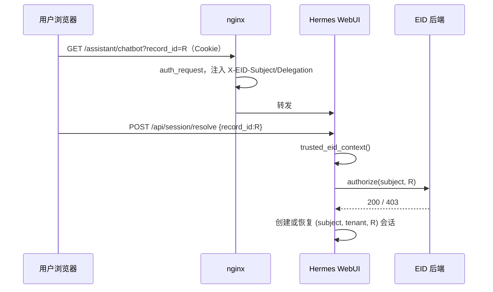

# EID 生产部署：多用户按 record 独立会话

> **Superseded / 历史方案**：本规格已被
> [008-eid-record-scoped-hermes-integration](../008-eid-record-scoped-hermes-integration/README.md)
> 取代，仅保留为历史上下文。当前实现只按 `record_id` / `profile` 分区会话，
> 不使用 EID trusted-proxy 身份头、subject/tenant、delegation token 或远端授权。
> 本文件下面的多用户授权、nginx 注入 `X-EID-Subject`、`api/eid_context.py`、
> `eid_subject` / `eid_tenant` 持久化等内容不得作为当前实现、测试或部署依据。

> **Status**: superseded | **Priority**: high | **Created**: 2026-06-15

## Overview

本规格描述如何在生产环境完成 EID 嵌入部署，使**多个真实登录用户**可以**同时**在各自
有权访问的 `record_id` 下独立聊天，且会话、业务 Skill 调用不得串号。

本规格是 [006-eid-auth-hermes-business-context](../006-eid-auth-hermes-business-context/README.md)
的**生产落地与验收**补充：006 定义领域不变量与 WebUI 守卫语义；本规格汇总已落地代码、
运维配置、Agent/Skill 部署、未完成项及可执行步骤。

### 目标拓扑（生产）

```text
https://eid.example.com/                  -> eid-web（登录 Cookie）
https://eid.example.com/api/              -> EID 后端（授权 + 业务 API）
https://eid.example.com/assistant/      -> Hermes WebUI（内网反代，不直连公网）
     └─ 聊天执行（Gateway 模式）         -> Hermes Agent Gateway :8642
          └─ ship-lighting Skill        -> EID 业务 API :5000/api/v1
```

### 参考部署参数（当前环境）

| 组件 | 地址 | 说明 |
| --- | --- | --- |
| Hermes Agent Gateway | `http://192.168.208.23:8642` | Docker，`API_SERVER_KEY` 与 WebUI 配对 |
| EID 业务 API | `http://192.168.208.23:5000/api/v1` | `ship-lighting` Skill 调用目标 |
| ship-lighting Skill 源码 | `Skills/ship-lighting/`（本仓库） | 须复制到 Agent `$HERMES_HOME/skills/` |

### 需求分层

| 层级 | 目标 | 当前状态 |
| --- | --- | --- |
| **A. 会话隔离** | 用户 A/B 同时聊不同 record，互不共享 Hermes 会话 | WebUI 已实现；依赖 nginx + EID 授权上线 |
| **B. 业务 Skill** | 按当前用户 + record 查询/修改船舶照明数据 | 脚本齐全；EID 上下文传递与专用工具未完全闭环 |

---

## User Requirements

### PR-01：多用户会话隔离（必须）

- 会话归属键：`(tenant, subject, record_id, profile)`。
- 用户 A、B 使用相同 `record_id` 时仍不得共享 Hermes 会话。
- 篡改 iframe URL 中 `record_id` 不得绕过服务端授权。
- 登出或切换账号后不得继续访问前一用户会话。

### PR-02：生产身份与代理（必须）

- `user_id` / 委托令牌不得来自 URL 或请求体。
- 反向代理认证 EID Cookie 后注入 `X-EID-Subject`、`X-EID-Tenant`（可选）、`X-EID-Delegation`。
- Hermes WebUI 只监听内网；公网仅通过 `/assistant/` 反代访问。

### PR-03：record 会话解析（必须）

- iframe：`/assistant/chatbot?record_id=<activeRecordId>`。
- 启动时 `POST /api/session/resolve` 创建或恢复当前用户在该 record 下的会话。
- record 切换（A→B→A）分别恢复对应当前用户的会话。

### PR-04：Gateway 远程 Agent（当前选型）

- WebUI 使用 `HERMES_WEBUI_CHAT_BACKEND=gateway` 将聊天转发至 `192.168.208.23:8642`。
- `HERMES_WEBUI_GATEWAY_API_KEY` 与 Agent `API_SERVER_KEY` 一致。
- Gateway 请求携带 EID 上下文头（见「已落地改动」）。

### PR-05：ship-lighting Skill（业务层）

- Skill 规范见 `Skills/ship-lighting/SKILL.md`。
- 生产禁止模型通过通用 `terminal` 直接调用 `tool_dispatcher.py`；须由服务端绑定上下文。
- 无完整可信上下文时 fail-closed（`missing_eid_delegation` 等）。

---

## 已落地改动（hermes-webui 代码）

以下改动已在仓库中实现，作为生产部署基线。

| 模块 | 改动 |
| --- | --- |
| `api/eid_context.py` | 可信身份解析、record 授权客户端、正向授权 TTL 缓存、会话归属判定 |
| `api/routes.py` | EID 请求守卫、`/api/session/resolve`、列表/搜索按用户+record 过滤；`chat/start` 从代理头读取 `delegation_token` 并传入 worker |
| `api/models.py` | Session 持久化 `eid_subject`/`eid_tenant`/`record_id`/`context_type` |
| `api/streaming.py` | in-process 路径：线程 env 注入 `HERMES_EID_SUBJECT`/`RECORD_ID`/`TENANT`/`DELEGATION`；EID 会话剥离 `SHIP_LIGHTING_RECORD_ID` |
| `api/gateway_chat.py` | Gateway 请求头：`X-EID-Subject`、`X-EID-Tenant`、`X-EID-Delegation`、`X-EID-Record-Id` |
| `api/helpers.py` | `HERMES_WEBUI_EMBED_ALLOWED_ORIGIN` 可配置 iframe 父来源 |
| `static/chatbot.html` / `boot.js` / `sessions.js` | 从 URL 读 `record_id`，调 resolve，列表作用域 |
| `.env.example` | EID、Gateway、embed origin 配置项说明 |
| `tests/test_eid_business_context.py` | 身份、授权缓存、env 注入、resolve 等回归测试 |

### 委托令牌传递路径（当前）

```text
nginx 注入 X-EID-Delegation
  → WebUI trusted_eid_context()（请求作用域，不持久化）
  → authorize_record_access()（调 EID 后端，Bearer delegation）
  → chat/start 读取 delegation → worker 参数
  → [Gateway] HTTP 头 X-EID-Delegation → Agent
  → [in-process] HERMES_EID_DELEGATION 线程 env + 子进程 os.environ
```

---

## 未完成项

### 外部依赖（非本仓库）

| ID | 项 | 负责方 | 阻塞 |
| --- | --- | --- | --- |
| EXT-01 | EID 用户登录 + HttpOnly Cookie | EID 后端 | PR-01/02 |
| EXT-02 | `POST .../hermes/authorize` 记录授权 API | EID 后端 | PR-01/03 |
| EXT-03 | 短期 `X-EID-Delegation` 签发（建议 TTL ≥10min） | EID 后端 + nginx | PR-05 |
| EXT-04 | nginx `auth_request` + 头清洗/注入 + `/assistant` 反代 | 运维 | PR-02 |
| EXT-05 | `HERMES_WEBUI_EMBED_ALLOWED_ORIGIN` 设为生产 eid-web 域名 | 运维/WebUI | iframe |
| EXT-06 | ship-lighting 复制到 Agent `$HERMES_HOME/skills/ship-lighting` | 运维 | PR-05 |
| EXT-07 | Agent `SHIP_LIGHTING_API_BASE` 环境变量 | 运维 | PR-05 |
| EXT-08 | Gateway API Key 轮换（曾出现在对话/截图中） | 运维 | 安全 |
| EXT-09 | eid-web 登录失效统一提示页 | eid-web | UX |
| EXT-10 | Agent 将 `X-EID-*` 头转为 Skill 子进程 `HERMES_EID_*` env | hermes-agent | PR-05（Gateway 路径） |

### 本仓库代码

| ID | 项 | 说明 |
| --- | --- | --- |
| CODE-01 | `EidToolContextBinder` + `eid_get_*` 服务端工具 | `SKILL.md` 规定的生产合规执行路径；当前 Skill 可能走 terminal，不符合规则 3 |
| CODE-02 | Gateway/Runner 与 in-process 一致的运行时上下文契约测试 | 规格 006 Plan 未勾选项 |
| CODE-03 | `/api/session/resolve` 并发去重锁 | 可选；并发首次加载可能各建一会话 |
| CODE-04 | `boot.js` 解析失败统一错误页 | 当前仅 console 警告 |
| CODE-05 | EID 模式下禁用 `/api/session/import*` 或补归属标记 | 导入会话对 EID 用户不可见 |
| CODE-06 | 更新 spec 006 Implementation Notes 中「委托令牌未传递」表述 | 已与 CODE 基线部分不符 |

---

## Design

### 会话隔离（层级 A）数据流



### 业务 Skill（层级 B）目标数据流

```text
LLM → Hermes EID 专用工具（eid_ship_*）
        → EidToolContextBinder（注入 subject/record/delegation）
            → tool_dispatcher.py
                → api_client.py → EID :5000
```

Gateway 模式下 Binder 或 Agent 必须保证 `HERMES_EID_*` 进入执行 `tool_dispatcher` 的进程。

---

## Plan

### 阶段 0：安全与网络（运维，0.5 天）

- [ ] **0.1** 轮换 Agent `API_SERVER_KEY`；同步 WebUI `HERMES_WEBUI_GATEWAY_API_KEY`。
- [ ] **0.2** 确认 `8642`、`8787` 不对公网暴露；仅内网或 nginx 可达。
- [ ] **0.3** 确认 WebUI 与 Agent 容器网络可访问 `192.168.208.23:5000`。

### 阶段 1：EID 后端（EID 团队，1–3 天）

- [ ] **1.1** 实现登录态 Cookie：`HttpOnly`、`Secure`、`SameSite=Lax`、`Path=/`。
- [ ] **1.2** 实现记录授权端点（示例）：

```http
POST /api/v1/hermes/authorize
Content-Type: application/json
X-EID-Subject: <subject>
X-EID-Tenant: <tenant>          # 可选
Authorization: Bearer <delegation>  # 可选

{"record_id": "<id>"}
```

响应：`200/204` 允许；`403` 无权；`404` 不存在；`401` 登录失效。

- [ ] **1.3** 实现或对接 nginx 认证子请求，返回 `X-EID-Subject`、`X-EID-Delegation`（TTL 建议 600–900 秒）。
- [ ] **1.4** 业务 API（`:5000/api/v1`）校验 `X-EID-Subject` + `Authorization: Bearer <delegation>`。

### 阶段 2：nginx 反向代理（运维，0.5–1 天）

- [ ] **2.1** 配置 `/assistant/` → `http://127.0.0.1:8787/`（或 WebUI 内网地址）。
- [ ] **2.2** `auth_request` 验证 Cookie；**先清空**客户端 `X-EID-*` 头，再注入可信头。
- [ ] **2.3** 生产 CSP：同站点可用 `frame-ancestors 'self'`；跨子域时设置 WebUI `HERMES_WEBUI_EMBED_ALLOWED_ORIGIN=https://eid.example.com`。
- [ ] **2.4** 验证：未登录访问 `/assistant/chatbot` 返回 401/跳转登录，不得创建匿名 record 会话。

**nginx 片段（需按实际认证接口调整）：**

```nginx
location /assistant/ {
    auth_request /_eid_auth;
    auth_request_set $eid_subject $upstream_http_x_eid_subject;
    auth_request_set $eid_tenant  $upstream_http_x_eid_tenant;
    auth_request_set $eid_delegation $upstream_http_x_eid_delegation;

    proxy_set_header X-EID-Subject "";
    proxy_set_header X-EID-Tenant "";
    proxy_set_header X-EID-Delegation "";

    proxy_set_header X-EID-Subject $eid_subject;
    proxy_set_header X-EID-Tenant $eid_tenant;
    proxy_set_header X-EID-Delegation $eid_delegation;

    proxy_pass http://127.0.0.1:8787/;
}

location /_eid_auth {
    internal;
    proxy_pass http://127.0.0.1:5000/api/v1/auth/introspect;
    proxy_pass_request_body off;
    proxy_set_header Content-Length "";
    proxy_set_header Cookie $http_cookie;
}
```

### 阶段 3：Hermes WebUI 配置（运维，0.5 天）

在 WebUI `.env` 或容器环境中设置：

```bash
# EID 多用户隔离（生产必开）
HERMES_WEBUI_EID_CONTEXT=1
HERMES_WEBUI_EID_TRUST_PROXY=1
# 生产禁止：
# HERMES_WEBUI_EID_DEVELOPMENT_MODE=1

HERMES_WEBUI_EID_AUTHORIZE_URL=http://192.168.208.23:5000/api/v1/hermes/authorize
HERMES_WEBUI_EID_AUTHORIZE_TIMEOUT=5
HERMES_WEBUI_EID_AUTHORIZE_CACHE_TTL=30

HERMES_WEBUI_EMBED_ALLOWED_ORIGIN=https://eid.example.com
HERMES_WEBUI_HOST=127.0.0.1
HERMES_WEBUI_PORT=8787

# Gateway（远程 Agent）
HERMES_WEBUI_CHAT_BACKEND=gateway
HERMES_WEBUI_GATEWAY_BASE_URL=http://192.168.208.23:8642
HERMES_WEBUI_GATEWAY_API_KEY=<与 API_SERVER_KEY 相同>
```

- [ ] **3.1** 写入配置并重启 WebUI。
- [ ] **3.2** `curl http://127.0.0.1:8787/api/health/agent` 确认 `gateway_chat.enabled=true`。

### 阶段 4：Hermes Agent + ship-lighting（运维，0.5 天）

- [ ] **4.1** 确认 Gateway 健康：

```bash
curl -sS http://192.168.208.23:8642/health/detailed
curl -sS -H "Authorization: Bearer <KEY>" http://192.168.208.23:8642/health
```

- [ ] **4.2** 部署 Skill（在 Agent 宿主机或容器内）：

```bash
docker cp ./Skills/ship-lighting <AGENT_CONTAINER>:$HERMES_HOME/skills/ship-lighting
docker restart <AGENT_CONTAINER>
```

- [ ] **4.3** Agent 环境变量：

```bash
SHIP_LIGHTING_API_BASE=http://192.168.208.23:5000/api/v1
# 勿设置 SHIP_LIGHTING_RECORD_ID
# 勿设置 HERMES_WEBUI_EID_DEVELOPMENT_MODE
```

- [ ] **4.4** 基线诊断（容器内，使用真实 subject/record/delegation）：

```bash
cd $HERMES_HOME/skills/ship-lighting
HERMES_EID_SUBJECT=<subject> \
HERMES_EID_RECORD_ID=<record_id> \
HERMES_EID_DELEGATION=<delegation> \
SHIP_LIGHTING_API_BASE=http://192.168.208.23:5000/api/v1 \
python3 scripts/tool_dispatcher.py --tool get_decks --params '{}'
```

期望：`"status": "success"`。若无 delegation 应返回 `missing_eid_delegation`。

### 阶段 5：Agent EID 头传递验证（Gateway 路径，0.5–2 天）

在 **Windows PowerShell 5.1** 上测试 Gateway（避免 JSON 被 shell 破坏）：

```powershell
function Write-Utf8NoBom($Path, $Content) {
    $utf8 = New-Object System.Text.UTF8Encoding $false
    [System.IO.File]::WriteAllText($Path, $Content, $utf8)
}

Write-Utf8NoBom "request.json" '{"model":"default","stream":true,"messages":[{"role":"user","content":"ping"}]}'

curl.exe -sS -N `
  -H "Authorization: Bearer <GATEWAY_API_KEY>" `
  -H "Content-Type: application/json" `
  -H "Accept: text/event-stream" `
  -H "X-EID-Subject: <subject>" `
  -H "X-EID-Record-Id: <record_id>" `
  -H "X-EID-Delegation: <delegation>" `
  --data-binary "@request.json" `
  http://192.168.208.23:8642/v1/chat/completions
```

| 工具结果 | 判定 | 下一步 |
| --- | --- | --- |
| `success` | Agent 已传递 EID 上下文 | 进入阶段 6 |
| `missing_eid_delegation` | Agent 未传 env | **EXT-10**：hermes-agent 补丁或 **CODE-01** |
| 无 tool 调用 | Skill 未加载或模型未路由 | 检查阶段 4 |

### 阶段 6：eid-web 集成（前端，0.5–1 天）

- [ ] **6.1** iframe：`<iframe src="/assistant/chatbot?record_id={{activeRecordId}}">`。
- [ ] **6.2** `activeRecordId` 仅来自用户有权 record 列表。
- [ ] **6.3** 切换 record 时重新加载 iframe 或触发 resolve。
- [ ] **6.4** 登录失效时展示重新登录（非空白 iframe）。

### 阶段 7：WebUI 代码补齐（开发，2–5 天，PR-05 合规）

若阶段 5 失败或需符合 `SKILL.md` 规则 3：

- [ ] **7.1** 实现 `api/eid_tool_binder.py`（或等价模块）：
  - 从 `TrustedEidContext` + Session 组装上下文；
  - 拒绝模型传入 `record_id`/`user_id`/`delegation_token`；
  - 为子进程设置 `HERMES_EID_*` 后调用 `tool_dispatcher.py`。
- [ ] **7.2** 注册服务端工具（示例命名）：`eid_ship_query`、`eid_ship_update`；公开参数不含 EID 字段。
- [ ] **7.3** Gateway 模式：与 hermes-agent 约定工具执行契约，或短期改用 in-process 跑 EID 工具。
- [ ] **7.4** 更新 `Skills/ship-lighting/SKILL.md` 中工具调用说明指向已注册工具名。
- [ ] **7.5** 增加集成测试：双用户双 record 并发 + Skill mock。

---

## Test

### 会话隔离（层级 A，必须全部通过）

- [ ] 用户 A、B 同时登录，各打开不同 record，`session/resolve` 均 200，且 `session_id` 不同。
- [ ] 用户 A 篡改 URL 为 B 的 `record_id` → `403`，不得进入 B 的会话。
- [ ] 用户 A、B 使用相同 `record_id` → 仍各用独立 Hermes 会话。
- [ ] A 执行 record-A → record-B → record-A，恢复 A 在两条 record 上的历史会话。
- [ ] 登出 A 后以 B 登录 → 看不到 A 的会话列表与消息。
- [ ] 浏览器 API 响应不含 `eid_subject`/`eid_tenant`。

### Gateway 与 Skill（层级 B）

- [ ] `ping.json` Gateway 请求返回有效 JSON/SSE（非 `Invalid JSON`）。
- [ ] 阶段 4 手动 env：`get_decks` → `success`。
- [ ] 阶段 5 Gateway + EID 头：工具结果 `success` 或记录明确阻塞原因。
- [ ] 无 `record_id` 的普通聊天不执行 record 业务工具。
- [ ] 委托令牌不出现在会话 JSON、SSE 正文、日志（抽样检查）。

### 安全

- [ ] Hermes `8787`、`8642` 无公网直连。
- [ ] 生产未开启 `HERMES_WEBUI_EID_DEVELOPMENT_MODE`。
- [ ] `API_SERVER_KEY` 已轮换且与 WebUI 一致。

---

## 验收判定矩阵

| 阶段 1–3 + 会话测试 | 阶段 4–5 Skill 测试 | 结论 |
| --- | --- | --- |
| 全部通过 | `success` | **可上线**：多用户多 record + 业务查询 |
| 全部通过 | `missing_eid_*` | **可上线普通聊天**；业务 Skill 待 EXT-10 或 CODE-01 |
| 授权/代理失败 | — | **不可上线**；先修 EID/nginx |

---

## Notes

### 与规格 006 的关系

- **006**：领域模型、不变量、WebUI 守卫与接口契约（权威需求）。
- **007**：生产部署步骤、环境参数、Agent 验证清单、未完成项与验收矩阵（本文件）。

### 决策记录

- 选用 Gateway 模式对接已部署的 `192.168.208.23:8642`，WebUI 与 Agent 可分机部署。
- ship-lighting 源码保留在本仓库 `Skills/ship-lighting/`，运行时须同步至 Agent `HERMES_HOME/skills/`。
- 在 `EidToolContextBinder` 完成前，Gateway 路径依赖 Agent 传递 `X-EID-*`；否则业务层 fail-closed 符合 `SKILL.md` 预期。
- Windows 验证 Gateway 时须用 `Write-Utf8NoBom` + `--data-binary @file.json`，避免 PowerShell 5.1 破坏 JSON。

### 待用户反馈的验证结果模板

```text
Agent 容器名:
HERMES_HOME:
阶段1 Gateway: [通过/失败]
阶段2 Skill部署: [通过/失败]
阶段4 手动env: [success / missing_eid_delegation / 其他]
阶段5 Gateway+EID头: [success / missing_eid_delegation / 无tool / 其他]
阶段6 用户A/B resolve: [200/403]
阶段6 A篡改B record: [403/其他]
```
