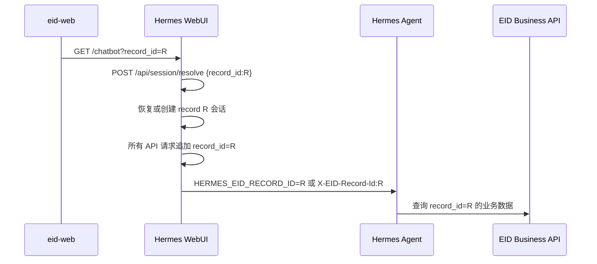

# EID 按 record 集成 Hermes WebUI

> **Status**: in-progress · **Priority**: high · **Created**: 2026-06-15

## Overview

EID 集成 Hermes WebUI 时不引入用户登录、用户身份、租户、ACL 或委托令牌。
EID 页面只通过 iframe URL 传入当前 `record_id`，Hermes 按该值创建、恢复、
展示和运行会话。

本规格取代 006 和 007。旧规格中的 `user_id`、`eid_subject`、`eid_tenant`、
可信代理头、登录 Cookie、delegation 和 `/hermes/authorize` 不再属于当前需求。

```text
eid-web
  -> /assistant/chatbot?record_id=<activeRecordId>
  -> Hermes WebUI
       -> record_id 对应的会话列表和会话详情
       -> Agent / ship-lighting 使用同一个 record_id 查询业务数据
```

## User Requirements

### UR-01：只传 record_id

- EID iframe 只传 `record_id`，不传 `user_id`、token 或 tenant。
- `record_id` 格式为 1–128 位字母、数字、下划线或连字符。
- Hermes 不调用 EID 登录、用户查询或 record 授权接口。

### UR-02：按 record 分区会话

- 会话分区键为 `(record_id, profile)`。
- 打开 record A 时只展示 A 的 Hermes 会话。
- 打开 record B 时只展示 B 的 Hermes 会话。
- A -> B -> A 时恢复各自最近的未归档会话。
- 不同 record 不得在正常 UI 流程中混合列表、详情或聊天操作。

### UR-03：创建和恢复

- `POST /api/session/resolve` 接收 `record_id`。
- 存在当前 record/profile 的未归档会话时恢复最近一条。
- 不存在时创建新会话并持久化 `record_id` 和 `context_type=eid-record`。
- `force_new=true` 时归档当前 record/profile 的候选并创建新会话。

### UR-04：无 record 的 chatbot 阻断

- `/chatbot` 缺少 `record_id` 时不得降级为普通聊天。
- 页面必须显示明确的错误提示，说明当前助手必须绑定业务记录后才能聊天。
- composer、新建会话、发送和 record-scoped session list/search 请求必须停止。
- 非法 `record_id` 使用相同阻断态，并显示格式错误描述。
- 普通非嵌入 WebUI `/` 仍支持不绑定 record 的普通聊天。

### UR-05：业务数据查询

- Agent 运行时获得 `HERMES_EID_RECORD_ID`。
- Gateway 请求携带 `X-EID-Record-Id`。
- ship-lighting 调度器自动把服务端 record 注入 API 参数。
- 模型或用户工具参数不能覆盖 `record_id`。
- EID 业务 API 根据传入 `record_id` 返回对应详细数据，不要求用户令牌。

## Domain Model

```text
EidRecordContext {
  record_id
}

HermesSession {
  session_id,
  record_id,
  profile,
  context_type = "eid-record"
}
```

领域不变量：

- `record_id` 是会话与业务数据的路由键。
- 新流程不创建或读取 EID 用户身份。
- Session 不再创建或持久化历史 `eid_subject`、`eid_tenant` 字段；旧文件中的同名键只按兼容输入忽略。
- 正常嵌入 UI 通过 `api()` 发起的 JSON API 请求自动携带当前 `record_id`。
- 请求 record 与目标 Session 不一致时返回 `404`。
- `/chatbot` 无 `record_id` 或非法 `record_id` 时不创建、不恢复、不列出会话。
- Skill 只接受服务端运行上下文中的 record，不接受模型提供的 record。

## Design

### 浏览器流程



### 接口

```http
POST /api/session/resolve?record_id=record-a
Content-Type: application/json

{
  "record_id": "record-a",
  "profile": "default",
  "force_new": false
}
```

成功响应：

```json
{
  "session": {
    "session_id": "...",
    "record_id": "record-a",
    "context_type": "eid-record"
  },
  "created": false
}
```

列表和搜索：

```http
GET /api/sessions?record_id=record-a
GET /api/sessions/search?q=light&record_id=record-a
```

### 配置

```env
HERMES_WEBUI_EID_RECORD_CONTEXT=1
HERMES_WEBUI_EMBED_ALLOWED_ORIGIN=https://eid.example.com
```

`turnNotifyEnabled` 随 `HERMES_WEBUI_EID_RECORD_CONTEXT=1` 自动开启；每轮 SSE `done` 后 iframe 向父页面发送 `hermes.chat.turn.completed` postMessage（详见 [spec 012](../012-eid-turn-complete-postmessage/README.md)）。

不再需要：

```text
HERMES_WEBUI_EID_CONTEXT
HERMES_WEBUI_EID_TRUST_PROXY
HERMES_WEBUI_EID_DEVELOPMENT_MODE
HERMES_WEBUI_EID_DEVELOPMENT_SUBJECT
HERMES_WEBUI_EID_AUTHORIZE_URL
HERMES_WEBUI_EID_AUTHORIZE_TIMEOUT
HERMES_WEBUI_EID_AUTHORIZE_CACHE_TTL
X-EID-Subject / X-EID-Tenant / X-EID-Delegation
```

### 明确的安全边界

`record_id` 不是密码，也不是授权凭证。该方案不阻止调用方猜测或修改
`record_id`。它适用于可信内网、受控入口或数据本身不要求用户级隔离的部署。
如果未来需要防止不同用户互相访问 record，必须新增身份认证与资源授权规格，
不能把本方案的 record 分区当作安全隔离。

## Plan

- [x] 新增 `HERMES_WEBUI_EID_RECORD_CONTEXT` 配置开关。
- [x] `/api/session/resolve` 改为只按 record/profile 创建或恢复。
- [x] 会话列表与搜索改为只按 record 过滤。
- [x] 嵌入页 API 请求自动追加当前 record。
- [x] 会话详情和修改操作校验请求 record 与 Session record 一致。
- [x] Native Agent 只注入 `HERMES_EID_RECORD_ID`。
- [x] Gateway 只发送 `X-EID-Record-Id`。
- [x] ship-lighting 移除身份和 delegation 前置条件。
- [x] `/chatbot` 缺少或非法 `record_id` 时显示阻断态，不降级普通聊天。
- [x] 更新环境变量、架构说明和变更日志。
- [ ] 验证实际 Gateway 是否把 `X-EID-Record-Id` 传入 Skill 子进程。

## Test

- [x] record A 首次打开创建会话。
- [x] record A 再次打开恢复最近会话。
- [x] record A 与 record B 的会话列表互不混合。
- [x] 使用 record B 请求 record A 的 session detail 返回 `404`。
- [x] force_new 为当前 record 创建新会话并归档旧候选。
- [x] `/chatbot` 无 `record_id` 时显示错误描述，禁用 composer / 新建 / 发送，并且不发 session-list 请求。
- [x] `/chatbot` 非法 `record_id` 时显示格式错误描述，禁用 composer / 新建 / 发送。
- [x] 普通 WebUI `/` 仍可创建非 record 普通聊天。
- [x] Native Agent 中 `HERMES_EID_RECORD_ID` 等于 iframe record。
- [ ] Gateway 中 ship-lighting 能收到并使用相同 record。
- [x] 工具参数显式传入 `record_id` 时被拒绝。
- [x] 无 record 上下文时业务工具返回 `missing_record_context`。

## Notes

- 旧 Session 文件中的 `eid_subject`、`eid_tenant` 键不再进入运行时模型，后续保存会自然清理。
- 新会话不写入上述身份字段，匹配逻辑只使用 `record_id`。
- `record_id` 继续持久化到 Session sidecar 和索引，便于列表快速过滤。
