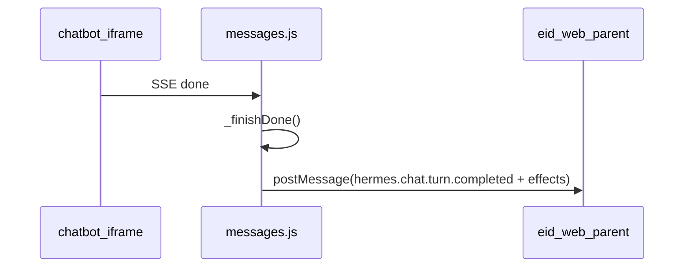

# EID 轮次完成 postMessage 通知

> **Status**: complete · **Priority**: high · **Created**: 2026-06-22

## Overview

当 Hermes `/chatbot` 以 iframe 嵌入 eid-web 时，每轮对话在 SSE `done`（模型回复完成且会话已落盘）后，
向父页面发送 `postMessage`。eid-web 监听该事件；只要事件通过 origin、source、record 与协议版本校验，
就调用自身的「更新数据」接口刷新业务 UI。不再区分本轮是否执行查询或更新操作。

Hermes 不直连 EID 业务 API；刷新逻辑与鉴权留在 eid-web 侧。

## Approval

**结论：批准。**

本方案可以作为 008 record-only 集成的补充方案进入联调/交付，批准范围限定为：

- iframe 内部只在一轮聊天收到 SSE `done` 后发送完成通知。
- 通知只作为父页面刷新业务数据的触发器，不携带聊天正文、工具参数、token 用量或业务详情。
- 每个成功完成的助手回合都触发画布刷新，不再按查询/更新或工具接口类型过滤。
- Hermes WebUI 不调用 EID 业务刷新接口，不新增 EID 鉴权、登录或授权流程。
- 父页面必须同时校验 `event.origin`、`data.type`、`data.version` 和当前 `record_id`。

批准前提：

- 生产环境显式设置 `HERMES_WEBUI_EMBED_ALLOWED_ORIGIN` 为实际 eid-web 父页面 origin。
- `postMessage` 禁止使用 `'*'`；缺少 target origin 时静默不发送。
- 该通知不被当作安全授权依据；`record_id` 仍只是 record-only 路由键，不是凭证。

## Message Protocol

### `hermes.chat.turn.completed` v1

每轮 `done` 后由 iframe 内的 `notifyEidParentTurnCompleted()` 发送：

```json
{
  "type": "hermes.chat.turn.completed",
  "version": 1,
  "record_id": "ship-001",
  "session_id": "abc123",
  "message_count": 8,
  "completed_at": 1719000000.123,
  "effects": {
    "canvas_updated": true
  },
  "refresh_targets": ["canvas"]
}
```

| 字段 | 说明 |
|---|---|
| `type` | 固定 `hermes.chat.turn.completed` |
| `version` | 协议版本，当前为 `1` |
| `record_id` | 当前嵌入 iframe 的业务记录 ID |
| `session_id` | 完成轮次的 Hermes 会话 ID |
| `message_count` | 会话消息条数（元数据，不含正文） |
| `completed_at` | Unix 秒时间戳 |
| `effects.canvas_updated` | 固定为 `true`，表示父页面应刷新画布数据 |
| `refresh_targets` | 固定包含 `canvas` |

**不包含**：用户输入、助手全文、token 用量、tool 参数、具体工具名或业务字段。

字段约束：

- `record_id` 必须与 `__HERMES_CHATBOT_CONTEXT__.recordId` 一致，否则不发送。
- `session_id` 为空时不发送。
- `message_count` 仅用于父页面调试、去重或审计提示，不应作为业务数据版本号。
- `completed_at` 是客户端发送时刻；父页面不得把它当作服务端落盘时间。
- `effects.canvas_updated` 只表达“完成后刷新画布数据”，不表达具体修改内容。
- `refresh_targets` 是父页面刷新提示，不是授权或事务证明。

### 完成即刷新

Hermes WebUI 不再根据当前回合完成的工具调用推导画布刷新标记。只要收到 SSE `done`
并完成本地会话收尾，就发送 `hermes.chat.turn.completed`，且 payload 固定表示父页面应刷新画布：

```json
{
  "effects": { "canvas_updated": true },
  "refresh_targets": ["canvas"]
}
```

工具参数校验失败、工具执行报错或用户取消确认不会阻止回合完成通知；只要最终进入 SSE `done`
路径，eid-web 就刷新当前 `record_id` 的画布数据。`cancel` / `error` 等没有 `done` 的路径仍不发送。

### 不发送的场景

- `cancel` / `apperror` / `error` 终止（无 `done`）
- 非 iframe 访问（`window.parent === window`）
- `HERMES_WEBUI_EID_RECORD_CONTEXT` 未启用（`turnNotifyEnabled: false`）
- 无有效 `record_id` 或 `recordBlocked`
- `parentPostMessageOrigin` 为空
- 完成会话缺少 `session_id`

### 非目标

- 不定义父页面的刷新接口、重试策略或业务数据缓存策略。
- 不新增 iframe -> parent 的 ACK / RPC 通道。
- 不把 WebUI 的会话内容同步给 eid-web。
- 不处理跨用户授权；如未来需要用户级隔离，必须新增独立安全规格。

## Hermes Implementation



### Runtime Flow

1. `/chatbot` 渲染时注入 `__HERMES_CHATBOT_CONTEXT__`：
   - `recordId`
   - `recordBlocked`
   - `parentPostMessageOrigin`
   - `turnNotifyEnabled`
2. `static/eid_embed.js` 在 `static/messages.js` 之前加载，提供
   `notifyEidParentTurnCompleted(payload)`。
3. `messages.js` 在 SSE `done` 路径中固定设置 `canvasUpdated:true`。
4. `messages.js` 收到 SSE `done`，在 `_finishDone()` 完成会话本地收尾后调用
   `notifyEidParentTurnCompleted()`。
5. `eid_embed.js` 重新校验 record、session、iframe 和 target origin，随后向
   `window.parent` 发送 v1 事件。

| 文件 | 职责 |
|---|---|
| `static/eid_embed.js` | `notifyEidParentTurnCompleted()` 封装 |
| `static/messages.js` | `_finishDone()` 尾部调用 |
| `static/chatbot.html` | 引入 `eid_embed.js`；`__HERMES_CHATBOT_CONTEXT__` 含 `parentPostMessageOrigin`、`turnNotifyEnabled` |
| `api/routes.py` | 渲染 `/chatbot` 时注入 `EMBED_ALLOWED_ORIGIN` 与 EID 开关 |

`postMessage` 的 `targetOrigin` 使用 `HERMES_WEBUI_EMBED_ALLOWED_ORIGIN`（与 CSP `frame-ancestors` 一致），禁止 `'*'`。

### 配置

```env
HERMES_WEBUI_EID_RECORD_CONTEXT=1
HERMES_WEBUI_EMBED_ALLOWED_ORIGIN=https://eid.example.com
```

`turnNotifyEnabled` 随 `HERMES_WEBUI_EID_RECORD_CONTEXT=1` 自动开启。

`HERMES_WEBUI_EMBED_ALLOWED_ORIGIN` 表示父页面 eid-web 的 origin，同时用于
CSP `frame-ancestors` 和 `postMessage(..., targetOrigin)`。如果 eid-web 通过
`/assistant/chatbot` 同源反代 Hermes，父页面 origin 与 `event.origin` 可能相同；
如果 eid-web 直连调试 WebUI 端口，父页面 origin 与 Hermes iframe origin 通常不同。

## eid-web Parent Integration

```js
const HERMES_IFRAME_ORIGIN = 'https://hermes.example.com';

window.addEventListener('message', (event) => {
  if (event.origin !== HERMES_IFRAME_ORIGIN) return;
  const data = event.data;
  if (!data || data.type !== 'hermes.chat.turn.completed' || data.version !== 1) return;
  if (data.record_id !== activeRecordId) return;
  refreshRecordData(data.record_id);
});
```

**注意**：

- `event.origin` 是 Hermes WebUI 页面 origin（反代后的 `/assistant` 源）
- `HERMES_WEBUI_EMBED_ALLOWED_ORIGIN` 是 Hermes 向父页面发送消息时使用的
  `targetOrigin`；它应等于 eid-web 父页面 origin
- `activeRecordId` 变化时应重载 iframe URL（见 spec 008）
- 可对 `refreshRecordData` 做 debounce（如 300ms）以应对连续多轮
- 合法的完成事件均应调用 `refreshRecordData`

## Acceptance Criteria

- [x] `/chatbot` 注入 `parentPostMessageOrigin` 与 `turnNotifyEnabled`，并替换所有模板占位符。
- [x] `turnNotifyEnabled` 仅在 `HERMES_WEBUI_EID_RECORD_CONTEXT=1` 时为 `true`。
- [x] `static/eid_embed.js` 在 `static/messages.js` 之前加载。
- [x] `messages.js` 只在 SSE `done` 路径调用 `notifyEidParentTurnCompleted()`。
- [x] `eid_embed.js` 在非 iframe、无 target origin、无 record、record 不匹配或无 session 时不发送。
- [x] 事件 payload 不包含正文、工具参数、token 用量、密钥、cookie 或授权信息。
- [x] 所有 SSE `done` 回合发送 `effects.canvas_updated:true` 与 `refresh_targets:["canvas"]`。
- [ ] 浏览器联调验证：eid-web 父页面在合法完成事件后按当前 `record_id` 刷新业务数据。
- [ ] 浏览器联调验证：`cancel` / `error` / 无 `record_id` / 非 iframe 访问不触发父页面刷新。

### Automated Test

```bash
python -m pytest tests/test_chatbot_startup_loading.py -q
```

重点断言：

- chatbot HTML 引入 `static/eid_embed.js`
- 路由注入 `EMBED_ALLOWED_ORIGIN` 与 `turnNotifyEnabled`
- EID 关闭时 `turnNotifyEnabled:false`
- `messages.js` 存在 `notifyEidParentTurnCompleted` 调用
- `messages.js` 在 SSE `done` 路径固定请求画布刷新
- `eid_embed.js` 发送 `effects.canvas_updated` 与 `refresh_targets`

## Related Specs

- [005 iframe embedding security headers](../005-iframe-embedding-security-headers/README.md)
- [008 EID record-scoped integration](../008-eid-record-scoped-hermes-integration/README.md)
- [011 EID chatbot Simplified Chinese localization](../011-eid-chatbot-zh-localization/README.md)
